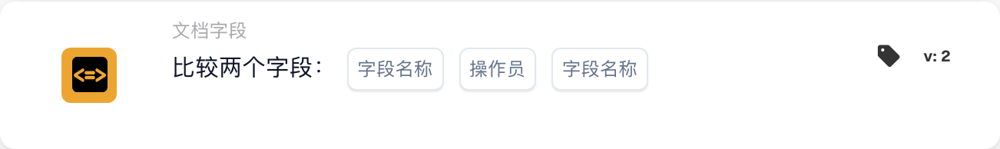

# 比较两个字段

<figure><figcaption>
所示版本的卡片字段。占位字段尚未配置。 此版本界面的部分标签尚未翻译或翻译不准确。本页说明使用正确术语；图片保留了实际界面。
</figcaption></figure>

## **用途：**

此工作流卡片旨在通过比较两个指定文档字段的值来自动执行操作。它支持基于字段数据动态决策，并确保工作流根据不同文档值之间的比较结果执行。

## **卡片组件：**

1. **字段名称 (1)**
   * **说明：** 指定要比较的第一个文档字段。
   * **详情：** 该名称必须与文档中第一个字段的标识符完全一致。
2. **运算符**
   * **说明：** 定义两个字段之间要执行的比较类型。
   * **选项：**
     * **等于 (=)：** 检查两个字段的值是否相等。
     * **不等于 (≠)：** 确保两个字段的值不同。
     * **大于 (>)：** 确认第一个字段的值大于第二个字段的值。
     * **大于或等于 (≥)：** 验证第一个字段的值是否等于或大于第二个字段的值。
     * **小于 (<)：** 检查第一个字段的值是否小于第二个字段的值。
     * **小于或等于 (≤)：** 确保第一个字段的值小于或等于第二个字段的值。
3. **字段名称 (2)**
   * **说明：** 指定要与第一个字段比较的第二个文档字段。
   * **详情：** 该名称应与文档中第二个字段的标识符完全一致。

## **功能：**

**条件评估：** 系统会评估这两个指定字段中的值是否满足运算符定义的比较条件。

**执行操作：**

* **条件为真：**\
  如果两个字段的值符合比较条件，系统就会触发相关操作。这些操作可以包括更新记录或触发警报。
* **条件为假：**\
  如果两个字段的值不符合指定条件，则可能执行其他操作，也可能不执行任何操作，具体取决于工作流的配置。

## **设置与配置：**

* 用户可从系统提供的可用字段列表中选择要比较的两个字段，以配置此卡片。运算符则从可用比较选项的下拉列表中选择。

## **结论：**

“比较两个字段”工作流卡片是比较文档字段间数据的重要工具。通过根据字段比较结果自动执行操作，此卡片有助于优化决策、支持数据验证并提升工作流自动化水平。

<!-- workflow-card-practical-example-20261021 -->

## 实际例子

**何时使用：** 检查复制的引用是否等于原始引用。

**配置：** 选择文本字段`purchase_order_number`和`confirmed_order_number`以及等于运算符。

**预期结果及反例：**值`PO-DEMO-001`和`PO-DEMO-001`通过。 `PO-DEMO-002` 的第二个值失败。

这是说明性配置和预期结果。使用测试组织中配置的字段、用户和组；这并不是说这个例子已经被执行了。
