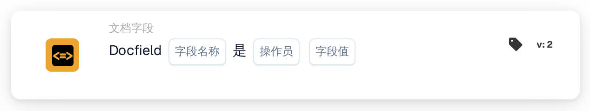

# 将文档字段与参考值比较

<figure><figcaption>
版本 1
</figcaption></figure>

<figure><figcaption>
版本 2
</figcaption></figure>

## **用途：**

此工作流卡片旨在通过将指定文档字段的值与参考值或条件进行比较来自动执行操作。它可根据文档数据验证结果，在工作流中实现动态且准确的决策。

## **卡片组件：**

1. **字段名称**
   * **描述：** 指定要评估的文档字段名称。
   * **详情：** 必须与文档中该字段的确切标识符一致。
2. **运算符**
   * **描述：** 定义字段值与参考值之间要执行的比较类型。
   * **选项：**
     * **等于 (=)：** 检查字段值是否与参考值匹配。
     * **不等于 (≠)：** 确保字段值与参考值不同。
     * **大于 (>)：** 确认字段值大于参考值。
     * **大于或等于 (≥)：** 验证字段值是否等于或大于参考值。
     * **小于 (<)：** 检查字段值是否小于参考值。
     * **小于或等于 (≤)：** 确保字段值小于或等于参考值。

## **功能：**

* **条件评估：** 系统会检查文档字段的值相对于其关联列，是否满足运算符和参考值指定的比较条件。
* **操作执行：**
  * **条件为真：**\
    如果文档字段的值满足指定条件（例如，等于参考值），系统会触发关联操作。这些操作可包括更新记录、推进工作流或生成通知。
  * **条件为假：**\
    如果文档字段的值不满足指定条件，则根据工作流配置执行其他操作，或不执行任何操作。

## **设置与配置：**

* 用户选择相关文档的字段名称，并从下拉菜单中选择运算符。然后，用户指定参考字段值以完成配置。

## **结论：**

“DocField Comparison Validation”工作流卡片是一款功能强大的动态文档处理工具。通过根据字段比较结果自动执行操作，此卡片可简化工作流、提高准确性并支持数据驱动的决策。

<!-- workflow-card-practical-example-20261021 -->

## 实际例子

**何时使用：**审核超过规定金额的发票。

**配置：**选择数值字段`total_amount`、运算符`>`和参考值`1000`。

**预期结果及反例：** `1200` 满足条件。`1000` 和 `900` 均不满足条件，因为运算符 `>` 要求字段值严格大于 `1000`。

这是说明性配置和预期结果。使用测试组织中配置的字段、用户和组；这并不是说这个例子已经被执行了。
