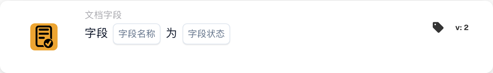

# 检查文档字段是否存在及是否有值

<figure><figcaption>
所示版本的卡片字段。占位字段尚未配置。
</figcaption></figure>

## 何时使用

使用此卡片检查文档字段是否为空或不存在。例如，发票缺少发票号码，需要进一步检查。此卡片是一项条件；后续操作需要另行配置。

**位置：** 标准工作流 → 附加条件（AND）→ 文档字段。

## 配置 — 版本 2

| 设置 | 示例值 |
| --- | --- |
| 字段 | `invoice_id` — 发票号码 |
| 字段状态 | 为空或不存在（`field_empty`） |

请选择组织中实际配置的字段。`field_not_empty` 选项检查字段是否包含值。

<!-- workflow-card-practical-example-20261021 -->

## 实际示例

| 示例值 | `field_empty` 的预期结果 |
| --- | --- |
| 字段为空或不存在 | 条件成立 |
| `DEMO-001` | 条件不成立 |
| 号码已填写但不正确 | 条件不成立 — 字段仍然包含值 |

这些示例展示预期结果。如需验证号码本身是否正确，请另加适合内容的条件；此卡片检查字段状态。版本 2 会先去除文本开头和结尾的空白，再判断字段是否为空。

## 管理员示例视频

何时使用此卡片、在哪里找到它，以及如何识别发票号码缺失。管理员、办公室和配音均为合成内容；操作演示使用测试账号中的真实 DocBits 界面。示例展示预期结果。



[打开带中文字幕的视频](https://docbits-videos.fra1.cdn.digitaloceanspaces.com/settings-assistant/workflow-card-field-status-admin/v1/zh-theme-v4.html)

[阅读文字稿](https://docbits-videos.fra1.cdn.digitaloceanspaces.com/settings-assistant/workflow-card-field-status-admin/v1/zh.txt)
