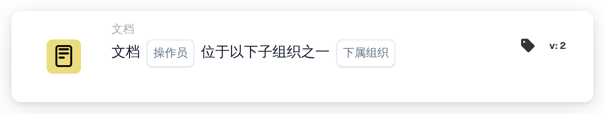

# 子组织的文档操作符（其中之一）

<figure><figcaption>
版本 2
</figcaption></figure>

## 目的：

此工作流卡片用于检查文档是否属于多个子组织中的一个。它不是将文档与单个子组织进行比较，而是与一个列表进行比较，因此一张卡片即可覆盖一组需要以相同方式处理的子组织。工作流会根据结果沿着真条件或假条件继续。

如需与单个子组织进行比较，可以使用卡片 **子组织的文档操作符**。

## 卡片组件：

1. **操作符**
   * **描述：** 定义文档应属于所列子组织之一，还是不属于其中任何一个。
   * **选项：**
     * **是：** 如果文档的子组织是所列子组织之一，则条件为真。
     * **不是：** 如果文档的子组织不在列表中，则条件为真。
2. **子组织**
   * **描述：** 与文档进行比较的子组织列表。
   * **详细信息：** 可以选择组织中的一个或多个子组织。系统比较的是文档所分配到的子组织。

## 功能：

* **条件评估：** 系统读取文档的子组织，并检查它是否是卡片上所选子组织之一。
* **执行操作：**
  * **条件为真：**\
    选择 **是** 时，文档的子组织在列表中；选择 **不是** 时，它不在列表中。工作流将沿着真条件继续，例如将文档转给负责这些子组织的团队，或应用仅适用于这些子组织的规则。
  * **条件为假：**\
    如果条件不满足，工作流将沿着假条件继续，例如应用通用规则或将文档转到其他地方。
* **缺少数据：** 如果文档未分配到任何子组织，或卡片上未选择任何子组织，卡片不会评估条件。它会在工作流日志中报告缺少的数据，而不是沿着假条件继续。

## 设置和配置：

* 可以从 **文档** 类别中添加卡片，然后选择操作符（**是** 或 **不是**），并在 **子组织** 字段中选择要检查的子组织。最后设置继续条件（真或假），以决定工作流的下一步。

## 结论：

“子组织的文档操作符（其中之一）”工作流卡片让一个条件即可同时覆盖多个子组织。当多个子组织共享相同的处理规则时，这能让工作流保持简洁，并确保文档在正确的组织上下文中得到处理。
