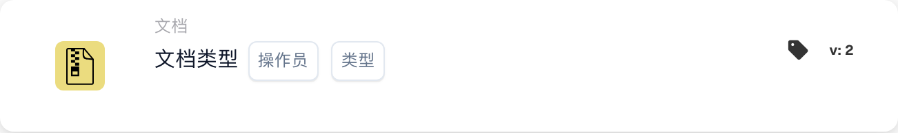

# 文档类型

<figure><figcaption>
所示版本的卡片字段。占位字段尚未配置。 此版本界面的部分标签尚未翻译或翻译不准确。本页说明使用正确术语；图片保留了实际界面。
</figcaption></figure>

## 用途：

此工作流卡片用于判断文档是否符合特定类型。通过检查文档是否与指定类型相符，工作流可以根据此条件继续执行或采取其他操作。这有助于自动化由文档类型决定后续步骤的流程。

## 卡片组件：

1. **运算符**
   * **说明**：定义文档是否应属于指定类型。
   * **选项**：
     * **是**：文档必须与指定类型匹配，条件才为真。
     * **不是**：文档不得与指定类型匹配，条件才为真。
2. **类型**
   * **说明**：指定用于比较的文档类型。
   * **详细信息**：其中包括多种文档类型，例如“发票”“采购订单”等，系统将根据所选类型评估条件（是/不是）。

## 功能：

* **条件评估**：系统会评估指定字段中的文档类型是否符合运算符定义的条件，并将字段值与提供的文档类型进行比较。
* **执行操作**：
  * **条件为真**：如果文档类型与指定类型匹配（或根据运算符的设置不匹配），工作流将沿真分支继续执行。这可能会触发文档的进一步处理、将文档发送审批，或根据文档类型应用特定规则等操作。
  * **条件为假**：如果文档类型与指定类型不匹配，工作流将沿假分支继续执行。这可能会触发其他操作，例如将文档路由到不同的流程，或停止后续操作。

## 设置与配置：

* 用户可以从可用字段列表中选择包含文档类型的文档字段，以配置此卡片。然后选择运算符，定义文档是否必须属于指定类型。最后，用户设置继续条件（真或假），以决定根据文档类型执行的下一步操作。

## 结论：

“文档类型比较”工作流卡片对于确保工作流根据正在处理的文档类型继续执行至关重要。通过比较文档类型，它可以帮助组织自动化文档路由和处理任务，确保根据文档类型妥善处理文档。

<!-- workflow-card-practical-example-20261021 -->

## 实际例子

**何时使用：** 运行发票特定检查。

**配置：**选择文档类型`Invoice`和等于运算符。

**预期结果及反例：**发票通过。贷方票据不满足此条件。

这是说明性配置和预期结果。使用测试组织中配置的字段、用户和组；这并不是说这个例子已经被执行了。
