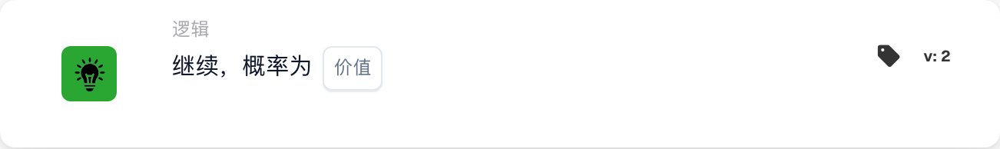

# 按概率继续

<figure><figcaption>
所示版本的卡片字段。占位字段尚未配置。 此版本界面的部分标签尚未翻译或翻译不准确。本页说明使用正确术语；图片保留了实际界面。
</figcaption></figure>

## **用途：**

此 DocBits 卡片引入了概率条件，使工作流可以按照设定的可能性继续执行。该卡片适用于测试场景、随机选择或在流程中引入受控的变化。

## **功能：**

* **按条件继续：** 此卡片根据用户设定的百分比概率决定是否继续工作流。卡片会生成一个随机结果，并将其与指定的百分比进行比较，从而以受控的概率继续工作流。
* **概率百分比：** 用户指定一个百分比值（0-100%），表示工作流继续执行的概率。例如：
  * **0%：** 工作流永远不会继续。
  * **50%：** 工作流有 50% 的概率继续。
  * **100%：** 工作流始终会继续。

## **用法：**

在需要随机工作流路径的场景中，此卡片很有用，例如 A/B 测试、受控抽样或流程模拟。它也可用于在自动化工作流中引入变化。

## **示例场景：**

* 用户将此卡片配置为**概率为 30%**。工作流到达此卡片时，有 30% 的概率继续执行下一步。当需要随机抽样或部分处理时，这种设置非常适用。

通过使用“按条件继续”卡片，组织可以在工作流中引入受控随机性、开展流程实验，并利用概率条件改进决策。
