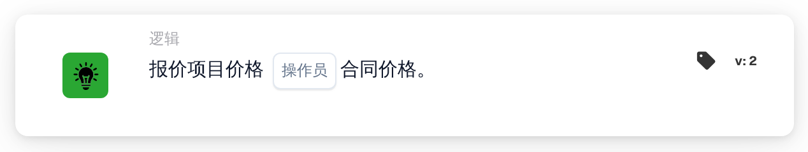
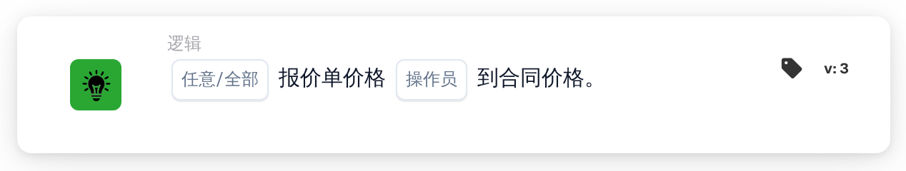

# 报价项目价格

<figure><figcaption>
版本 2
</figcaption></figure>

<figure><figcaption>
版本 3
</figcaption></figure>

## **目的：**

此 DocBits 卡将商品的报价与其合同价格进行比较，允许工作流程根据两个值是否匹配或不同来触发操作。它有助于确保定价的一致性和对合同条款的遵守。

## **功能：**

* **价格比较：**此卡评估报价的商品价格相对于合同价格是否符合指定条件。
* **运算符：**可以应用以下条件：
  * **等于(=)：** 检查报价是否与合同价格相符。
  * **不等于(≠)：**确保报价与合同价格不同。

## **用途：**

该卡在采购、销售或合同管理工作流程中特别有用，在这些工作流程中，在进行审批或订单处理之前验证报价是否符合商定的合同条款至关重要。

## **示例场景：**

* 用户配置卡以检查**报价是否等于(=)****合同价格**。如果价格匹配，工作流程将进入审批阶段；如果不是，则会触发手动审核通知以解决差异。

通过使用“报价项目价格与合同价格”卡，组织可以执行定价政策、保持合同合规性并减少财务交易中的错误。

## 版本 3：任何或全部

版本 3 添加了 `match_any` 和 `match_all`。任何一个都需要至少一个成功的可比品系； All 要求每条比较行都满足所选运算符。版本 2 保留全部。 v3 上未设置的选择默认为“全部”并被记录。没有可比较的行缺少数据，不是成功的匹配。请参阅[引用比较卡](../../quote-comparison-guide.md)了解混合结果、跳过的行和测试。
