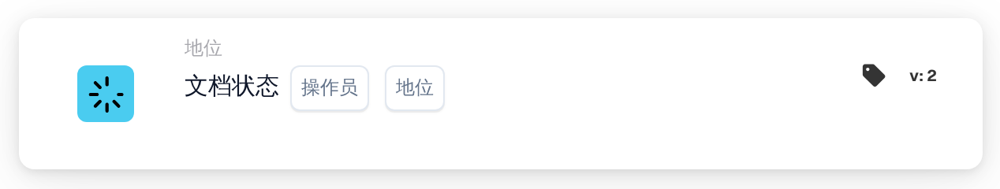

# 单个文档状态条件

<figure><figcaption>
版本 2
</figcaption></figure>

**用途**

此工作流卡片用于根据单个指定的文档状态管理文档操作。将条件简化为一种状态后，卡片便可专注于非常具体的工作流触发条件，因此适用于 ERP 系统中有针对性的文档处理活动。

**卡片组件**

1. **运算符**
   * **说明**：指定如何根据所选条件评估文档状态。
   * **选项**：
     * **是**：当文档的当前状态与所选状态匹配时，触发操作。
     * **不是**：当文档的当前状态与所选状态不匹配时，触发操作。
2. **状态**
   * **说明**：允许选择单个文档状态来设置条件。
   * **状态示例**：“错误”、“导出错误”、“验证就绪”、“审核就绪”、“待审批”、“待二次审批”。
   * **详细信息**：用户从下拉菜单或一组选项按钮中选择一个状态。此状态随后作为卡片执行操作的判断标准。

**功能**

* **文档状态识别**：识别文档在 ERP 系统中处理过程中的当前状态。
* **条件评估**：
  * 根据所选运算符（`is` 或 `is not`），卡片检查文档的当前状态是否符合所选状态条件。
* **执行操作**：
  * **条件为真**：如果状态匹配（或根据运算符的设置不匹配），则启动相应操作。操作可以是将文档转入后续处理、生成通知或触发其他预定义的工作流。
  * **条件为假**：如果条件不满足，则不执行任何操作，或触发其他路径。
* **与其他工作流集成**：尽管此卡片用于评估单个状态，但仍可有效集成到更广泛的工作流序列中，以确保精准处理文档。

**用户交互**

* **设置和配置**：用户先选择运算符，再从可用选项中选择一个状态，以此配置卡片。此选择过程简单明了，旨在避免混淆。
* **监控和报告**：可通过系统生成的报告或仪表板进行监控，跟踪基于文档状态的处理情况，从而帮助监督已实施工作流的有效性。
* **错误处理和通知**：可配置为在出现处理异常时提醒用户，或标记不符合所设条件的文档，确保及时关注并解决问题。

#### 结论

“单个文档状态条件”工作流卡片通过聚焦于单个状态条件，简化了文档管理。当需要精准控制文档流转时，尤其是在处理标准严格的环境中，此规范有助于满足相关需求。清晰记录此版本的卡片，可确保用户充分了解其用途，并能将其有效集成到日常操作中，从而提升文档处理的合规性和效率。

<!-- workflow-card-complete-example-20261021 condition_doc_status_is_isnot -->

### 单一状态示例

**配置：**选择运营商`is`和状态`Pending Approval`。添加适合该状态的以下审核操作。

**预期结果及反例：**当前文档`Pending Approval`条件为真； it is false for a document with status `Ready in Validation`.使用您的版本中实际选择的状态。更改状态本身并不导出文档。

这是一个说明性的测试配置和预期结果；它没有被执行。使用测试组织中配置的数据和收件人。
