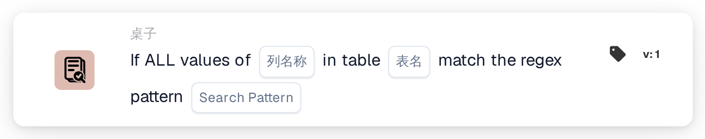
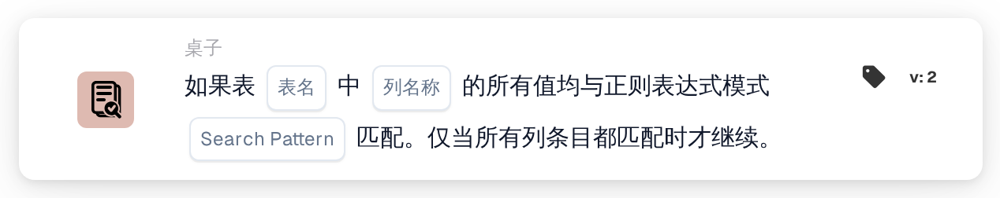

# 全部值匹配

<figure><figcaption>
版本 1
</figcaption></figure>

<figure><figcaption>
版本 2
</figcaption></figure>

## **用途：**

此 DocBits 卡片用于验证表格指定列中的**所有值**是否都符合给定的正则表达式模式。工作流只有在该列中的每个条目都满足条件时才会继续，因此此卡片非常适合确保所有条目的一致性和数据完整性。

## **功能：**

* **正则表达式模式验证：**此卡片会检查表格指定列中的**所有值**是否都符合给定的正则表达式模式。只有该列中的每个条目都满足条件，工作流才会继续。
* **运算符：**用户定义要检查的列并指定正则表达式模式。可用条件包括：
  * **匹配正则表达式模式：**验证指定列中的每个值是否都匹配该正则表达式模式。
* **表格和列选择：**用户指定要检查其值是否全部匹配正则表达式模式的表格和列。

## **用法：**

此卡片适用于需要数据统一性的场景，例如确保所有电话号码、产品 ID 或其他字段条目都符合特定格式。它能确保只有在所有相关条目都符合该模式时，工作流才会继续。

## **示例场景：**

* 用户将此卡片设置为检查“联系人”表格中的“电话号码”列，并使用正则表达式模式验证电话号码格式。如果该列中的每个电话号码都匹配该模式，卡片就会触发工作流的下一步，从而确认数据格式统一。

通过使用“所有值正则表达式模式匹配”卡片，组织可以执行严格的数据标准并提高工作流准确性，确保指定列中的每个条目在工作流继续之前都符合要求的格式。
