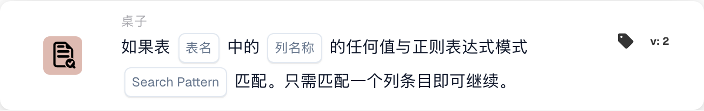

# 任意值

<figure><figcaption>
所示版本的卡片字段。占位字段尚未配置。 此版本界面的部分标签尚未翻译或翻译不准确。本页说明使用正确术语；图片保留了实际界面。
</figcaption></figure>

## **用途：**

此 DocBits 卡片用于验证表格中特定列的任意值是否与给定的正则表达式模式匹配。只要该列中有一个条目匹配此模式，工作流就会继续执行，因此非常适合通过单个匹配项触发流程后续步骤的场景。

## **功能：**

* **正则表达式模式验证：**此卡片会检查表格指定列中的任意值是否与给定的正则表达式模式匹配。如果该列中至少有一个条目满足条件，卡片就会触发并允许工作流继续执行。
* **运算符：**用户可以定义列并指定正则表达式模式。可用条件包括：
  * **匹配正则表达式模式：**验证指定列中至少有一个值与正则表达式模式匹配。
* **表格和列选择：**用户可以指定要检查正则表达式模式匹配情况的表格和列。

## **用法：**

当表格中的数据需要进行特定匹配时，此卡片尤其有用，例如验证电子邮件地址、发票编号或产品 ID。它能确保只要有任意相关条目与定义的模式匹配，工作流就会继续执行，而无需检查每个条目。

## **示例场景：**

* 用户将此卡片设置为检查“Customers”表格中“Email Address”列的条目，并使用用于匹配有效电子邮件格式的正则表达式模式。如果该列中至少有一个电子邮件地址与此模式匹配，卡片就会触发工作流的下一步，确保系统处理有效条目。

通过使用“Regex Pattern Matching”卡片，组织可以根据动态的模式验证自动执行工作流，从而简化流程，并确保只有相关条目才能触发后续操作。
