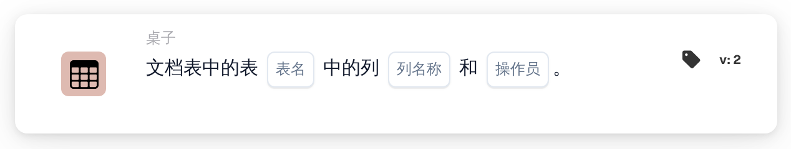

# 表格中存在列

<figure><figcaption>
版本 2
</figcaption></figure>

## 用途：

此工作流卡片用于检查文档表格是否包含特定的列。它可用于仅对表格中带有所需数据（例如交货日期列或商品编号列）的文档运行后续卡片，或将表格布局不同的文档转到其他地方。工作流会根据结果沿着真条件或假条件继续。

## 卡片组件：

1. **列名称**
   * **描述：** 卡片要查找的列的名称。
   * **详细信息：** 比较列名称时不区分大小写。
2. **表名**
   * **描述：** 要检查的文档表格的名称。
   * **详细信息：** 比较表名时不区分大小写。
3. **操作员**
   * **描述：** 定义该列应存在于表格中还是不应存在。
   * **选项：**
     * **是：** 如果表格包含该列，则条件为真。
     * **不是：** 如果表格不包含该列，则条件为真。

## 功能：

* **条件评估：** 卡片查找具有指定名称的文档表格，并检查该表格的第一行是否有具有指定名称的列。找到的列，或者实际存在的其他列，会记录在工作流日志中。
* **执行操作：**
  * **条件为真：**\
    使用 **是** 时，该列在表格中；使用 **不是** 时，该列不在表格中。工作流沿着真条件继续，例如对该列进行比较。
  * **条件为假：**\
    如果条件不满足，工作流沿着假条件继续。
* **缺少数据：** 如果卡片上未设置列名称或表名、文档没有具有指定名称的表格，或者该表格没有行或其第一行没有列，卡片不会评估条件，并会在工作流日志中报告缺少的数据。
* **错误：** 如果未设置运算符，或设置的运算符既不是 **是** 也不是 **不是**，卡片会报告设置错误。

## 设置和配置：

* 可以从 **桌子** 类别中添加此卡片，然后设置列名称、表名和运算符（**是** 或 **不是**）。最后设置继续条件（真或假），以决定工作流的下一步。

## 结论：

“表格中存在列”工作流卡片会在使用文档表格的数据之前检查其布局。将它放在其他表格卡片之前，有助于确保这些卡片只在带有预期列的文档上运行。
