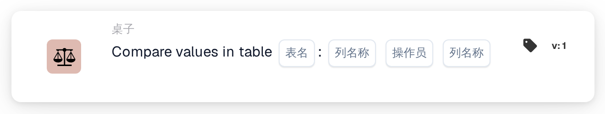
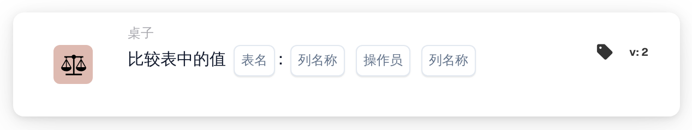

# 比较表格中的值

<figure><figcaption>
版本 1
</figcaption></figure>

<figure><figcaption>
版本 2
</figcaption></figure>

## **用途：**

此 DocBits 卡片根据所选条件，比较表格中两个指定列的值。它适用于需要验证数据点之间关系的场景，例如质量控制、数据一致性检查或合规性验证。

## **功能：**

* **列比较：**此卡片允许用户设置条件，以比较同一表格中两列的值。
* **运算符：**可使用以下运算符定义比较条件：
  * **等于 (=)：**检查两列中的值是否完全相等。
  * **不等于 (≠)：**确保两列中的值不相等。
  * **大于 (>)：**确认第一列中的值是否大于第二列中的值。
  * **大于或等于 (≥)：**确保第一列中的值大于或等于第二列中的值。
  * **小于 (<)：**检查第一列中的值是否小于第二列中的值。
  * **小于或等于 (≤)：**确保第一列中的值小于或等于第二列中的值。
* **表格和列选择：**用户可指定要比较的表格和两列。

## **用法：**

此卡片适用于数据分析师、质量控制团队或合规专员，他们需要根据特定规则确保一列中的值与另一列中的值相关，从而进行高级数据验证。

## **示例场景：**

* 用户配置此卡片，检查“库存当前数量”列中的值是否**大于或等于 (≥)**“最低库存水平”列中的值，且两列都位于“库存”表格中。如果所有值都满足此条件，工作流将继续，确认库存水平充足。

使用“列值比较”卡片，组织可以确保数据一致性、维持质量标准并验证表格中的数据关系。
