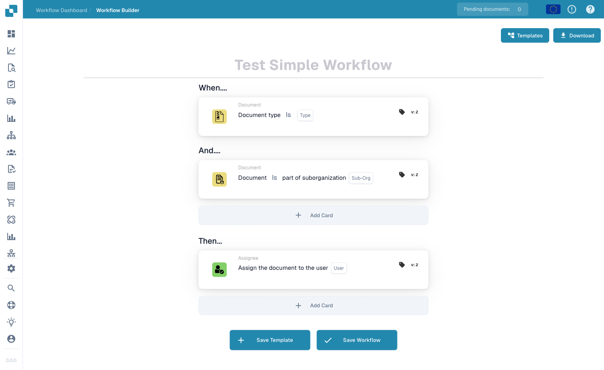

# 文档分配与用户卡片

## 文档分配与用户卡片 - 完整指南

**涵盖：**13 个分配和用户相关卡片

***

本页中的卡片位于 Workflow Builder 的 **Then** 组中——当 When/And 条件匹配时执行的操作：

<figure><figcaption><p>通过 <strong>Add Card</strong> 将分配和用户卡片添加到 <strong>Then</strong> 组。</p></figcaption></figure>

***

### 📌 版本信息

**多版本卡片：** DOC\_USER\_ASSIGN（最新版本 v2，v3 已弃用）、DOC\_GROUP\_ASSIGN（最新版本 v2，v3 已弃用）、OC\_ASSIGN\_DOC（v2）

**重要：**v3 版本增加了决策树支持，但现已弃用。**建议：**DOC\_USER\_ASSIGN 和 DOC\_GROUP\_ASSIGN 均使用 v2

📖 [完整版本历史](https://github.com/Fellow-Consulting-AG/docbits/tree/main/readme/administration-and-setup/changelog/release.md#-assignment--routing-cards) | [卡片版本数据库](https://github.com/Fellow-Consulting-AG/docbits/tree/main/readme/DocFlow/docs/card_version.md)

***

## 基本文档分配

### 卡片：DOC\_USER\_ASSIGN / 将文档分配给用户

#### 用途

将文档分配给特定人员，由其处理

#### 适用场景

* 需要由特定人员审核文档
* 将工作移交给某位团队成员
* 跟踪责任归属
* 将工作分配给指定人员

#### 工作方式

```
文档“分配给”= John Smith
只有 John 能在“分配给自己”中看到该文档
John 负责处理此文档
```

#### 示例

```
收到发票
    ↓
将文档分配给：John Smith（财务经理）
    ↓
只有 John 能在“分配给自己”中看到该文档
John 必须处理该文档
```

#### 参数

```
用户：[选择人员]
```

#### 注意

分配意味着：

* 对该人员而言，文档会显示为“分配给我”
* 该人员负责处理文档
* 其他人仍可查看文档（但文档不会显示为分配给他们）
* 每份文档同一时间只能有一个分配对象

***

### 卡片：DOC\_GROUP\_ASSIGN / 将文档分配给组

#### 用途

将文档分配给一个组（所有成员都会看到文档已分配给他们）

#### 适用场景

* 文档由团队处理，而非某个个人
* 多人都可以处理
* 共同承担责任
* 在团队之间分配工作量

#### 工作方式

```
文档“分配给”= 财务团队（10 人）
所有 10 名团队成员都能在“分配给我的组”中看到该文档
任何团队成员都可以处理该文档
```

#### 示例

```
收到新的供应商发票
    ↓
将文档分配给：采购团队
    ↓
所有采购团队成员都能看到该文档
由第一位有空的人员处理
```

#### 参数

```
组：[选择组]
```

#### 区别

```
个人分配：
- 由一个人负责
- 此人会看到“Assigned to Me”
- 其他人看不到该分配

群组分配：
- 由团队负责
- 所有成员都会看到“Assigned to My Group”
- 任何人都可以认领/处理
```

***

### 卡片：ACTION\_ASSIGN\_DOC\_BASED\_ON\_DECISION\_TABLE

#### 用途

根据决策表逻辑分配文档

#### 适用场景

* 不同供应商需要由不同人员处理
* 根据金额进行分配
* 复杂的路由逻辑
* 根据多个条件进行分配

#### 工作方式

```
决策表逻辑：
  如果供应商 = "ABC Corp" → 分配给：采购团队
  如果供应商 = "XYZ Inc" → 分配给：直属经理
  如果金额 > €10000 → 分配给：财务总监

文档到达
    ↓
检查：匹配哪个条件？
    ↓
据此分配
```

#### 示例：按金额分配

```
发票：来自 ABC Corp 的 €2000 发票

决策表检查：
  金额是否 > €10000？否
  金额是否 > €5000？否
  金额是否 > €1000？是

结果：分配给：财务经理
```

#### 示例：按供应商分配

```
来自：优选供应商的发票

决策表：
  如果是优选供应商 → 财务团队
  如果是新供应商 → 采购经理
  如果已列入黑名单 → 总监审核

结果：分配给：财务团队
```

#### 参数

```
决策表：[选择决策表]
（决策表包含分配逻辑）
```

***

### 卡片：ACTION\_ASSIGN\_DOC\_DECISION\_TABLE\_SEQUENTIAL

#### 用途

根据带有优先级的决策表按顺序分配文档

#### 适用场景

* 多个连续审批
* 不同级别由不同人员处理
* 根据金额设置审批链
* 设置升级路径

#### 工作方式

```
第一个决策：谁先审批？
    ↓
分配给：人员 1
    ↓
人员 1 审批
    ↓
第二个决策：接下来由谁审批？
    ↓
分配给：人员 2
    ↓
人员 2 审批（最终审批）
    ↓
文档完成
```

#### 优先级系统

```
优先级 1：第一次分配
优先级 2：第二次分配
优先级 3：第三次分配
（依此类推）

每个步骤都必须完成后，才能开始下一步
```

#### 示例：多级审批

```
发票：€50,000

决策表：
  €1k-€5k → 分配给：财务经理（优先级 1）
  €5k-€20k → 然后：分配给：财务总监（优先级 2）
  €20k+ → 然后：分配给：CFO（优先级 3）

发票流程：
1. 财务经理审核 → 批准
2. 财务总监审核 → 批准
3. CFO 审核 → 最终批准

每个步骤都取决于上一步是否完成
```

#### 参数

```
决策表：[选择]
优先顺序：[由决策表决定]
```

***

### 卡片：ACTION\_ASSIGN\_DOC\_TO\_USER\_SEQUENTIAL

#### 用途

按顺序优先级将文档分配给用户

#### 适用场景

* 文档需要由特定人员处理
* 需要明确的顺序处理流程
* 按顺序进行单次分配

#### 工作方式

```
将文档分配给：用户 A（优先级 1）
    ↓
用户 A 处理
    ↓
然后：分配给用户 B（优先级 2）
    ↓
用户 B 处理
```

#### 示例

```
发票处理：
1. 分配给：应付账款文员
2. 然后：分配给：财务经理
3. 然后：分配给：总监

每个人依次处理
```

***

### 卡片：ACTION\_ASSIGN\_DOC\_TO\_GROUP\_SEQUENTIAL

#### 用途

按顺序将文档分配给多个组

#### 适用场景

* 需要多个组审批
* 每个阶段由不同部门处理
* 按顺序进行团队处理

#### 工作方式

```
步骤 1：分配给组 A（质量团队）
        质量团队进行验证
    ↓
步骤 2：分配给组 B（财务团队）
        财务团队进行审核
    ↓
步骤 3：分配给组 C（采购部）
        采购部进行审批
```

#### 示例

```
新供应商入驻：

步骤 1：质量团队
  - 评估供应商能力
  - 检查认证

步骤 2：财务团队
  - 检查付款条款
  - 验证定价

步骤 3：采购团队
  - 批准供应商
  - 在系统中设置

文档会依次经过全部三个步骤
```

***

### 卡片：ACTION\_ASSIGN\_DOC\_TO\_FACILITY\_GROUP

#### 用途

将文档分配给特定设施组

#### 适用场景

* 文档对应特定仓库或设施
* 基于设施开展运营
* 按地点进行处理

#### 示例

```
发货通知

分配给：柏林仓库团队
    ↓
柏林仓库处理发货
    ↓
或者

分配给：慕尼黑仓库团队
    ↓
慕尼黑仓库处理发货
```

***

### 卡片：ACTION\_ASSIGN\_DOC\_TO\_FACILITY\_GROUP\_SEQUENTIAL

#### 用途

按顺序在多个设施之间进行分配

#### 适用场景

* 多地点处理
* 货物在多个设施之间流转
* 基于地点的工作流

#### 示例

```
制造订单：

步骤 1：Factory A（制造）- 制造产品
步骤 2：Quality Center（测试）- 测试产品
步骤 3：Distribution Center（包装）- 包装产品
步骤 4：Warehouse（存储）- 存放产品

文档/货物会依次经过每个环节
```

***

### 卡片：ACTION\_ASSIGN\_DOC\_TO\_PROCUREMENT\_GROUP

#### 用途

将文档分配给采购部门

#### 适用场景

* 由采购团队处理
* 与供应商相关的工作
* 与采购订单相关的工作

#### 示例

```
供应商评估文档
    ↓
分配给：采购组
    ↓
采购团队评估供应商
```

***

### 卡片：ACTION\_ASSIGN\_DOC\_TO\_PROCUREMENT\_GROUP\_SEQUENTIAL

#### 用途

在采购部门内按顺序分配

#### 适用场景

* 多步骤采购流程
* 采购部门的审批链

#### 示例

```
采购申请：

步骤 1：采购员（创建采购订单）
步骤 2：审批人（审核）
步骤 3：总监（最终签批）

每个步骤依次进行
```

***

### 卡片：ACTION\_CHANGE\_DOC\_SUBORG / 更改文档子组织

#### 用途

将文档分配给其他子组织

#### 适用场景

* 选错组织
* 需要将文档转到正确的部门
* 组织架构调整

#### 工作方式

```
当前子组织：财务部
    ↓
更改为：会计部
    ↓
文档现在归属会计部
```

#### 示例

```
文档适用于：柏林办公室
    ↓
确认应为：慕尼黑办公室
    ↓
将子组织更改为：慕尼黑办公室
```

***

### 卡片：ACTION\_CHANGE\_DOC\_SUBORG\_BY\_FIELD\_TEXT

#### 用途

根据文档字段值更改子组织

#### 适用场景

* 字段中存储了子组织信息
* 根据字段将文档地点进行匹配
* 自动分配组织

#### 工作方式

```
文档字段：“Delivery_Location” = “Berlin”
    ↓
决策表：
  如果位置 = “Berlin” → 分配给：柏林子组织
  如果位置 = “Munich” → 分配给：慕尼黑子组织

    ↓
文档已分配给：柏林子组织
```

#### 示例

```
发票字段：“Cost Center: CC-Berlin-001”
    ↓
系统识别出：柏林位置
    ↓
将文档更改为：柏林子组织
```

***

### 卡片：ACTION\_ASSIGN\_USER\_FROM\_FIELD\_WITH\_FALLBACK

#### 用途

根据字段将文档分配给用户；如果找不到该用户，则使用备用用户

#### 适用场景

* 文档字段中存储了用户名
* 该用户可能不存在于系统中
* 用户不可用时需要备用人员

#### 工作方式

```
文档字段：“Approver: John Smith”
    ↓
尝试分配给：John Smith
    ↓
如果系统中不存在 John：
    ↓
使用备用用户：Sarah Johnson（经理）
    ↓
文档已分配给：Sarah Johnson
```

#### 参数

```
来源字段：[包含用户名的字段]
备用用户：[如果找不到来源用户]
```

#### 示例

```
发票包含字段：“Contact Person: Mike Johnson”

尝试分配给：Mike Johnson
    ↓
如果系统中没有 Mike：
    ↓
改为分配给：财务经理（Robert）
```

***

### 卡片：ACTION\_ASSIGN\_USER\_TO\_SUPPLIER

#### 用途

将文档分配给负责该供应商的用户

#### 适用场景

* 用户与供应商关联
* 供应商客户经理
* 供应商关系负责人

#### 工作方式

```
文档供应商：ABC Corp
    ↓
系统检查：谁负责管理 ABC Corp？
    ↓
分配给：John Smith（ABC Corp 客户经理）
```

***

## 分配决策树

### 决策表示例 1：按金额

```
金额 ≤ €1000
  → 分配给：财务团队

金额 €1000-€5000
  → 分配给：财务经理

金额 €5000-€20000
  → 分配给：财务总监

金额 > €20000
  → 分配给：首席财务官
```

### 决策表示例 2：按供应商

```
供应商类型 = “Preferred”
  → 分配给：客户经理

供应商类型 = “New”
  → 分配给：采购经理

供应商类型 = “Problem”
  → 分配给：采购总监
```

### 决策表示例 3：按文档类型

```
文档类型 = “Invoice”
  → 分配给：应付账款团队

文档类型 = “Credit Memo”
  → 分配给：财务经理

文档类型 = “PO”
  → 分配给：采购团队
```

***

## 分配工作流示例

### 示例 1：简单路由

```
收到文档
    ↓
检查：供应商 = “ABC Corp”？是
    ↓
分配给：John Smith
（John 负责 ABC Corp）
    ↓
John 审核并批准
```

### 示例 2：顺序审批

```
收到文档
    ↓
分配给：财务经理（步骤 1）
    ↓
经理审核
    ↓
传递给：财务总监（步骤 2）
    ↓
总监审核
    ↓
传递给：首席财务官（步骤 3）
    ↓
首席财务官最终批准
```

### 示例 3：按金额路由

```
发票：€50,000
    ↓
决策表：金额 > €20k？
    ↓
是 → 分配给：首席财务官
    ↓
首席财务官直接批准
```

### 示例 4：按设施分配

```
发往：柏林办公室的货物
    ↓
分配给：柏林仓库团队
    ↓
然后分配给：柏林配送团队
    ↓
两个团队依次处理
```

***

## 分配最佳实践

✅ **建议：**

* 保持决策表简洁
* 使用样例测试路由逻辑
* 确保所有路径都有去向
* 为找不到用户的情况设置备用用户
* 记录路由决策

❌ **避免：**

* 创建循环分配（A→B→A）
* 分配给不存在的用户（未设置备用用户时）
* 让路由过于复杂
* 忘记测试路由
* 分配给不可用人员

***

## 分配故障排查

### “文档未分配”

**原因：**条件不满足或用户不存在

**解决方案：**

* 检查条件是否为真
* 确认用户存在于系统中
* 检查备用设置
* 查看决策表逻辑

### “分配给了错误的人员”

**原因：**决策表或路由逻辑不正确

**解决方案：**

* 测试决策表
* 检查条件
* 确认用户映射
* 查看字段值

### “分配似乎跳过了某个人”

**原因：**顺序不正确

**解决方案：**

* 检查优先级编号
* 确认顺序正确
* 使用样例进行测试
* 检查决策表的排序

***

## 分配卡片对比

| 卡片                                                    | 分配对象                 | 路由类型  | 使用场景                   |
| ------------------------------------------------------- | ------------------------ | ----------- | -------------------------- |
| DOC\_USER\_ASSIGN                                       | 个人                     | 直接      | 简单分配          |
| DOC\_GROUP\_ASSIGN                                      | 组                       | 直接      | 团队分配            |
| ACTION\_ASSIGN\_DOC\_BASED\_ON\_DECISION\_TABLE         | 决策结果                 | 条件式 | 复杂路由            |
| ACTION\_ASSIGN\_DOC\_DECISION\_TABLE\_SEQUENTIAL        | 多个对象（按顺序）    | 条件式 | 审批链             |
| ACTION\_ASSIGN\_DOC\_TO\_USER\_SEQUENTIAL               | 用户（按顺序）        | 有序     | 用户顺序处理步骤      |
| ACTION\_ASSIGN\_DOC\_TO\_GROUP\_SEQUENTIAL              | 多个组（按顺序）      | 有序     | 组顺序处理步骤     |
| ACTION\_ASSIGN\_DOC\_TO\_FACILITY\_GROUP                | 设施组           | 直接      | 特定设施处理          |
| ACTION\_ASSIGN\_DOC\_TO\_FACILITY\_GROUP\_SEQUENTIAL    | 多个设施（按顺序）  | 有序     | 多设施处理             |
| ACTION\_ASSIGN\_DOC\_TO\_PROCUREMENT\_GROUP             | 采购部门              | 直接      | 采购工作流       |
| ACTION\_ASSIGN\_DOC\_TO\_PROCUREMENT\_GROUP\_SEQUENTIAL | 采购部门（按顺序） | 有序     | 采购审批链 |
| ACTION\_CHANGE\_DOC\_SUBORG                             | 子组织         | 直接      | 部门变更          |
| ACTION\_CHANGE\_DOC\_SUBORG\_BY\_FIELD\_TEXT            | 按字段分配子组织         | 条件式 | 基于字段分配     |
| ACTION\_ASSIGN\_USER\_FROM\_FIELD\_WITH\_FALLBACK       | 字段/备用用户           | 条件式 | 动态用户分配    |

***

## 相关卡片

* **ACTION\_CREATE\_TASK\_FOR\_USER** - 将任务分配给同一人员
* **ACTION\_SEND\_EMAIL** - 通知已分配人员
* **CONDITION\_USER\_IS\_ISNOT** - 检查是否分配给了正确的人员
* **CONDITION\_GROUP\_IS\_ISNOT** - 检查是否分配给了正确的组
