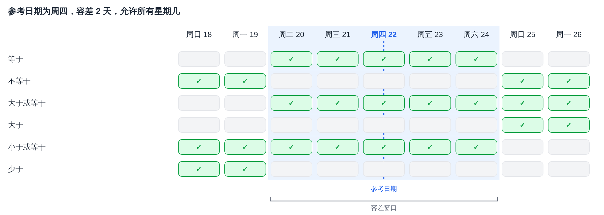
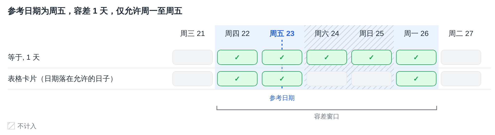
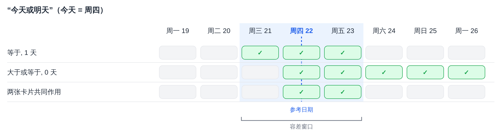

# 日期容差

有几张工作流卡片会将某个日期与参考日期进行比较，并接受以天数表示的容差。它们计算容差的方式都相同。本页说明这种计算方式、每个运算符的含义、**允许容忍天数** 的作用，以及如何组合两张卡片来实现“今天或明天”这类范围。

使用此计算方式的卡片：

* [表格日期与当前日期](and/table/table-date-to-current-date.md) – 将文档表格中的日期与当前日期进行比较。
* [行项目表中的承诺交货日期](and/compare-with-purchase-order/promised-delivery-date-for-line-items-in-table-with-promised-delivery-date/README.md) – 将行项目的承诺交货日期与当前日期进行比较。
* [采购订单上的承诺交货日期](and/compare-with-purchase-order/promised-delivery-date-on-purchase-order.md) – 将行项目的交货日期与采购订单上的交货日期进行比较。

## 容差窗口

容差从参考日期开始，分别往前（过去）和往后（将来）计算。结果是一个 **容差窗口**：从开始日期到结束日期，两端均包含在内。

* 容差为 **0 天** 时，窗口仅为参考日期本身。
* 容差为 **2 天** 时，窗口从参考日期之前 2 天延伸到参考日期之后 2 天。
* **当前日期** 是 DocBits 服务器上的日期，服务器以 **UTC** 运行。

每个运算符都会将日期与此窗口进行比较：

| 运算符 | 当日期……时为真 |
|---|---|
| **等于** | 在窗口之内 |
| **不等于** | 在窗口之外 |
| **大于或等于** | 在窗口的 **开始日期** 当天或之后 |
| **大于** | 在窗口的 **结束日期** 之后 |
| **小于或等于** | 在窗口的 **结束日期** 当天或之前 |
| **少于** | 在窗口的 **开始日期** 之前 |

需要注意的是，容差也会放宽 **大于或等于** 和 **小于或等于**：容差为 2 天时，**大于或等于** 已经会接受参考日期之前 2 天的日期。

<figure><figcaption>
参考日期为 22 日（周四），容差 2 天：窗口从 20 日（周二）到 24 日（周六）。
</figcaption></figure>

## 允许容忍天数

提供 **允许容忍天数** 的卡片在计算窗口时只计入所选的星期几。未选择的星期几在计数时会被跳过，但仍处于窗口之内。

**示例：** 参考日期为周五，容差 1 天，只选择周一至周五。往前数到达周四。往后数时跳过周六和周日，到达周一。窗口为 **周四至周一**。

**表格日期与当前日期** 还增加了一项检查：表格中的日期还需落在所选的星期几之一。因此，此卡片不接受窗口内的周六。另外两张卡片没有这项额外检查。

<figure><figcaption>
只计入周一至周五，因此周五之后 1 天是周一。
</figcaption></figure>

## 示例：今天或明天

单张卡片无法恰好只接受“今天或明天”，因为窗口在两个方向上延伸的天数总是相同。前后连续使用两张卡片则可以做到：

1. **等于** 加 **1 天** 容差，接受昨天、今天和明天。
2. **大于或等于** 加 **0 天** 容差，接受今天及之后的每一天。

只有同时通过两张卡片的日期才会保留：**今天和明天**。

<figure><figcaption>
今天是 22 日（周四）：两张卡片共同接受 22 日（周四）和 23 日（周五）。
</figcaption></figure>

以同样的方式，还可以构建其他范围：

| 范围 | 第一张卡片 | 第二张卡片 |
|---|---|---|
| 今天或明天 | **等于**，1 天 | **大于或等于**，0 天 |
| 昨天或今天 | **等于**，1 天 | **小于或等于**，0 天 |
| 今天起至之后 3 天 | **等于**，3 天 | **大于或等于**，0 天 |
| 不是今天 | **不等于**，0 天 | – |
| 从后天起 | **大于**，1 天 | – |

如果只选择周一至周五作为 **允许容忍天数**，那么周五的“明天”就是下周一。

## 结论

所有带容差的日期卡片都使用以参考日期为中心的同一个窗口。了解窗口的开始和结束位置，就能清楚每个运算符接受哪些日期，而两张卡片组合使用则可以覆盖单张卡片无法实现的范围。
