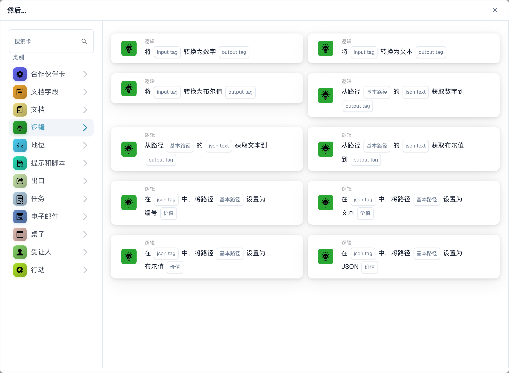

# 逻辑卡：变量、转换、JSON 和触发器

<figure><figcaption><p>卡片库中的转换和 JSON 卡片。组织变量卡片需要 Advanced Builder；可见模板还取决于发布版本。 此版本界面的部分标签尚未翻译或翻译不准确。本页说明使用正确术语；图片保留了实际界面。</p></figcaption></figure>

在高级工作流程生成器中使用这些卡，其中所选卡可用。卡片可见性取决于您的版本和启用的模板。下面的参考资料描述了版本 2。在将其字段与本指南进行比较时，请记住存储在现有工作流程中的版本。

## 选择正确的值存储位置

从“变量”面板中选择的组织工作流变量在工作流之间共享，并独立于画布保存。转换、JSON 和标签比较卡使用的命名标签属于当前执行上下文。创建标签不会创建组织变量。输入不带内部存储前缀的标签名称。文档字段是第三个独立的数据源。

即使组织变量和执行标记的名称匹配，它们仍然保持独立。选择兼容的变量字段或明确提供接收卡期望的值。有关组织范围和立即持久性，请参阅[变量](../advanced-workflow-builder/variables.md)。

## 组织变量操作

首先创建具有正确类型的变量，然后在卡上选择它。缺少变量参考报告`MISSING_VARIABLE`。设置变量的卡在卡日志中记录以前的值和新的值。避免测试值和共享日志中存在真实的个人或机密数据。

| 卡 | 所需输入 | 结果与示例 | 失败或边界情况 |
| --- | --- | --- | --- |
| `ACTION_LOGIC_SET_TEXT_VAR` | 文本变量和`value` | 存储文本；例如，设置路由标签为`review`。 | 缺失值与故意为空的文本值不同。 |
| `ACTION_LOGIC_SET_NUMBER_VAR` | Number 类型的变量和数值 `value` | 存储有限数值；例如，将阈值设置为`1000.50`。 | 无效的数字文本、无穷大和 NaN 将被拒绝。使用小数点，不带货币符号。 |
| `ACTION_LOGIC_CALC_NUMBER` | 数字变量和`expression` | 存储算术结果； `(100 + 20) / 2` 给出 `60`。 | 支持数字文字、括号、`+`、`-`、`*`、`/`、`%` 和 `**`。表达式中不接受名称、函数调用和文档字段引用。无效表达式或除以零会失败。 |
| `ACTION_LOGIC_SET_BOOLEAN_VAR` | 是/否变量和 `value` | 将标志设置为“是”或“否”。 | 使用卡片提供的布尔值，而不是翻译的自由文本同义词。 |
| `ACTION_LOGIC_INVERT_BOOLEAN` | 是/否变量 | 反转其当前值；是变为否。 | 在依赖特定的第一个结果之前初始化变量。 |

### 文档参考操作

`ACTION_LOGIC_SET_DOCUMENT_VAR` 将当前文档 ID 存储在选定的文档变量中。它需要当前文档；如果没有，它会报告`NO_DOCUMENT`。触发的工作流接收文档 ID，而不是序列化的文档对象。已检查的实现没有用于此操作的预置的界面卡片模板，因此不要指望它会出现在每个卡选择器中。仅当您的管理员确认有匹配的模板可用时才使用它；在变量创建表单中输入文档 ID 并不能替代。

## 标签和类型转换

这些操作使用当前执行上下文中的标记名称。在读取之前生成输入标签。缺少输入标签或缺少名称报告`MISSING_VARIABLE`；无效的数字转换会报告设置错误。输出是新的或覆盖的标签，而不是提取的文档字段。

| 卡 | 输入 | 输出和示例 |
| --- | --- | --- |
| `ACTION_LOGIC_CREATE_TEXT_TAG` | `tag_name`, `value` | 创建文本标签； `raw_amount` 具有值 `125.50`。允许使用空文本值。 |
| `ACTION_LOGIC_CONVERT_TO_NUMBER` | `input_tag`, `output_tag` | 将 `125.50` 转换为数字 `125.5`。布尔值变为 `1` 或 `0`。 `EUR 125,50` 等文本不是有效的数字输入。 |
| `ACTION_LOGIC_CONVERT_TO_TEXT` | `input_tag`, `output_tag` | 将存储的值转换为文本。它不会格式化货币或本地化小数分隔符。 |
| `ACTION_LOGIC_CONVERT_TO_BOOLEAN` | `input_tag`, `output_tag` | 直接转换现有的布尔值；非零数变为真，零变为假。使用`true`或`false`进行可预测的文本输入并测试其他可接受的表示。 |

### 转换示例

1. 创建具有值 `125.50` 的文本标签 `raw_amount`。
2. 将`raw_amount`转换为数字，写入`amount_number`。
3. 使用大于且 `tag_name` 设置为 `amount_number` 且 `value` 设置为 `100` 的数字。
4. 检查`125.50`的条件是否成功，`100`的条件失败，并在步骤2中报告`EUR 125,50`的转换错误。

## 从 JSON 读取值

所有三张读卡均取`json_text`、`json_path`和`output_tag`。尽管有它的名字，`json_text` 是包含 JSON 的标签的名称，而不是用于粘贴文本 JSON 文档的框。首先生成该标签，例如使用“创建文本标签”。

路径是点分隔的键和从零开始的列表索引：`invoice.lines.0.amount`。不要使用 JSONPath 语法，例如 `$.invoice.lines[0].amount`。如果缺少键、索引无效或 JSON 无效，则结果为 `ERROR_CARD_SETUP`；缺少源标签报告`MISSING_VARIABLE`。

| 卡 | 输出 |
| --- | --- |
| `ACTION_LOGIC_JSON_TO_NUMBER` | 数值；数字文本被转换，布尔值变为`1`或`0`。无效的数字文本失败。 |
| `ACTION_LOGIC_JSON_TO_TEXT` | 所选值的文本表示形式。这并不是对嵌套对象的 JSON 序列化的承诺。 |
| `ACTION_LOGIC_JSON_TO_BOOLEAN` | 一个布尔值；文本`true`、`1`或`yes`小写后为真，而其他文本为假。数字遵循其零/非零值。 |

对于包含以下 JSON 的标签 `payload`，将 `invoice.lines.0.amount` 读入 `amount`，并使用 JSON 进行数字生成 `125.5`：

```json
{"invoice":{"lines":[{"amount":"125.50"}],"approved":false}}
```

还要测试不存在的路径、超出范围的索引和格式错误的 JSON。失败的读取不得被视为有效的零或成功的批准。

## 更新 JSON

四张写卡分别取`json_tag`、`json_path`、`value`。 `json_tag` 命名包含 JSON 的现有标签。他们使用序列化 JSON 更新该标签。应用相同的点分隔路径语法；可以创建缺少的中间对象键，但列表索引必须标识现有元素。它们不扩展列表或支持通配符路径。

| 卡片 | 值与效果 |
| --- | --- |
| `ACTION_LOGIC_JSON_SET_NUMBER` | 数值，例如`125.5`；存储一个 JSON 数字。无效的数字文本失败。 |
| `ACTION_LOGIC_JSON_SET_TEXT` | 文字，如`review`；存储 JSON 字符串。 |
| `ACTION_LOGIC_JSON_SET_BOOLEAN` | 文本`true`、`1`或`yes`小写后设置为true；其他文本设置为 false。更喜欢`true`和`false`。 |
| `ACTION_LOGIC_JSON_SET_JSON` | 有效的 JSON，例如 `{"status":"review"}`；插入已解析的值，而不是其引用的文本。无效 JSON 失败。 |

例如，使用 JSON set Boolean 将`payload`中的路径`invoice.approved`设置为`true`。然后用 JSON 读取相同的路径进行布尔值并验证 true。在继续之前，必须在卡日志中诊断丢失的源标签、无效的 JSON 或无效路径。

## 条件

以下所有六个条件都是版本 2。错误条件是业务结果，而不是成功的操作或执行错误。在标准样式条件序列中，它会阻止以下操作；在高级工作流程中，将结果连接到预期分支。

| 卡 | 领域 | 评价与重要边界 |
| --- | --- | --- |
| `CONDITION_LOGIC_VALUE_EQUALS` | `tag_name`, `value` | 准确比较文本表示，包括大小写。不要将此用作存在检查：丢失的标签不会自动报告为错误。 |
| `CONDITION_LOGIC_BOOLEAN_IS` | `tag_name` | 检查标签是否真实。缺失的标签评估为 false。使用真正的布尔值以获得可靠的结果。 |
| `CONDITION_LOGIC_TEXT_CONTAINS` | `tag_name`, `value` | 区分大小写的子字符串搜索。缺少的标签将被视为空文本。空搜索字符串匹配；始终有意设置搜索值。 |
| `CONDITION_LOGIC_NUMBER_LESS` | `tag_name`，数字`value` | 严格小于。缺少标签或省略比较值默认为零；无效的数值数据是设置错误。 |
| `CONDITION_LOGIC_NUMBER_GREATER` | `tag_name`，数字`value` | 严格大于。等于阈值的值不满足此条件。相同的零默认值和数字错误行为也适用。 |
| `CONDITION_LOGIC_EXPRESSION` | `value1`, `operator`, `value2` | 支持`==`、`!=`、`<`、`<=`、`>`、`>=`、`contains`、`not_contains`。它首先尝试数字比较，否则比较文本。它不是任意的 Python 表达式字段。 |

对于大于`100`的数字，测试`99`、`100`和`101`。对于包含 `ABC` 的文本，测试 `ABC`、`abc` 和空搜索。检查分支和日志；灰色节点被跳过，证明没有成功比较。

## 触发器

| 卡 | 配置 | 当它匹配时 |
| --- | --- | --- |
| `CONDITION_LOGIC_VAR_CHANGED` | 选择组织变量。存储的引用使用其 ID，因此重命名变量不会有意更改目标。 | 提供的当前变量值和之前的变量值不同。重复相同的值并不是改变。缺少变量参考报告`MISSING_VARIABLE`。 |
| `CONDITION_LOGIC_WEBHOOK_EVENT` | 可选`event_name`。 | Webhook 负载存在于工作流执行上下文中。有了名称，有效负载的`event`值必须完全匹配；如果没有名称，任何提供的 Webhook 事件都会匹配。没有事件意味着错误。 |

选择 Webhook 事件不会创建公共 Webhook 端点或其身份验证。您的集成必须通过配置的入口点提供事件。测试匹配事件、另一个事件和无事件。对于变量触发器，测试真实值变化和未变化值，并避免重复重写同一共享变量的链。

## 测试和诊断

验证图表，使用代表性输入测试每个分支，并检查[工作流程日志](../workflow-logs.md)。包括缺失标签、无效 JSON、错误变量类型、数字边界和错误条件。没有文档的测试无法证明依赖于文档的操作。在依赖自动执行之前重新检查保存的卡版本和启用状态。

<!-- workflow-card-logic-examples-20261021 -->

## 每个逻辑卡的工作示例

这些是版本 2 的说明性输入和预期结果。仅在高级构建器公开其模板时才使用组织变量卡。

| 卡 | 配置示例 | 预期结果和反例 |
| --- | --- | --- |
| `ACTION_LOGIC_SET_TEXT_VAR` | 将组织文本变量 `routing_label` 设置为 `review`。 | 共享变量包含`review`。稍后的工作流程可以读取相同的组织变量。 |
| `ACTION_LOGIC_SET_NUMBER_VAR` | 将数字变量`approval_limit`设置为`1000.50`。 | 它存储数字`1000.5`。文本 `EUR 1000,50` 不是有效的数字输入。 |
| `ACTION_LOGIC_CALC_NUMBER` | 将表达式`(100 + 20) / 2`存储在数字变量`calculated_limit`中。 | 结果是`60`。文档字段名称或除以零不是有效的替代。 |
| `ACTION_LOGIC_SET_BOOLEAN_VAR` | 将是/否变量 `review_required` 设置为提供的布尔值 `true`。 | 组织旗帜是真实的。在单独的情况下使用布尔值`false`将其清除。 |
| `ACTION_LOGIC_INVERT_BOOLEAN` | 从组织变量 `demo_flag` 等于 `true` 开始。 | 执行一次即可实现`false`。再次执行则`true`，所以重复执行不是幂等的。 |
| `ACTION_LOGIC_CREATE_TEXT_TAG` | 使用文本 `125.50` 创建执行标签 `raw_amount`。 | 标签包含此执行中的文本；它不是新的组织变量或文档字段。 |
| `ACTION_LOGIC_CONVERT_TO_NUMBER` | 将包含`125.50`的输入标签`raw_amount`转换为输出标签`amount_number`。 | 输出是数字`125.5`。 `EUR 125,50` 产生转换错误。 |
| `ACTION_LOGIC_CONVERT_TO_TEXT` | 将包含`125.5`的数字标签`amount_number`转换为`amount_text`。 | 输出为文本`125.5`；它没有本地化为货币金额。 |
| `ACTION_LOGIC_CONVERT_TO_BOOLEAN` | 将包含`1`的数字输入标签转换为输出标签`has_value`。 | 输出结果为真。数字 `0` 产生 false。 |
| `ACTION_LOGIC_JSON_TO_NUMBER` | 使用`{"invoice":{"amount":"125.50"}}`创建源标签`payload`；读取路径`invoice.amount`到`amount_number`。 | 输出是数字`125.5`。不存在的路径是一个错误，而不是有效的零。 |
| `ACTION_LOGIC_JSON_TO_TEXT` | 使用包含`{"invoice":{"status":"review"}}`和路径`invoice.status`的源标签`payload`。 | 输出标签包含文本`review`。 |
| `ACTION_LOGIC_JSON_TO_BOOLEAN` | 使用包含`{"invoice":{"approved":false}}`和路径`invoice.approved`的源标签`payload`。 | 输出为布尔值 false。丢失的路径与存储的错误不同。 |
| `ACTION_LOGIC_JSON_SET_NUMBER` | 使用包含`{"invoice":{}}`的现有JSON标签`payload`；将 `invoice.total` 设置为 `125.5`。 | 该标签包含 JSON 数字总计，而不是带引号的数字字符串。 |
| `ACTION_LOGIC_JSON_SET_TEXT` | 使用包含`{"invoice":{}}`的现有JSON标签`payload`；将 `invoice.status` 设置为 `review`。 | 存储的 JSON 值是一个字符串：`{"invoice":{"status":"review"}}`。 |
| `ACTION_LOGIC_JSON_SET_BOOLEAN` | 使用包含`{"invoice":{}}`的现有JSON标签`payload`；将 `invoice.approved` 设置为文本 `true`。 | 存储的 JSON 值为布尔 true。使用`false`清除它。 |
| `ACTION_LOGIC_JSON_SET_JSON` | 使用包含`{"invoice":{}}`的现有JSON标签`payload`；将 `invoice.metadata` 设置为有效的 JSON `{"source":"demo"}`。 | 插入的值是一个对象。必须报告无效的 JSON，而不是将其存储为成功的对象更新。 |
| `CONDITION_LOGIC_VALUE_EQUALS` | 使用文本 `review` 创建标签 `route` 并将其与 `review` 进行比较。 | 它过去了。与 `Review` 比较失败，因为比较区分大小写。 |
| `CONDITION_LOGIC_BOOLEAN_IS` | 使用包含真实布尔值`true`的标签`review_required`。 | 它过去了；错误或缺失标签不能得出正确的结果。 |
| `CONDITION_LOGIC_TEXT_CONTAINS` | 使用标签 `note` 和文本 `manual review` 并搜索 `review`。 | 它过去了。搜索大写字母 `REVIEW` 失败。空搜索字符串匹配，除非有意为之，否则应避免使用。 |
| `CONDITION_LOGIC_NUMBER_LESS` | 使用等于`50`的数字标签`amount`和比较值`100`。 | 它过去了。 `100` 值无法进行严格的小于比较。 |
| `CONDITION_LOGIC_NUMBER_GREATER` | 使用等于`125`的数字标签`amount`和比较值`100`。 | 它过去了。 `100` 无法进行严格的大于比较。 |
| `CONDITION_LOGIC_EXPRESSION` | 选择值 1 `120`、运算符 `>` 和值 2 `100`。 | 数字比较通过。使用`80`作为假分支的value1；这不是一个自由格式的 Python 表达式。 |
| `CONDITION_LOGIC_VAR_CHANGED` | 选择一个组织变量，其先前值为 `new`，提供的当前值为 `review`。 | 更改值事件匹配。重复`review`，因为先前值和当前值都不匹配。 |
| `CONDITION_LOGIC_WEBHOOK_EVENT` | 选择事件名称 `invoice.ready` 并提供带有负载 `{"event":"invoice.ready"}` 的已配置集成事件。 | 它匹配。 `{"event":"invoice.updated"}` 且没有事件不匹配。该卡不会创建 Webhook 端点。 |

可选的文档引用操作 `ACTION_LOGIC_SET_DOCUMENT_VAR` 在检查的源中没有种子模板。如果您的管理员提供了受支持的模板，请选择文档变量并使用当前演示文档执行：它存储该文档 ID。如果没有文档，它会报告`NO_DOCUMENT`。不要仅仅因为实现存在而将其视为可用卡。
