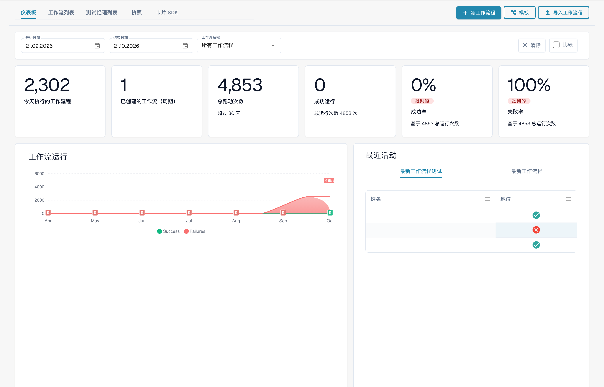
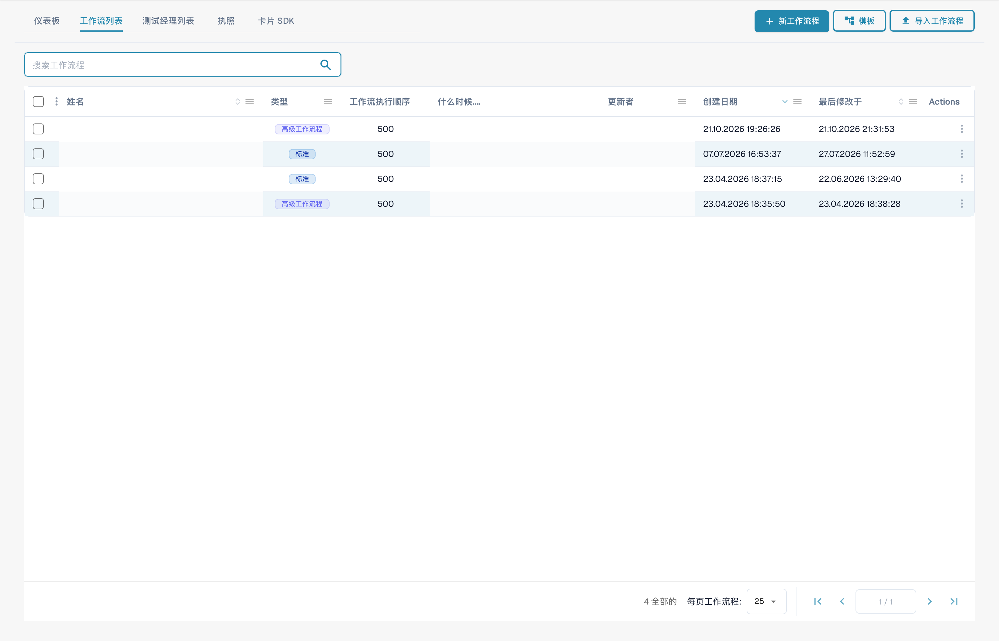

# 工作流程模式指南

**版本：** 1.0 **最后更新时间：**2025 年 10 月 23 日

***

## 概述

该目录包含全面的工作流模式指南，演示如何组合多个工作流卡来解决常见的业务场景。每个模式都提供了分步实施说明、完整示例和最佳实践。

**什么是工作流程模式？**

工作流模式是针对常见文档处理挑战的经过验证的、可重用的解决方案。您可以使用这些模式作为模板并根据您的特定需求进行调整，而不是从头开始。

***

## 工作流程构建器概览

此页面上的每个模式都在**工作流程生成器**中组装。您可以从**工作流程仪表板→工作流程列表→添加工作流程**（或通过打开现有工作流程）到达它。仪表板为您提供所有工作流程的运行历史记录和成功/失败率：

<figure><figcaption><p>Workflow Dashboard — 显示每个工作流的运行总数、成功率和失败率以及最近活动。 机密名称和文档引用已隐藏。 此版本界面的部分标签尚未翻译或翻译不准确。本页说明使用正确术语；图片保留了实际界面。</p></figcaption></figure>

**工作流程列表**选项卡列出了每个工作流程及其类型、执行顺序和触发器。使用**添加工作流程**创建一个新工作流程，或单击工作流程在构建器中将其打开：

<figure><figcaption><p>Workflow List — 每一行代表一个工作流，您可以打开它、切换启用或停用状态，也可以对其进行编辑。 机密名称和文档引用已隐藏。</p></figcaption></figure>

工作流程包含三组卡片：**当**（触发条件）、**且**（附加条件）和 **则**（操作）。以下未保存的示例展示了此结构。文档类型、子组织和用户仍需选择：

<figure><figcaption><p>包含“当”“且”和“则”卡片的未保存示例。执行前请配置所有占位字段。 此版本界面的部分标签尚未翻译或翻译不准确。本页说明使用正确术语；图片保留了实际界面。</p></figcaption></figure>

在任意组中点击**添加卡片**即可打开卡片库。卡片按类别进行组织（与采购订单、合作伙伴卡、文档字段、日期和时间、文档、逻辑、状态、表格、分配对象等进行比较），以便您可以找到每个模式所需的构建块：

<figure><figcaption><p>所选类别中的可用卡片。使用前请填写所需字段。 此版本界面的部分标签尚未翻译或翻译不准确。本页说明使用正确术语；图片保留了实际界面。</p></figcaption></figure>

***

## 可用模式

### 1.【API集成模式](api-integration-pattern.md)

**复杂度：**中等| **设置时间：** 45-60 分钟

了解如何将 DocBits 与外部 API 集成以从外部系统获取、验证和存储数据。

**用例：**

* 从外部系统获取实时定价
* 根据主数据库验证供应商信息
* 从目录系统查找产品详细信息
* 从货币服务获取汇率
* 使用地理编码服务验证地址

**使用卡片：** CALL\_API、CONDITION\_HTTPS\_REQUEST\_STATUS、ACTION\_SET\_FIELD\_TO\_TEXT、CONDITION\_COMPARE\_TWO\_DOCFIELD\_VALUES

[**查看完整图案→**](api-integration-pattern.md)

***

### 2.【任务管理模式](task-management-pattern.md)

**复杂度：**低-中 | **设置时间：** 30-45 分钟

掌握在 DocBits 工作流程中创建、分配、跟踪和管理任务的艺术，以进行审批和审核流程。

**用例：**

* 创建审批工作流程
* 为用户分配审核任务
* 处理需要人工干预的异常
* 将问题上报给经理
* 创建多级审批链
* 跟踪任务完成情况和截止日期

**使用的卡片：**tasks\_create、ACTION\_ASSIGN\_TO\_USER、ACTION\_SEND\_EMAIL\_TO\_GROUPS、CONDITION\_TASK\_STATUS

[**查看完整图案→**](task-management-pattern.md)

***

### 3.【PO匹配模式](po-matching-pattern.md)

**复杂度：**中高| **设置时间：** 60-90 分钟

实施全面的采购订单匹配工作流程，通过基于容差的路由来根据采购订单验证发票。

**用例：**

* 根据采购订单验证发票
* 付款前检测定价错误
* 识别数量差异
* 实施采购控制
* 防止重复付款
* 自动三向匹配

**使用卡片：** PURCHASE\_ORDER\_FULL\_MATCH、CONDITION\_DOC\_TO\_PO\_UNIT\_PRICE、CONDITION\_DOC\_TO\_PO\_QUANTITY、CONDITION\_DOC\_TO\_PO\_TAX\_LINES

[**查看完整图案→**](po-matching-pattern.md)

***

### 4.【判定逻辑模式](decision-logic-pattern.md)

**复杂度：**中等| **设置时间：** 30-45 分钟

实现复杂的决策树和条件路由逻辑，以根据业务规则通过不同的路径处理文档。

**用例：**

* 按金额阈值传送文档
* 对不同的文档类型应用不同的规则
* 实现多级审批逻辑
* 处理复杂的业务政策
* 基于多个标准创建动态路由
* 实施审批矩阵

**使用卡片：** CONDITION\_DOC\_FIELD\_AMOUNT、CONDITION\_DOC\_TYPE\_IS\_ISNOT、CONDITION\_SUPPLIER\_STATUS\_IS\_ISNOT、ACTION\_ASSIGN\_TO\_USER

[**查看完整图案→**](decision-logic-pattern.md)

***

### 5.【数据转换模式](data-transformation-pattern.md)

**复杂度：**中等| **设置时间：** 30-45 分钟

转换、计算、格式化和丰富文档数据，以准备导出、执行计算和标准化格式。

**用例：**

* 计算总计、小计、税金
* 转换货币或单位
* 设置日期、数字、文本的格式
* 从现有字段中获取值
* 丰富外部来源的数据
* 标准化数据格式
* 验证计算

**使用卡片：** ACTION\_CALCULATE\_FIELD、ACTION\_SET\_FIELD\_TO\_TEXT、ACTION\_COPY\_FIELD\_VALUE、CALL\_API、CONDITION\_COMPARE\_TWO\_DOCFIELD\_VALUES

[**查看完整图案→**](data-transformation-pattern.md)

***

## 图案选择指南

### 按复杂程度

| 复杂性      | 图案                                                                                                                                                                                      | 最适合                               |
| --------------- | --------------------------------------------------------------------------------------------------------------------------------------------------------------------------------------------- | -------------------------------------- |
| **低中**  | [任务管理](task-management-pattern.md)                                                                                                                                                 | 初学者，简单的工作流程            |
| **中**      | <p><a href="api-integration-pattern.md">API集成</a><br><a href="decision-logic-pattern.md">决策逻辑</a><br><a href="data-transformation-pattern.md">数据转换</a></p> | 中级用户，标准工作流程 |
| **中高** | [PO匹配](po-matching-pattern.md)                                                                                                                                                         | 高级用户，复杂的验证     |

***

### 按用例

| 我需要...                     | 使用此模式                                              |
| -------------------------------- | ------------------------------------------------------------- |
| 与外部系统集成  | [API集成模式](api-integration-pattern.md)         |
| 创建审批工作流程        | 【任务管理模式](task-management-pattern.md)         |
| 根据采购订单进行验证 | [PO匹配模式](po-matching-pattern.md)                 |
| 根据条件选择路线        | [决策逻辑模式](decision-logic-pattern.md)           |
| 计算和转换数据     | [数据转换模式](data-transformation-pattern.md) |

***

### 按行业/部门

| 行业/部门    | 推荐图案                                                                                                                        |
| ---------------------- | ------------------------------------------------------------------------------------------------------------------------------------------- |
| **财务/会计** | 【PO匹配](po-matching-pattern.md)、【任务管理](task-management-pattern.md)】、【数据转换](data-transformation-pattern.md) |
| **采购**        | 【PO匹配](po-matching-pattern.md)、【决策逻辑](decision-logic-pattern.md)】、【API集成](api-integration-pattern.md)           |
| **操作**         | 【任务管理](task-management-pattern.md)、【决策逻辑](decision-logic-pattern.md)】                                                  |
| **IT/集成**     | 【API集成](api-integration-pattern.md)、【数据转换](data-transformation-pattern.md)】                                        |
| **所有部门**    | 【决策逻辑](decision-logic-pattern.md)、【任务管理](task-management-pattern.md)】                                                  |

***

## 如何使用这些模式

### 第 1 步：选择图案

1. 查看上面的模式描述
2. 确定哪种模式符合您的用例
3. 检查复杂性和预计设置时间
4. 查看模式指南中的“何时使用”部分

### 第 2 步：查看先决条件

每个模式指南列出：

* 所需知识
* 首先阅读相关指南
* 将使用的卡
* 配置要求

### 第 3 步：按照分步说明进行操作

每个模式提供：

* 完整的工作流程示例
* 分步实施指南
* 配置模板
* 现实世界的例子
* 故障排除提示

### 第 4 步：根据您的需求进行定制

* 使示例适应您的业务规则
* 调整阈值和容差
* 修改路由逻辑
* 根据需要添加/删除步骤
* 生产使用前进行彻底测试

### 第 5 步：监控和优化

* 跟踪工作流程绩效
* 监控成功率
* 收集用户反馈
* 细化配置
* 文档定制

***

## 图案组合

许多现实场景需要组合多种模式：

### 示例 1：完整的发票处理

```
1. API Integration Pattern → Fetch current pricing
2. Data Transformation Pattern → Calculate totals
3. PO Matching Pattern → Validate against PO
4. Decision Logic Pattern → Route based on variance
5. Task Management Pattern → Create approval tasks
```

### 示例 2：大额发票审批

```
1. Data Transformation Pattern → Calculate amounts
2. Decision Logic Pattern → Check thresholds
3. Task Management Pattern → Multi-level approval
4. API Integration Pattern → Notify external systems
```

### 示例 3：异常处理

```
1. PO Matching Pattern → Detect variances
2. Decision Logic Pattern → Classify exception severity
3. Task Management Pattern → Create review tasks
4. Data Transformation Pattern → Calculate impact
```

***

## 图案模板

每个模式都包含这些标准化部分：

1. **概述** - 模式的作用
2. **何时使用** - 适当的用例
3. **完整示例** - 真实场景
4. **分步** - 实施说明
5. **配置** - 卡设置模板
6. **工作流程图** - 可视化表示
7. **高级变体** - 替代实现
8. **错误处理** - 常见问题及解决方案
9. **测试清单** - 验证步骤
10. **相关模式** - 互补模式
11. **相关指南** - 参考文档

***

## 寻求帮助

### 模式支持资源

**文档：**

* 【完整工作流程指南索引](../..)
* [个人卡牌攻略](../then/action)
* [条件卡参考](../condition-cards-complete-guide.md)
* [工作流程链接图](https://github.com/Fellow-Consulting-AG/docbits/tree/main/WORKFLOW_LINKING_MAP.md)

**其他资源：**

* [快速参考指南](https://github.com/Fellow-Consulting-AG/docbits/tree/main/WORKFLOW_LINKING_QUICK_REFERENCE.md)
* [2025 年 10 月发行说明](https://github.com/Fellow-Consulting-AG/docbits/tree/main/readme/administration-and-setup/workflow/changelog/2025-10-october.md)
* [卡版本控制参考](../po-comparison-versions-guide.md)

**联系人：**

* 模式反馈：docs@docbits.com
* 技术支持：support@docbits.com
* 实施帮助：consulting@docbits.com

***

## 模式统计

| 指标                      | 值               |
| --------------------------- | ------------------- |
| **总图案**          | 5                   |
| **涵盖的卡片总数**     | 30+                 |
| **综合文档**  | \~1,200 行       |
| **示例场景**       | 25+                 |
| **配置模板** | 15+                 |
| **工作流程图**       | 5张完整图 |
| **交叉引用**        | 87+ 内部链接  |

***

## 为模式做出贡献

是否有一个可以让他人受益的工作流程模式？

**图案贡献指南：**

1. **记录您的工作流程**
   * 清晰的业务场景
   * 分步实施
   * 工作配置示例
   * 真实世界的测试结果
2. **遵循模式模板**
   * 使用标准截面结构
   * 包括所有必需的元素
   * 提供图表/示例
   * 添加故障排除指南
3. **提交审核**
   * 电子邮件至：docs@docbits.com
   * 包括：模式描述、用例、实施指南
   * 我们将审查并可能添加到官方文档中

**好处：**

* 帮助其他 DocBits 用户
* 在文档中获得认可
* 完善整体产品知识库
* 接收有关您的实施的反馈

***

## 变更日志

### 1.0 版（2025 年 10 月 23 日）

* 首次发布 5 种综合工作流程模式
* 添加了 API 集成模式
* 添加任务管理模式
* 添加 PO 匹配模式
* 添加了决策逻辑模式
* 添加了数据转换模式
* 实现交叉引用链接（87 个链接）
* 创建模式选择指南

***

## 下一步

**工作流程模式新手？**

1. 从【任务管理模式](task-management-pattern.md)开始——最容易理解
2. 回顾[决策逻辑模式](decision-logic-pattern.md) - 所有工作流程的基础
3. 探索【API集成模式](api-integration-pattern.md)——常见集成需求

**准备好实施了吗？**

1. 从上面的列表中选择您的图案
2. 阅读完整的模式指南
3. 查看先决条件和相关指南
4. 按照分步说明进行操作
5. 使用示例文档进行测试
6. 部署到生产环境
7. 监控和优化

**需要更多帮助吗？**

* 查看[工作流程文档概述](../..)
* 查看【快速参考指南](https://github.com/Fellow-Consulting-AG/docbits/tree/main/WORKFLOW_LINKING_QUICK_REFERENCE.md)
* 联系支持团队

***

**最后更新时间：**2025年10月23日**维护者：**文档团队**版本：**1.0
