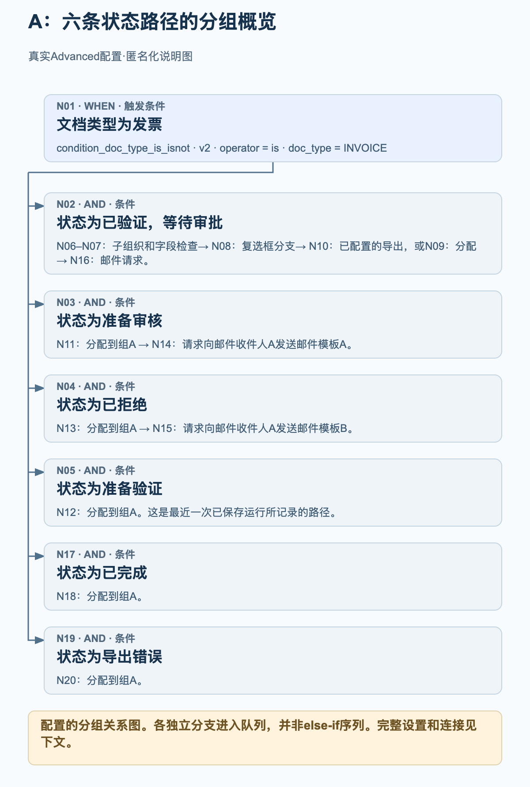
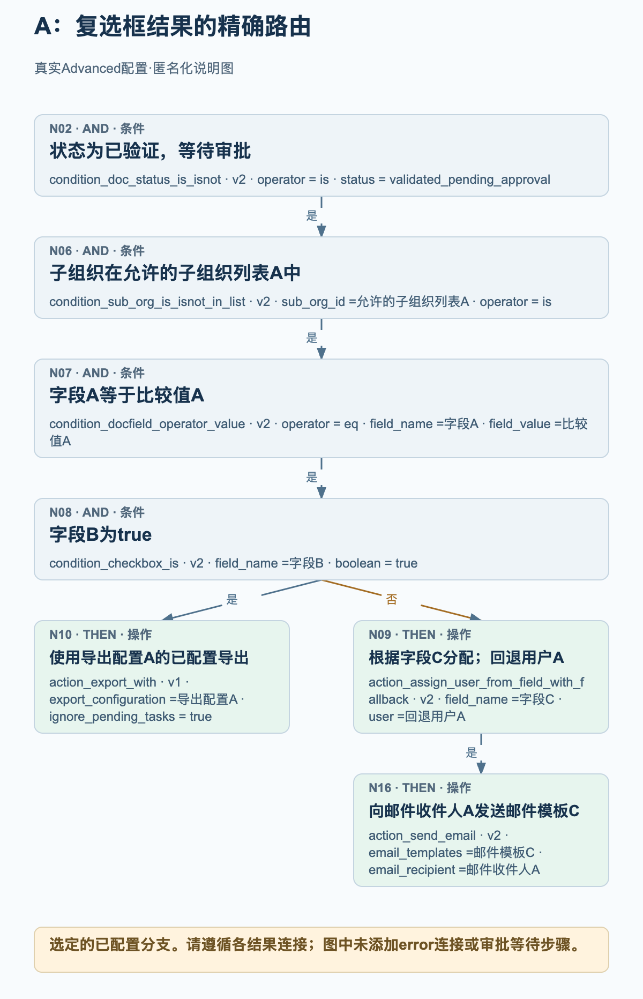
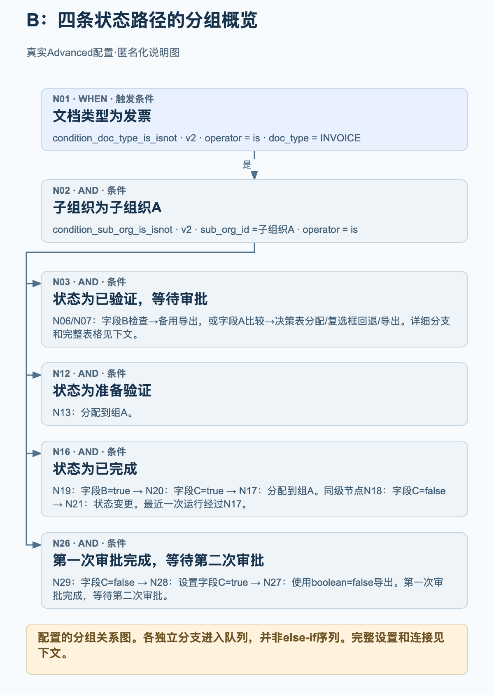
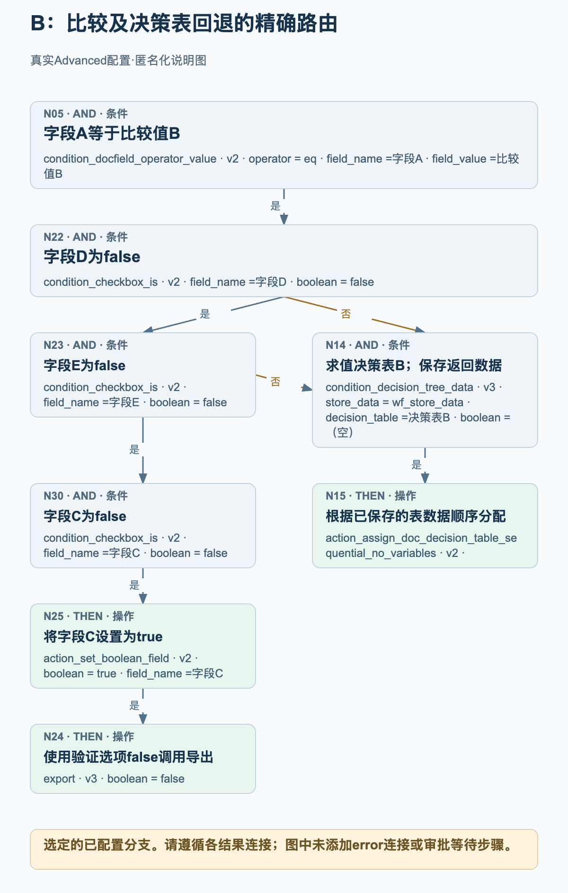

# 生产环境中的高级工作流示例

生产环境中两个已启用的 Advanced 工作流展示了真实发票处理如何结合状态分支、复选框判断、分配和已配置的导出操作。四张流程图分别说明各关系图中的选定部分；完整的节点设置和连接另行列出。

于 2026 年 10 月 27 日以只读方式核查源数据：两个当前配置的节点、卡片、版本、设置和连接数据，均与各自最近一次已记录运行中保存的数据一致。示例 A 有 20 个节点和 19 条连接；示例 B 有 30 个节点和 30 条连接。两次已记录运行的整体状态均为 failed_condition，但各自都包含一次成功的组分配操作。这些是观察到的配置和已保存的执行记录，并非新执行的测试。组织、字段、用户、组、表、模板和收件人的值均已匿名化。别名保留同一示例内部的区别，不表示不同示例中的别名指向同一真实实体。

## 如何阅读这些关系图

每条连接都对应一个特定结果：success、failed_condition 或 error。这些示例包含 success 和 failed_condition 连接；两个关系图都未配置 error 连接。条件不满足是正常的条件判断结果，不能理解为技术错误。

多条传出的 success 连接会将多个目标加入执行队列。它们不会形成 else-if 链，也不表示操作并行运行。在关系图的一次运行中，每个目标最多处理一次。应遵循实际连接，不能根据卡片的位置推断控制流。

具有多条传入连接的目标，不会自动成为等待所有输入的汇合点。在示例 B 中，任一已配置的 failed_condition 连接都可以将普通条件卡片 N14 加入队列；它不是独立的 ALL 或 ANY 网关。

分配操作不能证明有人已批准文档。不能根据分配操作或已配置的导出卡片，推断存在等待步骤、审批完成或外部系统收件。流程图没有添加这些步骤。

分组概览汇总各状态路径，并明确将后续节点分组。详细流程图展开选定的复选框路径或回退路径。如需检查完整的已配置关系图，请使用完整的节点和连接列表。

## A. 由复选框控制导出或分配路径的状态路由

一张发票会进入六项状态检查。“已验证，等待审批”分支还会检查允许的子组织列表、比较字段 A，并测试字段 B。复选框结果决定进入已配置的导出卡片，还是进入按字段分配的操作后再发送邮件。其他状态路径会分配到组 A，其中两条路径随后发送已配置的邮件。

### A：六条状态路径的分组概览

<figure><figcaption>N01 分别连接六项独立的状态检查。概览将较长的 N02 分支分组，并展示其他状态下已配置的分配和邮件路径。这是配置的分组关系图，不是执行轨迹，也不是 else-if 序列。</figcaption></figure>

### A：复选框结果的精确路由

<figure><figcaption>展开的分支为 N02 → N06 → N07 → N08。字段 B=true 时沿 success 进入已配置的导出卡片 N10，其中 ignore_pending_tasks=true。failed_condition 连接通向按字段分配的卡片 N09；该卡片的 success 通向邮件卡片 N16。此图不表示任何导出结果、人工批准或等待步骤。</figcaption></figure>

### 最近一次已保存运行实际显示了什么

已保存运行：2026 年 10 月 26 日 12:01:54 UTC。N01 和 ready_for_validation 检查 N05 返回 success；随后分配操作 N12 返回 success。其他五项状态检查返回 failed_condition，其余节点在本次运行中没有记录结果。整体记录为 failed_condition。因此，本次运行展示的是 N01 → N05 → N12 组分配路径，没有展示复选框、导出或邮件路径。

- N01 成功后，状态检查 N02、N03、N04、N05、N17 和 N19 通过各自独立的 success 连接加入队列。它们不是 else-if 阶梯。
- 详细审批分支沿 success 连接依次经过 N02 → N06 → N07 → N08。N08 测试字段 B 是否为 true。其 success 连接通向 N10；其 failed_condition 连接通向 N09。
- N10 是 action_export_with v1，配置了导出配置 A 和 ignore_pending_tasks=true。图中说明的是配置，不声称导出成功或外部系统已收件。在此卡片中，ignore_pending_tasks=true 会为导出请求关闭待处理任务检查；这是本示例特有的选项。
- N09 配置为根据字段 C 进行分配，并使用回退用户 A。仅其 success 连接通向 N16，该节点配置了邮件模板 C 和邮件收件人 A。
- 字段 C 必须包含用户 ID。用户 ID 无匹配项时可以使用已配置的回退用户；但文档字段缺失时，可能在进入回退处理之前就失败。回退设置不保证在所有字段缺失的情况下都能完成分配。
- N11、N12、N13、N18 和 N20 在本示例中都配置了同一个组 A。只有 N11 和 N13 连接了后续邮件节点，分别为 N14 和 N15。

完整节点配置

| 节点 | 卡片 | 配置 |
| --- | --- | --- |
| N01 | condition_doc_type_is_isnot · v2 | operator = is; doc_type = INVOICE |
| N02 | condition_doc_status_is_isnot · v2 | operator = is; status = validated_pending_approval |
| N03 | condition_doc_status_is_isnot · v2 | operator = is; status = ready_for_review |
| N04 | condition_doc_status_is_isnot · v2 | operator = is; status = rejected |
| N05 | condition_doc_status_is_isnot · v2 | operator = is; status = ready_for_validation |
| N06 | condition_sub_org_is_isnot_in_list · v2 | sub_org_id = 允许的子组织列表 A; operator = is |
| N07 | condition_docfield_operator_value · v2 | operator = eq; field_name = 字段 A; field_value = 比较值 A |
| N08 | condition_checkbox_is · v2 | field_name = 字段 B; boolean = true |
| N09 | action_assign_user_from_field_with_fallback · v2 | field_name = 字段 C; user = 回退用户 A |
| N10 | action_export_with · v1 | export_configuration = 导出配置 A; ignore_pending_tasks = true |
| N11 | doc_group_assign · v2 | groups = 组 A; use_decision_table = （空） |
| N12 | doc_group_assign · v2 | groups = 组 A; use_decision_table = （空） |
| N13 | doc_group_assign · v2 | groups = 组 A; use_decision_table = （空） |
| N14 | action_send_email · v2 | email_templates = 邮件模板 A; email_recipient = 邮件收件人 A |
| N15 | action_send_email · v2 | email_templates = 邮件模板 B; email_recipient = 邮件收件人 A |
| N16 | action_send_email · v2 | email_templates = 邮件模板 C; email_recipient = 邮件收件人 A |
| N17 | condition_doc_status_is_isnot · v2 | operator = is; status = finished |
| N18 | doc_group_assign · v2 | groups = 组 A; use_decision_table = （空） |
| N19 | condition_doc_status_is_isnot · v2 | operator = is; status = export_error |
| N20 | doc_group_assign · v2 | groups = 组 A; use_decision_table = （空） |

完整的已配置连接

| 节点 | 结果路径 | 节点 |
| --- | --- | --- |
| N01 | success | N02 |
| N01 | success | N03 |
| N01 | success | N04 |
| N01 | success | N05 |
| N08 | failed_condition | N09 |
| N08 | success | N10 |
| N07 | success | N08 |
| N06 | success | N07 |
| N02 | success | N06 |
| N03 | success | N11 |
| N04 | success | N13 |
| N05 | success | N12 |
| N13 | success | N15 |
| N11 | success | N14 |
| N09 | success | N16 |
| N01 | success | N17 |
| N17 | success | N18 |
| N19 | success | N20 |
| N01 | success | N19 |

## B. 包含复选框回退路径和状态分支的决策表路由

子组织 A 的一张发票会进入四项状态检查。“已验证，等待审批”路径使用字段 B、对字段 A 的两种备选比较、决策表以及额外的复选框检查。“已完成”路径先检查字段 B 和 C，然后分配到组 A 或配置状态变更。另一条独立的“等待第二次审批”路径在已配置条件满足时设置字段 C 并调用导出。

### B：四条状态路径的分组概览

<figure><figcaption>N01 和 N02 通向四项分别连接的状态检查。概览将较大的决策表分支分组，保留“准备验证”的分配路径和已完成文档的复选框分支，并汇总“等待第二次审批”的导出路径。完整节点和连接列表保留全部 30 个节点和 30 条连接。</figcaption></figure>

### B：比较及决策表回退的精确路由

<figure><figcaption>选定的已配置分支位于 N01 → N02 → N03 → N07 之后：N05 将字段 A 与比较值 B 比较。N22（字段 D=false）或 N23（字段 E=false）中的任一 failed_condition 连接，都可以将普通条件卡片 N14 的决策表 B 加入队列，然后进入顺序分配 N15。N23 的 success 则继续经过 N30 → N25 → N24。此图不表示 ALL 汇合、ANY 卡片、审批完成或外部系统收件。</figcaption></figure>

### 最近一次已保存运行实际显示了什么

已保存运行：2026 年 10 月 27 日 11:56:25 UTC。N01、N02、finished 状态检查 N16、字段 B=true 检查 N19、字段 C=true 检查 N20 以及组分配 N17 返回 success。N03、N12、N18 和 N26 返回 failed_condition；其他节点在本次运行中没有记录结果。整体记录为 failed_condition。本次运行展示的是已完成文档的分配路径，不是任一决策表路径、状态变更或导出。

- 发票类型和子组织 A 的检查成功后，N02 将状态检查 N03、N12、N16 和 N26 加入队列。关系图不会等待一条状态分支完成后才定义另一条。
- N03 返回 success 时，N06 测试字段 B=false，N07 测试字段 B=true。N06 的 success 通向 N10，将字段 B 设置为 true，然后进入备用导出卡片 N11。N07 的 success 将字段 A 的两项比较 N04 和 N05 都加入队列。
- N06 和 N07 在字段 B 更新节点 N10 之前加入队列。两项检查都会在更新之前求值；将字段 B 设置为 true，不会使 N07 在同一次遍历中稍后转为成功。较晚加入队列的卡片可以看到先前操作返回的值；各分支不是相互隔离的快照。
- 比较值 A 的路径通向 N08 的决策表 A，再进入顺序分配 N09。比较值 B 的路径依次检查 N22 的字段 D=false、N23 的字段 E=false 和 N30 的字段 C=false，然后在 N25 将字段 C 设置为 true，并调用导出 N24。
- N22 或 N23 任一节点返回 failed_condition，都可以将普通条件卡片 N14 加入队列；该卡片用于决策表 B。N14 不是等待所有输入的汇合点，也不是新增的 ANY 卡片。其 success 连接通向顺序分配 N15。
- 对于已完成的文档，N19 测试字段 B=true，然后将 N18 和 N20 都加入队列。N20 的字段 C=true 通向组 A 分配 N17。N18 的字段 C=false 通向状态变更卡片 N21，其配置为 validated_pending_approval 和 trigger_docflow=true。这不是等待步骤。
- approved_pending_second_approval 路径沿 success 连接执行 N29 → N28 → N27：测试字段 C=false，将字段 C 设置为 true，然后调用导出。导出卡片 N24 和 N27 保留 boolean=false。这是验证选项，不是关闭导出调用的指令。
- 两张决策表条件卡片都以 wf_store_data 保存数据。对应的顺序分配操作没有自身设置。表规则和实际接收人不在此公开，关系图也不能证明审批已完成。
- 备用导出 N11 取决于文档类型的导出属性。不能根据该节点的空设置推断导出配置或目标。状态变更 N21 请求后续触发工作流；它不会向当前这次遍历添加隐含的回连。

完整节点配置

| 节点 | 卡片 | 配置 |
| --- | --- | --- |
| N01 | condition_doc_type_is_isnot · v2 | operator = is; doc_type = INVOICE |
| N02 | condition_sub_org_is_isnot · v2 | sub_org_id = 子组织 A; operator = is |
| N03 | condition_doc_status_is_isnot · v2 | operator = is; status = validated_pending_approval |
| N04 | condition_docfield_operator_value · v2 | operator = eq; field_name = 字段 A; field_value = 比较值 A |
| N05 | condition_docfield_operator_value · v2 | operator = eq; field_name = 字段 A; field_value = 比较值 B |
| N06 | condition_checkbox_is · v2 | field_name = 字段 B; boolean = false |
| N07 | condition_checkbox_is · v2 | field_name = 字段 B; boolean = true |
| N08 | condition_decision_tree_data · v3 | store_data = wf_store_data; decision_table = 决策表 A; boolean = （空） |
| N09 | action_assign_doc_decision_table_sequential_no_variables · v2 | — |
| N10 | action_set_boolean_field · v2 | boolean = true; field_name = 字段 B |
| N11 | action_alternate_export · v2 | — |
| N12 | condition_doc_status_is_isnot_in_list · v2 | operator = is; status = ready_for_validation |
| N13 | doc_group_assign · v2 | groups = 组 A; use_decision_table = （空） |
| N14 | condition_decision_tree_data · v3 | store_data = wf_store_data; decision_table = 决策表 B; boolean = （空） |
| N15 | action_assign_doc_decision_table_sequential_no_variables · v2 | — |
| N16 | condition_doc_status_is_isnot_in_list · v2 | operator = is; status = finished |
| N17 | doc_group_assign · v2 | groups = 组 A; use_decision_table = （空） |
| N18 | condition_checkbox_is · v2 | field_name = 字段 C; boolean = false |
| N19 | condition_checkbox_is · v2 | field_name = 字段 B; boolean = true |
| N20 | condition_checkbox_is · v2 | field_name = 字段 C; boolean = true |
| N21 | staus_change · v3 | status = validated_pending_approval; trigger_docflow = true |
| N22 | condition_checkbox_is · v2 | field_name = 字段 D; boolean = false |
| N23 | condition_checkbox_is · v2 | field_name = 字段 E; boolean = false |
| N24 | export · v3 | boolean = false |
| N25 | action_set_boolean_field · v2 | boolean = true; field_name = 字段 C |
| N26 | condition_doc_status_is_isnot_in_list · v2 | operator = is; status = approved_pending_second_approval |
| N27 | export · v3 | boolean = false |
| N28 | action_set_boolean_field · v2 | boolean = true; field_name = 字段 C |
| N29 | condition_checkbox_is · v2 | field_name = 字段 C; boolean = false |
| N30 | condition_checkbox_is · v2 | field_name = 字段 C; boolean = false |

完整的已配置连接

| 节点 | 结果路径 | 节点 |
| --- | --- | --- |
| N01 | success | N02 |
| N02 | success | N03 |
| N03 | success | N06 |
| N03 | success | N07 |
| N07 | success | N04 |
| N07 | success | N05 |
| N06 | success | N10 |
| N10 | success | N11 |
| N02 | success | N12 |
| N12 | success | N13 |
| N16 | success | N19 |
| N20 | success | N17 |
| N19 | success | N20 |
| N19 | success | N18 |
| N18 | success | N21 |
| N04 | success | N08 |
| N02 | success | N16 |
| N05 | success | N22 |
| N22 | success | N23 |
| N25 | success | N24 |
| N02 | success | N26 |
| N22 | failed_condition | N14 |
| N23 | failed_condition | N14 |
| N28 | success | N27 |
| N26 | success | N29 |
| N29 | success | N28 |
| N23 | success | N30 |
| N30 | success | N25 |
| N08 | success | N09 |
| N14 | success | N15 |

## 调整示例前的检查

将每个中性别名替换为适合您所在组织的值。保留各设置之间的字段对应关系：哪些引用同一字段，哪些引用不同字段；不要将这些占位名称当作真实标识符使用。

逐一检查每种结果对应的连接，包括 failed_condition 路由和具有多条传入连接的目标。请根据自身流程选择错误处理方式，不要假定关系图会处理未连接的 error 路径。

根据自身要求审查导出设置、验证选项和待处理任务的处理方式。已配置的导出操作或成功的节点记录，都不是外部系统已接收数据的证据。

在获授权的测试环境中验证调整后的工作流，覆盖每种相关的条件结果以及分配数据缺失的情况。这些生产环境示例仅作读取，未进行修改或重新运行。
