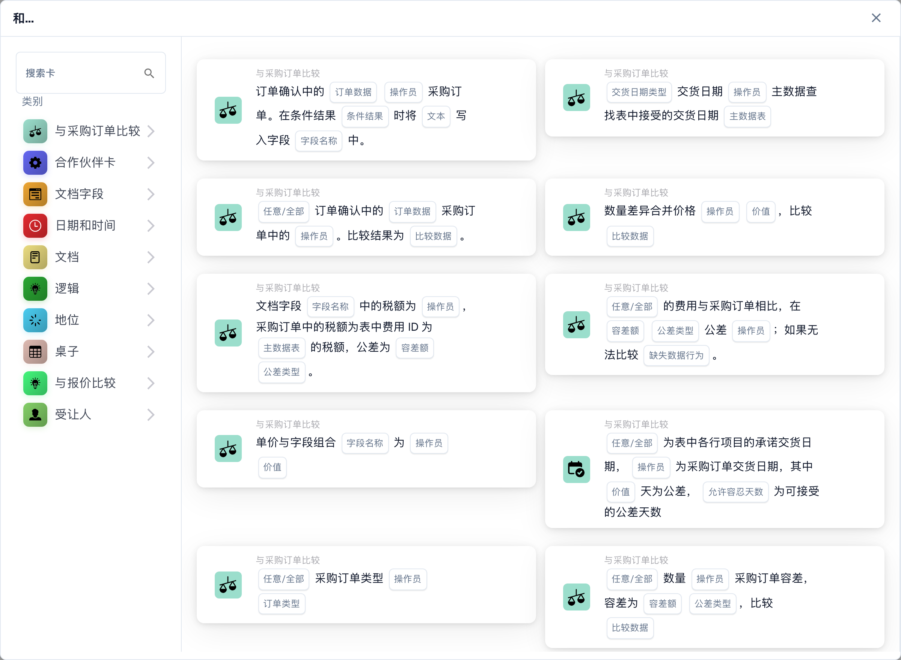

# 决策逻辑模式

**模式类型：**条件路由与逻辑 **复杂度：**中等 **预计设置时间：**30-45 分钟 **常见用例：**多路径路由、条件处理、决策树、业务规则实施

***

您可以在 **工作流程生成器**（Workflow Dashboard → Workflow List → Add Workflow）中构建此模式。点击 **添加卡** 并打开 **逻辑** 类别——其中包含用于驱动决策树的条件卡片和分支卡片，您可以将它们与 **且** 组结合起来评估多个条件：

<figure><figcaption><p>所选类别中的可用卡片。使用前请填写所需字段。 此版本界面的部分标签尚未翻译或翻译不准确。本页说明使用正确术语；图片保留了实际界面。</p></figcaption></figure>

***

## 模式概述

此模式演示如何在 DocBits 工作流中使用条件卡片实现复杂的决策逻辑，根据文档属性、字段值和业务规则将文档路由到不同的处理路径。

**此模式的功能：**

1. 按顺序或并行评估多个条件
2. 根据条件将文档路由到不同路径
3. 实施业务规则和政策
4. 处理复杂的决策树
5. 组合多个标准来决定路由

***

## 何时使用此模式

在需要以下功能时使用此模式：

* ✅ 按金额阈值路由文档
* ✅ 为不同文档类型应用不同规则
* ✅ 实施多级审批逻辑
* ✅ 处理复杂的业务政策
* ✅ 根据多个标准创建动态路由
* ✅ 实施异常处理逻辑
* ✅ 创建审批矩阵

**以下情况不要使用此模式：**

* ❌ 简单的线性工作流已足够
* ❌ 所有文档都遵循相同路径
* ❌ 不需要条件处理

***

## 决策逻辑类型

### 1. 简单的 IF-THEN 逻辑

```
IF condition:
  → 操作 A
ELSE:
  → 操作 B
```

**示例：**

```
IF Amount > €10,000:
  → 分配给总监
ELSE:
  → 分配给经理
```

### 2. 多个条件（AND 逻辑）

```
IF condition1 AND condition2 AND condition3:
  → 操作 A
ELSE:
  → 操作 B
```

**示例：**

```
IF Amount > €10,000 AND Supplier = "New" AND Department = "IT":
  → 分配给 IT 总监 + CFO（双重审批）
ELSE:
  → 标准审批工作流
```

### 3. 替代条件（OR 逻辑）

```
IF condition1 OR condition2 OR condition3:
  → 操作 A
ELSE:
  → 操作 B
```

**示例：**

```
IF Amount > €50,000 OR Supplier is "Blocked" OR Document has "Urgent" flag:
  → 立即升级处理
ELSE:
  → 标准处理
```

### 4. 嵌套决策树

```
IF condition1:
  IF condition2:
    → 操作 A
  ELSE:
    → 操作 B
ELSE:
  IF condition3:
    → 操作 C
  ELSE:
    → 操作 D
```

**示例：**

```
IF Document_Type = "Invoice":
  IF Amount > €10,000:
    → 高金额发票工作流
  ELSE:
    → 标准发票工作流
ELSE IF Document_Type = "Credit Note":
  IF Amount > €5,000:
    → 高金额贷项通知单工作流
  ELSE:
    → 标准贷项通知单工作流
```

***

## 完整工作流示例

### 场景：发票审批矩阵

**业务规则：**

1. 金额 < €1,000：自动审批
2. 金额 €1,000-€10,000：经理审批
3. 金额 > €10,000 且为新供应商：总监 + CFO 审批
4. 金额 > €10,000 且为现有供应商：仅需总监审批
5. 任意金额但采购订单不匹配：先由采购部门审批
6. 紧急发票（已标记）：使用加急工作流

**实施：**

```
步骤 1：检查采购订单不匹配
  IF PO_Match_Status = "FAIL":
    → 转交采购部门处理采购订单问题
    → 问题解决后，继续以下步骤

步骤 2：检查紧急标记
  IF Urgent_Flag = TRUE:
    → 跳过金额检查
    → 直接转交级别最高的审批人
    → 将优先级设为 HIGH
    → 截止时间为 1 天

步骤 3：按金额路由（非紧急情况）
  IF Amount < €1,000:
    → 自动审批
    → 立即导出

  ELSE IF Amount < €10,000:
    → 为经理创建任务
    → 优先级：中
    → 截止时间：3 天

  ELSE IF Amount ≥ €10,000:
    检查供应商状态：
      IF Supplier_Age < 180 days（新供应商）:
        → 为总监创建任务（任务 1）
        → 获批后，为 CFO 创建任务（任务 2）
        → 优先级：高
        → 每项任务的截止时间：2 天

      ELSE（现有供应商）:
        → 仅为总监创建任务
        → 优先级：高
        → 截止时间：2 天
```

***

## 分步实施

### 第 1 步：定义条件卡片

**条件 1：金额阈值**

```
Card: CONDITION_DOC_FIELD_AMOUNT
Field: Total_Amount
Operator: IS LESS THAN
Value: 1000
Currency: EUR
```

**条件 2：文档类型检查**

```
Card: CONDITION_DOC_TYPE_IS_ISNOT
Document Type: IS
Type: Invoice
```

**条件 3：供应商状态**

```
Card: CONDITION_SUPPLIER_STATUS_IS_ISNOT
Supplier Status: IS
Status: ACTIVE
```

**条件 4：新供应商检查**

```
Card: CONDITION_DOC_FIELD_DATE
Field: Supplier_First_Transaction_Date
Operator: IS AFTER
Value: {{TODAY_MINUS_180_DAYS}}
```

**指南参考：**[条件卡片完整指南](../condition-cards-complete-guide.md)

***

### 第 2 步：构建决策树

**第 1 级：文档类型**

```
工作流："Invoice Processing"

IF Document_Type = "Invoice":
  → 继续到第 2 级

ELSE IF Document_Type = "Credit Note":
  → 转入 "Credit Note Processing" 工作流

ELSE IF Document_Type = "Receipt":
  → 转入 "Receipt Processing" 工作流

ELSE:
  → 转交 "Unknown Document Type" 处理流程
```

**第 2 级：金额阈值（适用于发票）**

```
IF Amount < €1,000:
  → 转入 "Auto-Approve Path"（自动审批路径）

ELSE IF Amount < €10,000:
  → 转入 "Manager Approval Path"（经理审批路径）

ELSE IF Amount < €50,000:
  → 转入 "Director Approval Path"（总监审批路径）
  → 检查第 3 级条件

ELSE（Amount ≥ €50,000）:
  → 转入 "Executive Approval Path"（高管审批路径）
  → 需要双重或三重审批
```

**第 3 级：供应商分析（适用于高金额发票）**

```
IF Supplier_Status = "BLOCKED":
  → 停止处理
  → 创建紧急升级任务
  → 通知采购部门和财务部门

ELSE IF Supplier_Age < 180 days（新供应商）:
  → 需要额外审批
  → 将 CFO 加入审批链
  → 加强验证

ELSE IF Supplier_Risk_Rating = "HIGH":
  → 需要额外检查
  → 进行欺诈检测审查
  → 由经理预先审批

ELSE:
  → 标准高金额工作流
```

***

### 第 3 步：创建路由操作

**路径 A：自动审批（金额 < €1,000）**

```
操作：
1. 将字段 "Approval_Type" 设为 "AUTO"
2. 将字段 "Approval_Level" 设为 "0"
3. ACTION_APPROVE_DOCUMENT
4. 导出到 ERP
5. 发送确认电子邮件（可选）
```

**路径 B：经理审批（€1,000-€10,000）**

```
操作：
1. 将字段 "Approval_Type" 设为 "MANUAL"
2. 将字段 "Approval_Level" 设为 "1"
3. tasks_create：
   - 标题："Approve Invoice {{DOCUMENT_NUMBER}}"
   - 分配给：Department_Manager
   - 优先级：中
   - 截止时间：3 天
4. 向经理发送电子邮件通知
5. 等待任务完成
6. 如果已批准：导出到 ERP
7. 如果已拒绝：退回供应商
```

**路径 C：总监审批（€10,000-€50,000）**

```
操作：
1. 将字段 "Approval_Type" 设为 "MANUAL"
2. 将字段 "Approval_Level" 设为 "2"
3. 检查 Supplier_Age：
   IF 新供应商（< 180 days）：
     - 创建任务 1：由总监审批
     - 任务 1 完成后：创建任务 2：由 CFO 审批
     - 需要双重审批
   ELSE:
     - 创建任务：仅由总监审批
4. 优先级：高
5. 截止时间：2 天
6. 发送电子邮件通知
7. 等待完成
8. 如果全部获批：导出
9. 如果有任何一项被拒绝：退回供应商
```

**路径 D：高管审批（≥ €50,000）**

```
操作：
1. 将字段 "Approval_Type" 设为 "EXECUTIVE"
2. 将字段 "Approval_Level" 设为 "3"
3. 顺序审批：
   - 任务 1：财务总监
   - 任务 2：CFO
   - 任务 3：CEO（如果 > €100,000）
4. 优先级：紧急
5. 每项任务的截止时间：1 天
6. 发送紧急通知
7. 更新高管仪表板
8. 等待所有审批完成
9. 如果全部获批：导出
10. 如果有任何一项被拒绝：召开高管审查会议
```

***

## 高级决策逻辑模式

### 模式 1：基于评分的路由

**计算风险评分并据此路由：**

```
风险评分计算：
  分数 = 0

  IF Amount > €50,000: 分数 += 30
  IF Supplier_Age < 180 days: 分数 += 25
  IF PO_Variance > 10%: 分数 += 20
  IF Supplier_Country = "High Risk Country": 分数 += 15
  IF Payment_Terms < 30 days: 分数 += 10

  总分范围：0-100

路由：
  IF Score < 20: 自动审批
  IF Score 20-50: 经理审批
  IF Score 51-75: 总监审批
  IF Score > 75: 高管审批 + 欺诈检查
```

**实施：**

```
1. ACTION_CALCULATE_FIELD：计算风险评分
2. ACTION_SET_FIELD_TO_NUMBER：存储评分
3. CONDITION_DOC_FIELD_NUMBER：检查评分阈值
4. 根据评分进行路由
```

***

### 模式 2：基于部门的矩阵

**按部门应用不同的审批规则：**

```
部门审批矩阵：

  IT 部门：
    Amount < €5,000：IT 经理
    Amount ≥ €5,000：IT 总监 + CIO

  财务部门：
    Amount < €10,000：财务经理
    Amount ≥ €10,000：CFO

  运营部门：
    Amount < €3,000：运营经理
    Amount ≥ €3,000：COO

  通用规则：
    Amount < €2,000：部门经理
    Amount ≥ €2,000：部门总监
```

**实施：**

```
1. 检查 Department 字段
2. 根据部门检查金额阈值
3. 路由到相应的审批人
4. 为不同部门设置不同阈值
```

***

### 模式 3：基于时间的逻辑

**根据时间采用不同规则：**

```
月末处理（月末最后 3 天）：
  IF 今天处于月末最后 3 天内：
    - 优先级：URGENT
    - 截止时间：1 天
    - 审批人：当值财务经理
    - 加急工作流
  ELSE:
    - 标准优先级
    - 标准截止时间
    - 标准工作流

工作时间与非工作时间：
  IF 时间在 9 AM - 5 PM 之间：
    - 分配给当前班次
  ELSE:
    - 排入下一个工作日的队列
    - 或转交给值班审批人

财务期间：
  IF Document_Date 属于 Current_Fiscal_Period：
    - 标准处理
  ELSE:
    - 标记为 "Prior Period"
    - 需要会计审批
    - 进行额外检查
```

***

### 模式 4：基于异常的路由

**单独路由异常：**

```
异常检测：

  无异常：
    → 标准工作流

  轻微异常（可自动修复）：
    → 自动更正
    → 记录更正内容
    → 继续标准工作流

  中等异常（需要审查）：
    → 创建审查任务
    → 标记文档
    → 修复后：继续工作流

  严重异常（需要升级处理）：
    → 停止处理
    → 创建紧急任务
    → 通知多个级别的相关人员
    → 需要人工干预

异常类型：
  - 缺少必填字段
  - 字段值无效
  - 采购订单不匹配
  - 重复发票
  - 供应商不匹配
  - 金额差异
```

***

## 完整决策逻辑图

```
发票到达
│
├─ 第 1 级：异常检查
│  │
│  ├─ 是否存在严重异常？（缺少采购订单、重复项等）
│  │  │
│  │  ├─ 是 → 停止并升级处理
│  │  │        创建紧急任务
│  │  │        通知管理员
│  │  │        → 结束（异常处理）
│  │  │
│  │  └─ 否 → 继续到第 2 级
│
├─ 第 2 级：文档类型
│  │
│  ├─ 类型 = Invoice？
│  │  └─ 是 → 继续到第 3 级
│  │
│  ├─ 类型 = Credit Note？
│  │  └─ 是 → 转入贷项通知单工作流
│  │           → 结束（贷项通知单路径）
│  │
│  └─ 其他类型？
│     └─ 是 → 转入相应工作流
│              → 结束（其他类型路径）
│
├─ 第 3 级：紧急程度检查（针对发票）
│  │
│  ├─ Urgent Flag = TRUE？
│  │  │
│  │  ├─ 是 → 加急工作流
│  │  │        优先级：URGENT
│  │  │        截止时间：1 天
│  │  │        分配给：高级审批人
│  │  │        → 结束（加急路径）
│  │  │
│  │  └─ 否 → 继续到第 4 级
│
├─ 第 4 级：金额阈值
│  │
│  ├─ Amount < €1,000？
│  │  │
│  │  ├─ 是 → 自动审批路径
│  │  │        将 Approval_Type 设为 "AUTO"
│  │  │        立即批准
│  │  │        导出到 ERP
│  │  │        → 结束（自动批准）
│  │  │
│  │  └─ 否 → 继续
│  │
│  ├─ Amount < €10,000？
│  │  │
│  │  ├─ 是 → 经理审批路径
│  │  │        为经理创建任务
│  │  │        优先级：中
│  │  │        截止时间：3 天
│  │  │        → 等待审批
│  │  │           → 结束（经理路径）
│  │  │
│  │  └─ 否 → 继续
│  │
│  ├─ Amount < €50,000？
│  │  │
│  │  ├─ 是 → 总监审批路径
│  │  │        继续到第 5 级（供应商检查）
│  │  │
│  │  └─ 否 → 继续
│  │
│  └─ Amount ≥ €50,000？
│     │
│     └─ 是 → 高管审批路径
│              按顺序创建任务：
│              - 财务总监
│              - CFO
│              - CEO（if > €100,000）
│              优先级：URGENT
│              每项任务的截止时间：1 天
│              → 等待所有审批完成
│                 → 结束（高管路径）
│
├─ 第 5 级：供应商分析（针对 €10k-€50k 范围）
│  │
│  ├─ Supplier Status = "BLOCKED"？
│  │  │
│  │  ├─ 是 → 阻止并升级处理
│  │  │        停止处理
│  │  │        创建紧急任务
│  │  │        通知采购部门和财务部门
│  │  │        → 结束（供应商已阻止）
│  │  │
│  │  └─ 否 → 继续
│  │
│  ├─ Supplier Age < 180 days（新供应商）？
│  │  │
│  │  ├─ 是 → 需要双重审批
│  │  │        任务 1：总监（2 天）
│  │  │        → 等待任务 1
│  │  │           IF 任务 1 已批准：
│  │  │             任务 2：CFO（2 天）
│  │  │             → 等待任务 2
│  │  │                → 结束（双重审批通过）
│  │  │           IF 任务 1 已拒绝：
│  │  │             → 结束（在第 1 级被拒绝）
│  │  │
│  │  └─ 否 → 继续
│  │
│  ├─ Supplier Risk Rating = "HIGH"？
│  │  │
│  │  ├─ 是 → 加强审批
│  │  │        进行额外欺诈检查
│  │  │        需要总监审批
│  │  │        延长截止时间
│  │  │        → 结束（加强审批路径）
│  │  │
│  │  └─ 否 → 标准总监审批
│  │           为总监创建任务
│  │           优先级：高
│  │           截止时间：2 天
│  │           → 等待审批
│  │              → 结束（标准高金额路径）
│  │
│  └─ [供应商分析完成]
│
└─ [所有决策级别均已处理]
```

***

## 配置最佳实践

### 1. 保持逻辑清晰且易于维护

✅ **良好示例：**

```
IF Amount > 10000:
  → 高金额路径
ELSE:
  → 标准路径
```

❌ **不良示例（过于复杂）：**

```
IF (Amount > 10000 AND (Supplier = "A" OR Supplier = "B") AND NOT (Status = "X" OR Status = "Y") AND Department IN [1,2,3]):
  → 复杂路径
```

**更好的做法：拆分为多个步骤：**

```
步骤 1：IF Amount > 10000：继续，否则：标准路径
步骤 2：IF Supplier 在允许列表中：继续，否则：审核
步骤 3：IF Status 有效：继续，否则：拒绝
步骤 4：IF Department 已授权：批准，否则：升级处理
```

***

### 2. 记录决策逻辑

**务必包含：**

* 每个决策点的用途
* 所实施的业务规则
* 预期结果
* 异常处理

**文档示例：**

```
决策点：金额阈值检查
业务规则：BR-INV-001（发票审批矩阵）
用途：依据公司的政策，按金额阈值路由发票
阈值：
  < €1,000：自动审批（CFO 批准的阈值）
  €1,000-€10,000：经理审批（授权矩阵）
  > €10,000：总监审批（签字权限）
例外情况：紧急发票跳过常规级别，直接转至最高级别
更新日期：2025-10-23
负责人：财务部门
```

***

### 3. 测试所有路径

**测试矩阵：**

| 测试用例 | 金额   | 类型        | 供应商 | 预期路径         | 状态 |
| -------- | ------ | ----------- | ------ | ---------------- | ---- |
| TC1      | €500   | 发票        | 现有   | 自动审批         | ✅    |
| TC2      | €5,000 | 发票        | 现有   | 经理             | ✅    |
| TC3      | €15,000 | 发票       | 新供应商 | 总监+CFO         | ✅    |
| TC4      | €60,000 | 发票       | 现有   | 高管             | ✅    |
| TC5      | €2,000 | 贷项通知单  | 现有   | 贷项工作流       | ✅    |
| TC6      | €100,000 | 发票     | 已阻止 | 停止并升级       | ✅    |

***

### 4. 监控决策指标

**跟踪：**

* 各决策路径的分布情况
* 自动审批率
* 人工审核率
* 各路径的平均处理时间
* 异常率
* 路径使用率

**指标示例：**

```
月份：2025 年 10 月
发票总数：1,250

决策路径分布：
- 自动批准（< €1k）：680（54%）
- 经理路径（€1k-€10k）：420（34%）
- 总监路径（€10k-€50k）：120（10%）
- 高管路径（> €50k）：30（2%）

处理时间：
- 自动审批：< 1 分钟
- 经理路径：平均 2.5 天
- 总监路径：平均 1.8 天
- 高管路径：平均 3.2 天

异常：15（1.2%）
```

***

## 相关模式

### 可配合使用的模式：

* [**任务管理模式**](task-management-pattern.md) - 根据决策创建任务
* [**API 集成模式**](api-integration-pattern.md) - 获取决策所需的数据
* [**采购订单匹配模式**](po-matching-pattern.md) - 在决策中使用采购订单匹配结果
* [**数据转换模式**](data-transformation-pattern.md) - 在决策前转换数据

***

## 相关指南

### 前置条件

* [条件卡片完整指南](../condition-cards-complete-guide.md) - 所有条件卡片
* [字段操作指南](../field-manipulation-guide.md) - 字段操作
* [分配用户指南](../assignment-user-guide.md) - 路由逻辑

### 相关卡片

* **CONDITION\_DOC\_FIELD\_AMOUNT** - [条件卡片指南](../condition-cards-complete-guide.md)
* **CONDITION\_DOC\_TYPE\_IS\_ISNOT** - [条件卡片指南](../condition-cards-complete-guide.md)
* **CONDITION\_SUPPLIER\_STATUS\_IS\_ISNOT** - [条件卡片指南](../condition-cards-complete-guide.md)
* **ACTION\_ASSIGN\_TO\_USER** - [分配指南](../assignment-user-guide.md)
* **tasks\_create** - [任务分配指南](../task-assignment-guide.md)

### 后续步骤

* 创建任务：[任务管理模式](task-management-pattern.md)
* 添加复杂匹配：[采购订单匹配模式](po-matching-pattern.md)
* 集成 API：[API 集成模式](api-integration-pattern.md)

***

**模式版本：**1.0 **最后更新：**2025 年 10 月 23 日 **难度：**中等 **预计时间：**30-45 分钟 **成功率：**高
