# 决策逻辑模式

**模式类型：**条件路由与逻辑 **复杂度：**中等 **预计设置时间：**30-45 分钟 **常见用例：**多路径路由、条件处理、决策树、业务规则实施

***

在 Standard 模式的设计器中，在“和....”组内选择“添加卡”，然后打开“逻辑”类别。画面显示一个基于决策表的条件，尚未选择决策表，也尚未配置结果存储。请选择决策表，并配置针对文档或供应商组织的返回结果存储。随后配置工作流中的其他条件、操作和连接，并测试其行为。

<figure><figcaption><p>Standard 模式的设计器：通过“和....”组内的“添加卡”打开“逻辑”类别；条件尚未选择决策表，也尚未配置结果存储。</p></figcaption></figure>

***

## 模式概述

以下概念图描述需要配置的业务规则，补充卡片库示例。Advanced 中每条路径均需明确连接；Standard 线性序列需要设置允许执行动作的条件。图示不证明已实际执行。

此模式演示如何在 DocBits 工作流中使用条件卡片实现复杂的决策逻辑，根据文档属性、字段值和业务规则将文档路由到不同的处理路径。

**此模式的功能：**

1. 按顺序或并行评估多个条件
2. 根据条件将文档路由到不同路径
3. 实施业务规则和政策
4. 处理复杂的决策树
5. 组合多个标准来决定路由

***

## 何时使用此模式

在需要以下功能时使用此模式：

* ✅ 按金额阈值路由文档
* ✅ 为不同文档类型应用不同规则
* ✅ 实施多级审批逻辑
* ✅ 处理复杂的业务政策
* ✅ 根据多个标准创建动态路由
* ✅ 实施异常处理逻辑
* ✅ 创建审批矩阵

**以下情况不要使用此模式：**

* ❌ 简单的线性工作流已足够
* ❌ 所有文档都遵循相同路径
* ❌ 不需要条件处理

***

## 决策逻辑类型

以下 IF-THEN、AND、OR 和嵌套示例相互独立，阈值仅用于说明各自原理，不构成一套共同审批矩阵。完整矩阵使用四个不重叠区间。未知数据或评估错误不自动等于假，必须单独定义并测试处理方式。

### 1. 简单的 IF-THEN 逻辑

#### 图示：一个条件，两种结果 {#diagram-simple-if}

<figure>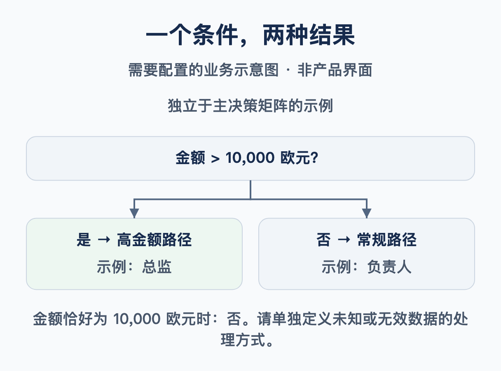<figcaption><p>独立的 IF-THEN 示例：金额严格大于 10,000 欧元时选择总监，否则选择负责人。相等时归入第二个分支。目标路径需要配置。</p></figcaption></figure>

对应概念图：[图示：一个条件，两种结果](#diagram-simple-if)。

<details>
<summary>IF-THEN 原理：一个条件，两种结果</summary>

```
IF condition:
  → 操作 A
ELSE:
  → 操作 B
```

</details>

**示例：**

对应概念图：[图示：一个条件，两种结果](#diagram-simple-if)。

<details>
<summary>IF-THEN 示例：金额阈值</summary>

```
IF Amount > €10,000:
  → 分配给总监
ELSE:
  → 分配给经理
```

</details>

#### 图示：与：全部满足 · 或：至少满足一项 {#diagram-conditions-and-or}

<figure>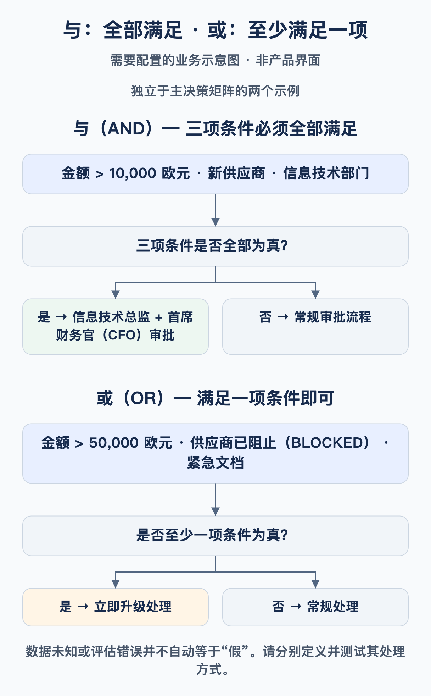<figcaption><p>两个独立示例：与（AND）要求三项条件全部满足；或（OR）要求至少一项满足。这些示例阈值不能替代完整决策矩阵中的金额区间。各输出路径，以及未知数据或错误的处理方式，都必须配置。</p></figcaption></figure>

### 2. 多个条件（AND 逻辑）

对应概念图：[图示：与：全部满足 · 或：至少满足一项](#diagram-conditions-and-or)。

<details>
<summary>AND 原理：所有条件均满足</summary>

```
IF condition1 AND condition2 AND condition3:
  → 操作 A
ELSE:
  → 操作 B
```

</details>

**示例：**

对应概念图：[图示：与：全部满足 · 或：至少满足一项](#diagram-conditions-and-or)。

<details>
<summary>AND 示例：三个条件</summary>

```
IF Amount > €10,000 AND Supplier = "New" AND Department = "IT":
  → 分配给 IT 总监 + CFO（双重审批）
ELSE:
  → 标准审批工作流
```

</details>

### 3. 替代条件（OR 逻辑）

对应概念图：[图示：与：全部满足 · 或：至少满足一项](#diagram-conditions-and-or)。

<details>
<summary>OR 原理：至少满足一项</summary>

```
IF condition1 OR condition2 OR condition3:
  → 操作 A
ELSE:
  → 操作 B
```

</details>

**示例：**

对应概念图：[图示：与：全部满足 · 或：至少满足一项](#diagram-conditions-and-or)。

<details>
<summary>OR 示例：金额、阻止状态或紧急标记</summary>

```
IF Amount > €50,000 OR Supplier is "Blocked" OR Document 带有 "Urgent" 标记:
  → 立即升级处理
ELSE:
  → 标准处理
```

</details>

### 4. 嵌套决策树

#### 图示：分两层作出决策 {#diagram-nested-type-amount}

<figure>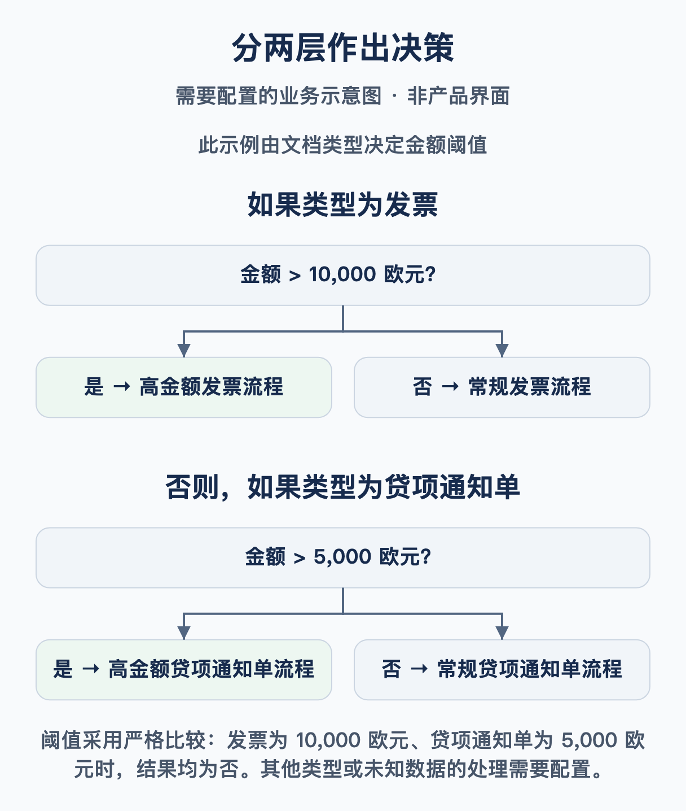<figcaption><p>独立的嵌套示例：文档类型决定金额判断。阈值采用严格比较：10,000 欧元的发票和 5,000 欧元的贷项通知单均不满足“大于”条件。请定义其他类型及未知数据的处理方式。</p></figcaption></figure>

对应概念图：[图示：分两层作出决策](#diagram-nested-type-amount)。

<details>
<summary>嵌套决策原理</summary>

```
IF condition1:
  IF condition2:
    → 操作 A
  ELSE:
    → 操作 B
ELSE:
  IF condition3:
    → 操作 C
  ELSE:
    → 操作 D
```

</details>

**示例：**

对应概念图：[图示：分两层作出决策](#diagram-nested-type-amount)。

<details>
<summary>嵌套示例：发票与贷项通知单</summary>

```
IF Document_Type = "Invoice":
  IF Amount > €10,000:
    → 高金额发票工作流
  ELSE:
    → 标准发票工作流
ELSE IF Document_Type = "Credit Note":
  IF Amount > €5,000:
    → 高金额贷项通知单工作流
  ELSE:
    → 标准贷项通知单工作流
```

</details>

***

## 完整工作流示例

### 场景：发票审批矩阵

**业务规则：**

1. 金额路由前先停止并处理关键异常，包括已阻止（BLOCKED）的供应商。采购订单差异不一定属于关键异常；采购部门解决后可按配置继续。随后检查文档类型。
2. 紧急发票采用此示例的加急流程。
3. 非紧急且金额有效的发票采用四个互不重叠的区间：金额 < €1,000 为自动审批；€1,000 ≤ 金额 < €10,000 为经理审批；€10,000 ≤ 金额 < €50,000 先检查供应商再进入总监路径；金额 ≥ €50,000 进入路径 D。
4. 供应商未被阻止（BLOCKED）且合作关系不足 180 天时，先由总监批准，才创建首席财务官（CFO）任务，再等待其明确批准。其他供应商仍需检查风险。
5. 金额缺失或无效时，进入显式配置的人工审查。这是此示例选择的策略，并非产品自动回退行为。
6. 创建任务不等于批准。拒绝会停止审批链并按配置处理；待审批不得继续。

**实施示例：** 技术名称和伪代码仅作示例，请适配当前版本实际提供的卡片、字段、运算符、角色和状态。它们并非可直接导入的文件。请核实执行结果与实际影响。

**实施：**

#### 图示：从文档到审批流程 {#diagram-flow-overview}

<figure>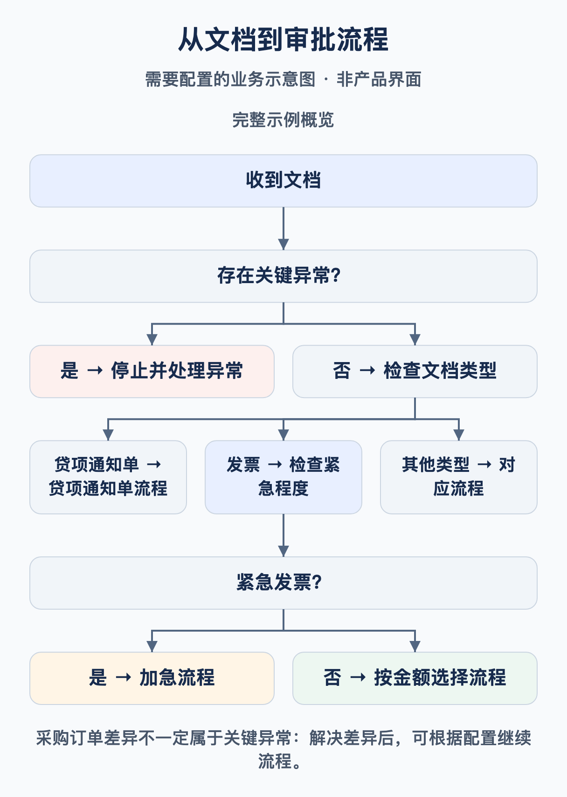<figcaption><p>完整示例概览：选择审批流程前，先检查关键异常、文档类型和紧急程度。每项处理及每条连接都必须配置；此图并不表示产品会自动执行这些操作。</p></figcaption></figure>

#### 图示：四个互不重叠的金额区间 {#diagram-amount-routing}

<figure>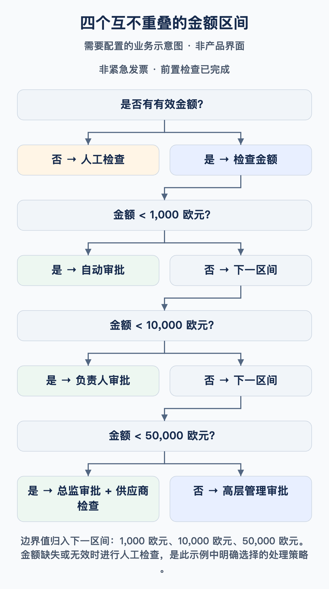<figcaption><p>第 2 层金额阈值：小于 1,000 欧元；大于或等于 1,000 欧元且小于 10,000 欧元；大于或等于 10,000 欧元且小于 50,000 欧元；大于或等于 50,000 欧元。每项判断都沿前一项判断的否定结果继续。金额缺失或无效时的人工检查必须显式配置。</p></figcaption></figure>

#### 图示：分析供应商 {#diagram-supplier-analysis}

<figure>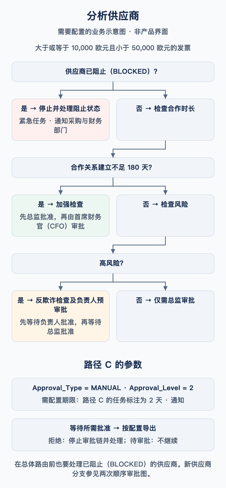<figcaption><p>供应商流程节选：先处理阻止状态（BLOCKED），再检查合作时长，最后检查风险。不足 180 天的分支参见两次顺序审批图。路径 C 的任务、期限、通知及动作仍需配置。</p></figcaption></figure>

#### 图示：路径 A：批准后导出 {#diagram-action-auto}

<figure>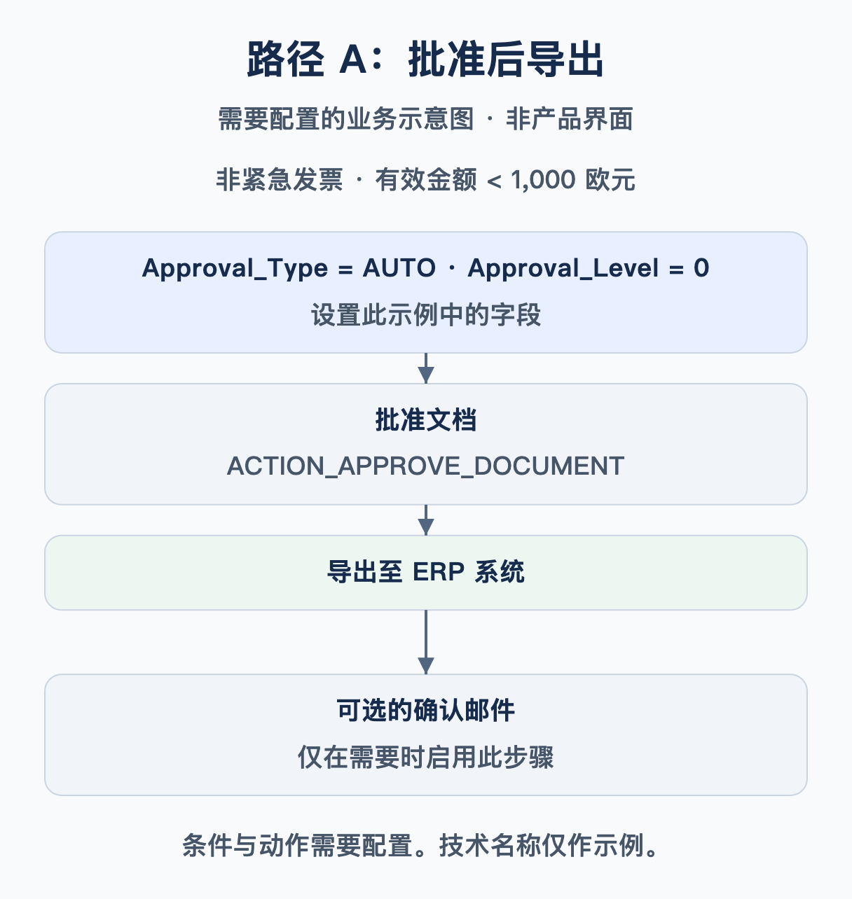<figcaption><p>示例路径 A：设置审批字段，批准文档，然后导出。确认邮件为可选步骤。此图描述需要配置的动作，并非已观察到的执行。</p></figcaption></figure>

#### 图示：路径 B：等待负责人审批 {#diagram-action-manager}

<figure>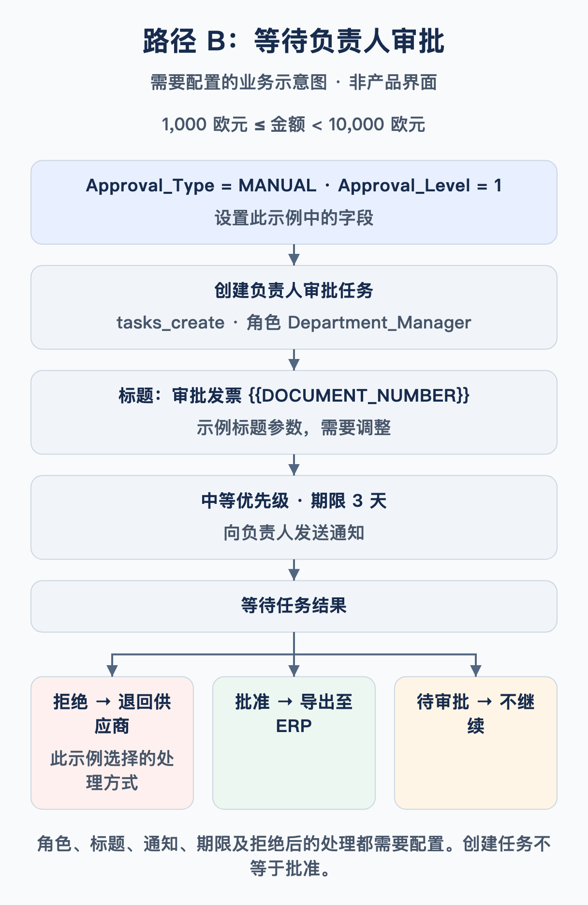<figcaption><p>示例路径 B：为负责人创建任务，发送通知并等待结果。只有批准后才可导出；此示例在拒绝后退回供应商。三天期限与接收人均为配置选择。</p></figcaption></figure>

#### 图示：路径 D：高层管理审批 {#diagram-action-executive}

<figure>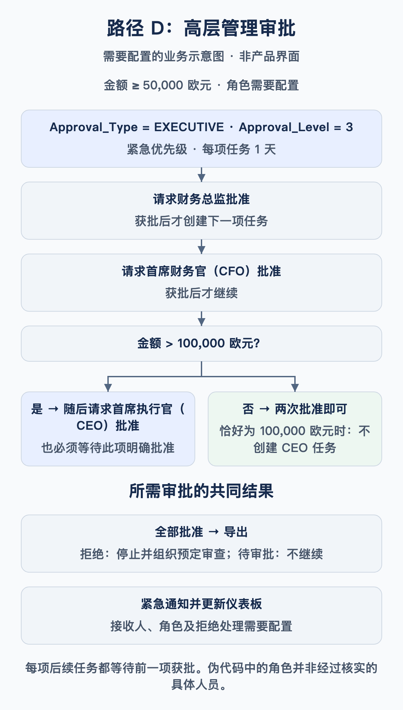<figcaption><p>示例路径 D：金额达到 50,000 欧元时进行两次顺序审批，只有超过 100,000 欧元才需要第三次。每项后续任务都等待前一项获批。角色、期限、通知及拒绝后的处理都必须配置。</p></figcaption></figure>

#### 图示：记录规则与例外 {#diagram-rule-documentation}

<figure>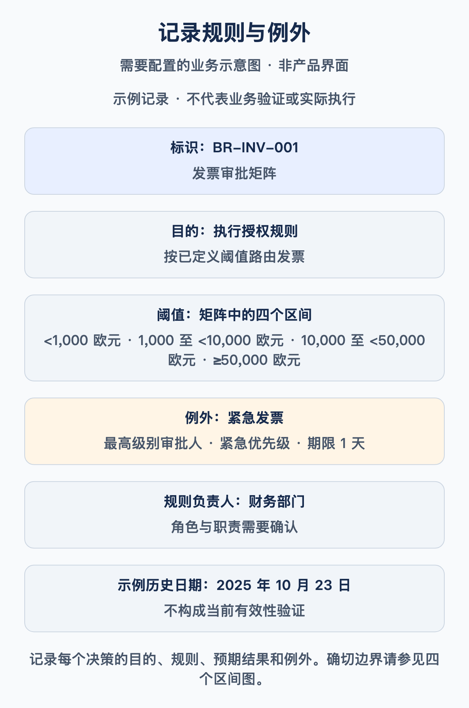<figcaption><p>规则 BR-INV-001 的示例记录：目的、阈值、例外、负责人及参考日期。引用四个区间可避免重复定义规则；此记录不能证明规则已获批准或已执行。</p></figcaption></figure>

对应概念图：[图示：从文档到审批流程](#diagram-flow-overview)、[图示：四个互不重叠的金额区间](#diagram-amount-routing)、[图示：分析供应商](#diagram-supplier-analysis)、[图示：路径 A：批准后导出](#diagram-action-auto)、[图示：路径 B：等待负责人审批](#diagram-action-manager)、[图示：路径 D：高层管理审批](#diagram-action-executive)、[图示：记录规则与例外](#diagram-rule-documentation)。

<details>
<summary>完整矩阵伪代码</summary>

```
预检：关键异常
  IF Critical_Exception = TRUE OR Supplier_Status = "BLOCKED":
    → 路由前停止并处理异常

步骤 1：检查采购订单不匹配
  IF PO_Match_Status = "FAIL":
    → 转交采购部门处理采购订单问题
    → 解决后，按配置继续

步骤 1b：检查文档类型
  IF Document_Type = "Credit Note":
    → 已配置的贷项通知单工作流
  ELSE IF Document_Type is not "Invoice":
    → 此文档类型对应的已配置工作流
  ELSE:
    → 继续以下步骤

步骤 2：检查紧急标记
  IF Urgent_Flag = TRUE:
    → 跳过金额检查
    → 转交最高级别审批人
    → 设置 priority = URGENT
    → Deadline: 1 天

步骤 3：按金额路由（非紧急发票）
  IF Amount 缺失或无效:
    → 人工审查（显式配置的示例策略）
    → 不进入金额区间
  ELSE IF Amount < €1,000:
    → 自动审批
    → 立即导出
  ELSE IF Amount < €10,000:
    → 创建经理审批任务
    → Priority: Medium
    → Deadline: 3 天
  ELSE IF Amount < €50,000:
    检查供应商状态与风险：
      IF Supplier_Status = "BLOCKED":
        → 停止并处理异常
      ELSE IF Supplier_Age < 180 天（新供应商）:
        → 创建总监审批任务（任务 1）
        → 总监明确批准后，才创建 CFO 审批任务（任务 2）
        → CFO 明确批准后才继续
        → 任何拒绝：停止审批链并按配置处理
        → 待审批：不继续
        → Priority: High
        → Deadline: 每项任务 2 天
      ELSE IF Supplier_Risk_Rating = "HIGH":
        → 额外检查与经理预审批
        → 经理批准后才进行总监审批
        → 待审批或拒绝：不继续审批链
      ELSE（现有供应商）:
        → 仅创建总监审批任务
        → Priority: High
        → Deadline: 2 天
  ELSE（Amount ≥ €50,000）:
    → 高管审批路径（参见路径 D）
```

</details>

***

## 分步实施

### 第 1 步：定义条件卡片

**条件 1：金额阈值**

#### 图示：理解两个独立条件 {#diagram-parameter-checks}

<figure>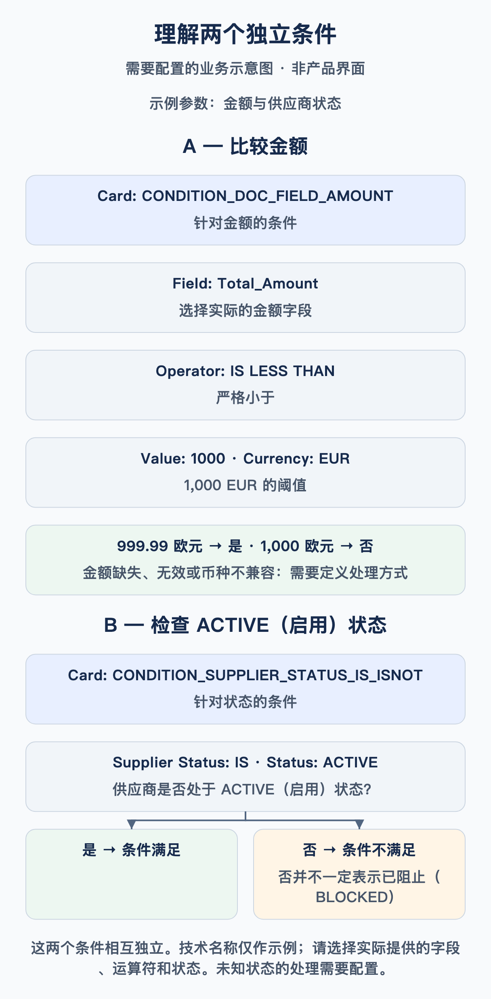<figcaption><p>两个独立条件：金额严格小于 1,000 EUR，以及供应商状态为 ACTIVE（启用）。金额相等时结果为否；状态不是 ACTIVE 的供应商并不一定已被阻止（BLOCKED）。技术参数仅作示例，必须适应实际配置。</p></figcaption></figure>

对应概念图：[图示：理解两个独立条件](#diagram-parameter-checks)。

<details>
<summary>示例参数：金额阈值</summary>

```
Card: CONDITION_DOC_FIELD_AMOUNT
Field: Total_Amount
Operator: IS LESS THAN
Value: 1000
Currency: EUR
```

</details>

**条件 2：文档类型检查**

#### 图示：按类型筛选并路由文档 {#diagram-document-type}

<figure>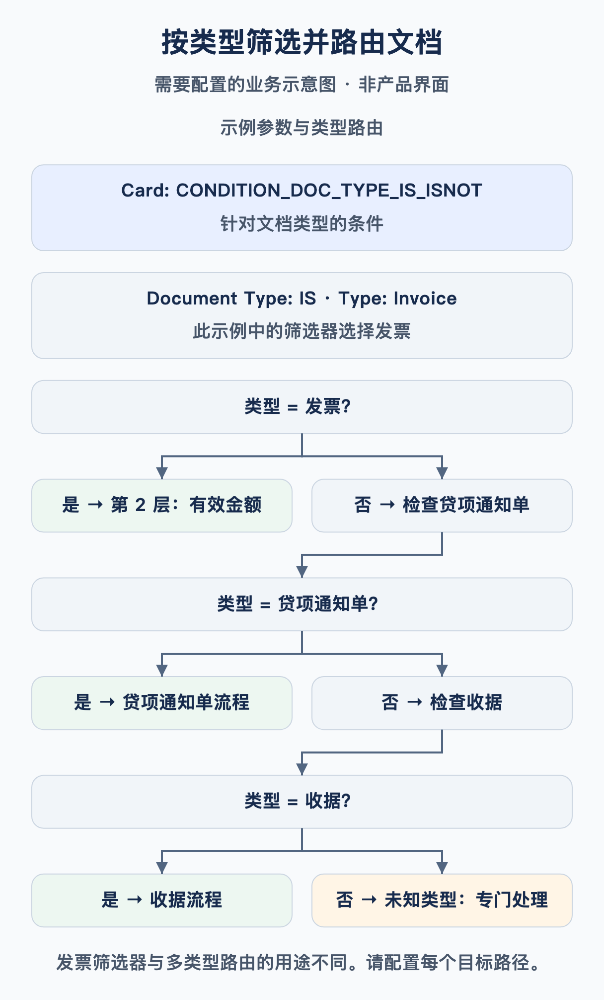<figcaption><p>发票筛选器与类型路由是此示例的两种互补读法。路由区分发票、贷项通知单、收据和未知类型。卡片与工作流名称仅作示例；每个目标路径都必须配置。</p></figcaption></figure>

对应概念图：[图示：按类型筛选并路由文档](#diagram-document-type)。

<details>
<summary>示例参数：文档类型</summary>

```
Card: CONDITION_DOC_TYPE_IS_ISNOT
Document Type: IS
Type: Invoice
```

</details>

**条件 3：供应商状态**

对应概念图：[图示：理解两个独立条件](#diagram-parameter-checks)。

<details>
<summary>示例参数：启用状态</summary>

```
Card: CONDITION_SUPPLIER_STATUS_IS_ISNOT
Supplier Status: IS
Status: ACTIVE
```

</details>

**条件 4：新供应商检查**

计算评估日期前 180 天的截止日期，再将供应商首次交易日期与之比较。IS AFTER 表示严格晚于，等于截止日期时结果为否。请另行验证日期有效且不晚于评估日期；缺失、无效及未来日期的处理需要配置。卡片、字段和 {{TODAY_MINUS_180_DAYS}} 仅作示例，须选择实际字段并计算或填入日期。

#### 图示：理解 180 天条件 {#diagram-supplier-date-180-days}

<figure>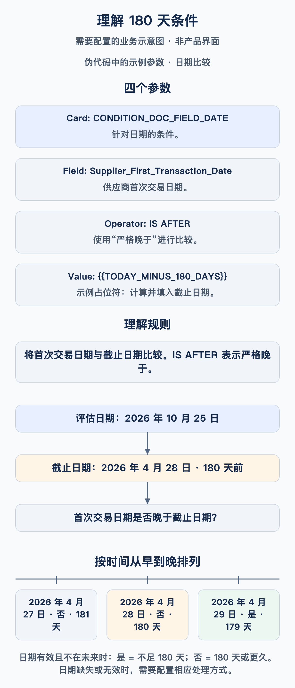<figcaption><p>日期比较示例：以 2026 年 10 月 25 日为评估日期，截止日期为 2026 年 4 月 28 日。IS AFTER 不包含相等情况：4 月 29 日的结果为“是”，4 月 28 日和 27 日的结果为“否”。卡片名称、字段名称及占位符 {{TODAY_MINUS_180_DAYS}} 均仅作示例：请选择实际字段，并计算或填入截止日期。此处假定日期有效且不在未来；日期缺失或无效时的处理仍需配置。</p></figcaption></figure>

对应概念图：[图示：理解 180 天条件](#diagram-supplier-date-180-days)。

<details>
<summary>复制此示例的日期参数</summary>

```
Card: CONDITION_DOC_FIELD_DATE
Field: Supplier_First_Transaction_Date
Operator: IS AFTER
Value: {{TODAY_MINUS_180_DAYS}}
```

</details>

**指南参考：**[条件卡片完整指南](../condition-cards-complete-guide.md)

***

### 第 2 步：构建决策树

**第 1 级：文档类型**

对应概念图：[图示：按类型筛选并路由文档](#diagram-document-type)。

<details>
<summary>示例文档类型路由</summary>

```
Workflow: "Invoice Processing"

IF Document_Type = "Invoice":
  → 继续到第 2 级

ELSE IF Document_Type = "Credit Note":
  → 转入 "Credit Note Processing" 工作流

ELSE IF Document_Type = "Receipt":
  → 转入 "Receipt Processing" 工作流

ELSE:
  → 转交 "Unknown Document Type" 处理流程
```

</details>

**第 2 级：金额阈值（适用于发票）**

对应概念图：[图示：四个互不重叠的金额区间](#diagram-amount-routing)。

<details>
<summary>第 2 层：金额区间</summary>

```
IF Amount < €1,000:
  → 转入 "Auto-Approve Path"（自动审批路径）

ELSE IF Amount < €10,000:
  → 转入 "Manager Approval Path"（经理审批路径）

ELSE IF Amount < €50,000:
  → 转入 "Director Approval Path"（总监审批路径）
  → 检查第 3 级条件

ELSE（Amount ≥ €50,000）:
  → 转入 "Executive Approval Path"（高管审批路径）
  → 需要双重或三重审批
```

</details>

**第 3 级：供应商分析（€10,000 ≤ 金额 < €50,000）**

对应概念图：[图示：分析供应商](#diagram-supplier-analysis)。

<details>
<summary>第 3 层：供应商分析</summary>

```
IF Supplier_Status = "BLOCKED":
  → 停止处理
  → 创建紧急升级任务
  → 通知采购部门和财务部门

ELSE IF Supplier_Age < 180 天（新供应商）:
  → 需要额外审批
  → 将 CFO 加入审批链
  → 加强验证

ELSE IF Supplier_Risk_Rating = "HIGH":
  → 需要额外检查
  → 进行欺诈检测审查
  → 由经理预先审批；等待明确批准
  → 总监审批；等待明确批准

ELSE:
  → 标准高金额工作流
```

</details>

***

### 第 3 步：创建路由操作

**路径 A：自动审批（金额 < €1,000）**

对应概念图：[图示：路径 A：批准后导出](#diagram-action-auto)。

<details>
<summary>路径 A：批准与导出</summary>

```
操作：
1. 设置字段 "Approval_Type" = "AUTO"
2. 设置字段 "Approval_Level" = "0"
3. ACTION_APPROVE_DOCUMENT
4. 导出到 ERP
5. 发送确认电子邮件（可选）
```

</details>

**路径 B：经理审批（€1,000 ≤ 金额 < €10,000）**

对应概念图：[图示：路径 B：等待负责人审批](#diagram-action-manager)。

<details>
<summary>路径 B：负责人任务</summary>

```
操作：
1. 设置字段 "Approval_Type" = "MANUAL"
2. 设置字段 "Approval_Level" = "1"
3. tasks_create:
   - Title: "审批发票 {{DOCUMENT_NUMBER}}"
   - Assign to: Department_Manager
   - Priority: Medium
   - Deadline: 3 天
4. 向经理发送电子邮件通知
5. 等待任务完成
6. 如果已批准：导出到 ERP
7. 如果已拒绝：退回供应商
```

</details>

**路径 C：总监审批（€10,000 ≤ 金额 < €50,000）**

#### 图示：两次批准，按序完成 {#diagram-approvals-sequence}

<figure>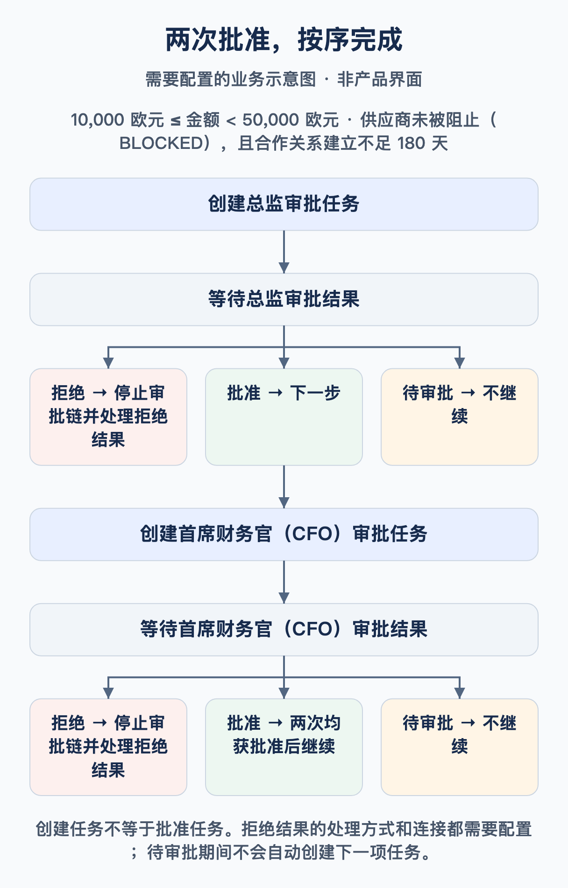<figcaption><p>依次审批示例：只有总监批准后，才创建首席财务官（CFO）审批任务，然后等待该任务的审批结果。只有两次均获批准后才继续。拒绝会停止审批链，并按配置处理；待审批状态不允许继续。</p></figcaption></figure>

对应概念图：[图示：分析供应商](#diagram-supplier-analysis)、[图示：两次批准，按序完成](#diagram-approvals-sequence)。

<details>
<summary>路径 C：供应商与总监审批</summary>

```
操作：
1. 设置字段 "Approval_Type" = "MANUAL"
2. 设置字段 "Approval_Level" = "2"
3. 检查 Supplier_Age 与 Supplier_Risk_Rating：
   IF 新供应商（< 180 天）：
     - 创建任务 1：由总监审批
     - 任务 1 明确批准后：才创建任务 2：由 CFO 审批
     - 等待任务 2 明确批准后才继续
     - 待审批：不继续
     - 任何拒绝：停止审批链并按配置处理
     - 需要双重审批
   ELSE IF Supplier_Risk_Rating = "HIGH":
     - 额外风险检查及经理预审批
     - 等待经理明确批准后，进行总监审批
     - 等待总监明确批准后才导出
     - 待审批或拒绝：停止推进并按配置处理
   ELSE:
     - 创建任务：仅由总监审批
4. Priority: High
5. Deadline: 路径 C 审批任务为 2 天；风险检查期限单独配置
6. 发送电子邮件通知
7. 等待完成
8. 如果全部获批：导出
9. 如果有任何一项被拒绝：退回供应商
```

</details>

**路径 D：高管审批（≥ €50,000）**

对应概念图：[图示：路径 D：高层管理审批](#diagram-action-executive)。

<details>
<summary>路径 D：高管顺序审批</summary>

```
操作：
1. 设置字段 "Approval_Type" = "EXECUTIVE"
2. 设置字段 "Approval_Level" = "3"
3. 顺序审批：
   - 任务 1：财务总监
   - 等待任务 1 明确批准，再创建任务 2：CFO
   - 等待任务 2 明确批准；只有金额 > €100,000 时才创建任务 3：CEO
   - 所有所需任务均明确批准后才继续；待审批或拒绝不得继续
4. Priority: Urgent
5. Deadline: 每项任务 1 天
6. 发送紧急通知
7. 更新高管仪表板
8. 等待所有审批完成
9. 如果全部获批：导出
10. 如果有任何一项被拒绝：召开高管审查会议
```

</details>

***

## 高级决策逻辑模式

### 模式 1：基于评分的路由

**独立评分变体：** 假定参与评分的数据已知；未知项不能自动计为 0。五项权重合计最高 100，只能产生部分 5 的倍数。51 和 76 是类别边界，而非这些权重实际产生的分数。

#### 图示：累加评分，然后路由 {#diagram-risk-score}

<figure>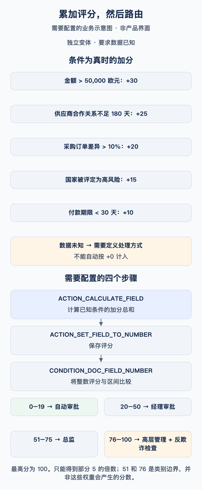<figcaption><p>独立变体：五项已知加分得到 0 至 100 的整数评分，再选择流程。51 和 76 是类别边界，并非这五项权重实际产生的分数。请单独定义未知数据的处理方式。</p></figcaption></figure>

对应概念图：[图示：累加评分，然后路由](#diagram-risk-score)。

<details>
<summary>独立变体：风险评分</summary>

```
风险评分计算：
  Score = 0

  IF Amount > €50,000: Score += 30
  IF Supplier_Age < 180 天: Score += 25
  IF PO_Variance > 10%: Score += 20
  IF Supplier_Country = "High Risk Country": Score += 15
  IF Payment_Terms < 30 天: Score += 10

  总分范围：0-100

路由：
  IF Score < 20: 自动审批
  IF Score 20-50: 经理审批
  IF Score 51-75: 总监审批
  IF Score > 75: 高管审批 + 欺诈检查
```

</details>

**实施：**

对应概念图：[图示：累加评分，然后路由](#diagram-risk-score)。

<details>
<summary>风险评分的配置步骤</summary>

```
1. ACTION_CALCULATE_FIELD：计算风险评分
2. ACTION_SET_FIELD_TO_NUMBER：存储评分
3. CONDITION_DOC_FIELD_NUMBER：检查评分阈值
4. 根据评分进行路由
```

</details>

***

### 模式 2：基于部门的矩阵

**独立部门变体：** 相等时进入更高级别。多个审批角色并不证明任务按顺序执行；需单独配置角色、顺序和未知部门的处理。

#### 图示：由部门决定阈值 {#diagram-department-matrix}

<figure>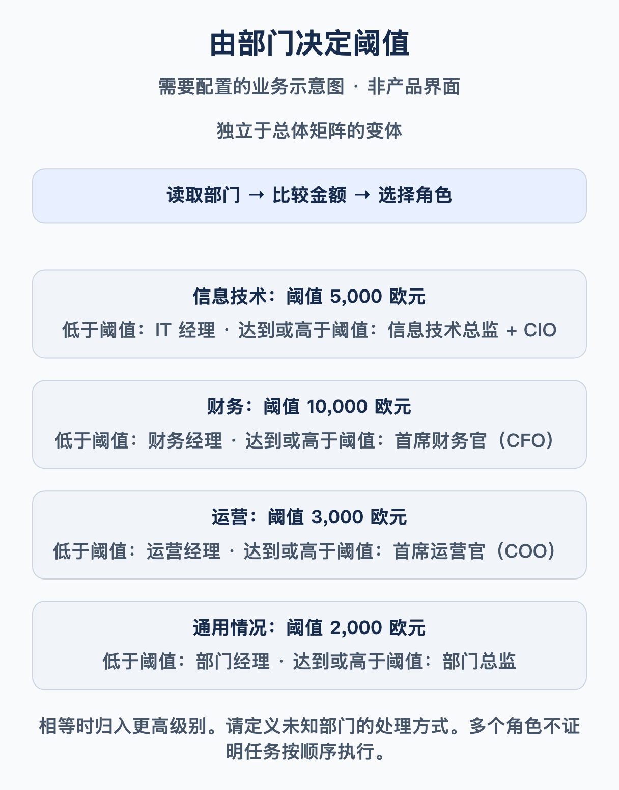<figcaption><p>独立的部门矩阵：信息技术、财务、运营及通用情况使用不同阈值。相等时选择更高区间。多个角色必须配置；列出多个角色并不证明审批按顺序执行。</p></figcaption></figure>

对应概念图：[图示：由部门决定阈值](#diagram-department-matrix)。

<details>
<summary>独立变体：部门矩阵</summary>

```
部门审批矩阵：

  IT 部门：
    Amount < €5,000：IT 经理
    Amount ≥ €5,000：IT 总监 + CIO

  财务部门：
    Amount < €10,000：财务经理
    Amount ≥ €10,000：CFO

  运营部门：
    Amount < €3,000：运营经理
    Amount ≥ €3,000：COO

  通用规则：
    Amount < €2,000：部门经理
    Amount ≥ €2,000：部门总监
```

</details>

**实施：**

对应概念图：[图示：由部门决定阈值](#diagram-department-matrix)。

<details>
<summary>部门路由的配置步骤</summary>

```
1. 检查 Department 字段
2. 根据部门检查金额阈值
3. 路由到相应的审批人
4. 为不同部门设置不同阈值
```

</details>

***

### 模式 3：基于时间的逻辑

**三个独立时间变体：** 日历、时区及确切工作时段边界需要配置。排队到下一工作日与转交值班审批人是需要选择的替代方案。“不在当前期间”不自动代表以前期间，应单独核实。

#### 图示：三种独立的时间规则 {#diagram-time-variants}

<figure>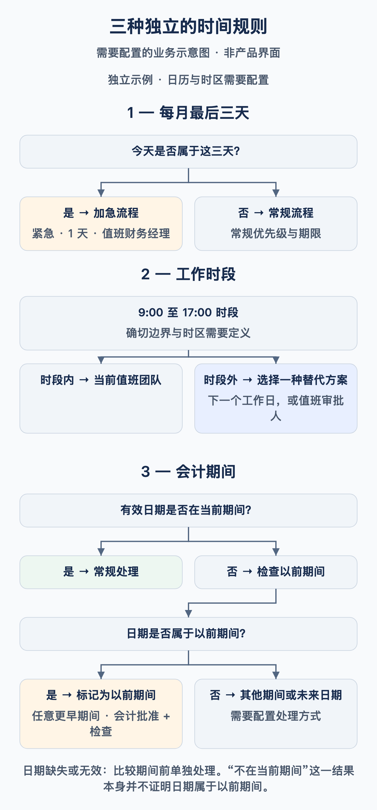<figcaption><p>三种独立变体：月末、工作时段和会计期间。排队与值班处理是需要选择的替代方案。不在当前期间的日期并不一定属于以前期间；必须单独核实。</p></figcaption></figure>

对应概念图：[图示：三种独立的时间规则](#diagram-time-variants)。

<details>
<summary>独立变体：时间规则</summary>

```
月末处理（月末最后 3 天）：
  IF Today 处于月末最后 3 天内：
    - Priority: URGENT
    - Deadline: 1 天
    - 审批人：当值财务经理
    - 加急工作流
  ELSE:
    - 标准优先级
    - 标准截止时间
    - 标准工作流

工作时间与非工作时间：
  IF Time 在上午 9 时至下午 5 时之间：
    - 分配给当前班次
  ELSE:
    - 排入下一个工作日的队列
    - OR 转交给值班审批人

财务期间（独立的示例策略）：
  IF Document_Date 缺失或无效：
    - 按配置处理无效或未知日期
  ELSE IF Document_Date in Current_Fiscal_Period：
    - 标准处理
  ELSE IF Document_Date in 早于 Current_Fiscal_Period 的任意 Fiscal_Period：
    - 标记为 "Prior Period"
    - 需要会计审批
    - 进行额外检查
  ELSE:
    - 未来或其他财务期间：按配置处理
```

</details>

***

### 模式 4：基于异常的路由

**严重程度策略示例：** 采购订单差异不自动属于关键异常；检测类型并不决定严重程度。仅允许明确授权的自动修复，修复或解决后才继续。

#### 图示：按严重程度处理 {#diagram-exception-severity}

<figure>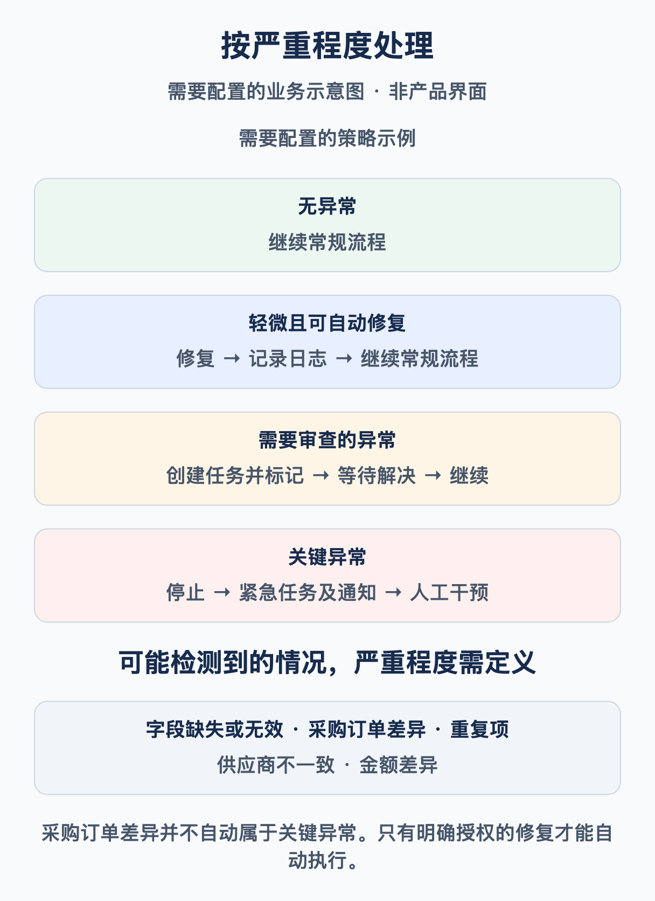<figcaption><p>严重程度策略示例：只有按预定方式修复或等待问题解决后才继续。关键异常会停止处理。检测示例本身并不能决定严重程度。</p></figcaption></figure>

对应概念图：[图示：按严重程度处理](#diagram-exception-severity)。

<details>
<summary>异常与严重程度策略</summary>

```
异常检测：

  无异常：
    → 标准工作流

  轻微异常（可自动修复）：
    → 自动更正
    → 记录更正内容
    → 继续标准工作流

  中等异常（需要审查）：
    → 创建审查任务
    → 标记文档
    → 修复后：继续工作流

  严重异常（需要升级处理）：
    → 停止处理
    → 创建紧急任务
    → 通知多个级别的相关人员
    → 需要人工干预

异常类型：
  - 缺少必填字段
  - 字段值无效
  - 采购订单不匹配
  - 重复发票
  - 供应商不匹配
  - 金额差异
```

</details>

***

## 完整决策逻辑图

对应概念图：[图示：从文档到审批流程](#diagram-flow-overview)、[图示：四个互不重叠的金额区间](#diagram-amount-routing)、[图示：分析供应商](#diagram-supplier-analysis)、[图示：两次批准，按序完成](#diagram-approvals-sequence)。

<details>
<summary>完整决策逻辑树</summary>

```
发票到达
│
├─ 第 1 级：异常检查
│  │
│  ├─ 是否存在关键异常或被阻止（BLOCKED）的供应商？
│  │  （严重程度必须配置；采购订单不匹配并不一定是关键异常。）
│  │  │
│  │  ├─ 是 → 停止并升级处理
│  │  │        创建紧急任务
│  │  │        通知管理员
│  │  │        → 结束（异常处理）
│  │  │
│  │  └─ 否 → 继续到第 2 级
│
├─ 第 2 级：文档类型
│  │
│  ├─ 类型 = Invoice？
│  │  └─ 是 → 继续到第 3 级
│  │
│  ├─ 类型 = Credit Note？
│  │  └─ 是 → 转入贷项通知单工作流
│  │           → 结束（贷项通知单路径）
│  │
│  └─ 其他类型？
│     └─ 是 → 转入相应工作流
│              → 结束（其他类型路径）
│
├─ 第 3 级：紧急程度检查（针对发票）
│  │
│  ├─ Urgent Flag = TRUE？
│  │  │
│  │  ├─ 是 → 加急工作流
│  │  │        Priority: URGENT
│  │  │        Deadline: 1 天
│  │  │        分配给：最高级别审批人
│  │  │        → 结束（加急路径）
│  │  │
│  │  └─ 否 → 继续到第 4 级
│
├─ 第 4 级：金额阈值
│  │
│  ├─ Amount 缺失或无效？
│  │  ├─ 是 → 人工审查（显式示例策略）
│  │  └─ 否 → 继续以下金额区间
│  │
│  ├─ Amount < €1,000？
│  │  │
│  │  ├─ 是 → 自动审批路径
│  │  │        设置 Approval_Type = "AUTO"
│  │  │        立即批准
│  │  │        导出到 ERP
│  │  │        → 结束（自动批准）
│  │  │
│  │  └─ 否 → 继续
│  │
│  ├─ Amount < €10,000？
│  │  │
│  │  ├─ 是 → 经理审批路径
│  │  │        为经理创建任务
│  │  │        Priority: Medium
│  │  │        Deadline: 3 天
│  │  │        → 等待审批结果；待审批不得继续
│  │  │           → 批准：按配置继续
│  │  │           → 拒绝：停止审批链并按配置处理
│  │  │           → 结束（经理路径）
│  │  │
│  │  └─ 否 → 继续
│  │
│  ├─ Amount < €50,000？
│  │  │
│  │  ├─ 是 → 总监审批路径
│  │  │        继续到第 5 级（供应商检查）
│  │  │
│  │  └─ 否 → 继续
│  │
│  └─ Amount ≥ €50,000？
│     │
│     └─ 是 → 高管审批路径
│              按顺序创建任务：
│              - 财务总监
│              - CFO
│              - CEO（如果 > €100,000）
│              Priority: URGENT
│              Deadline: 每项任务 1 天
│              → 等待所有必需审批；各后续任务仅在前项批准后创建
│              → 全部批准：按配置继续
│              → 待审批：不继续
│              → 任何拒绝：停止审批链并按配置处理
│                 → 结束（高管路径）
│
├─ 第 5 级：供应商分析（€10,000 ≤ Amount < €50,000）
│  │
│  ├─ Supplier Status = "BLOCKED"？
│  │  │
│  │  ├─ 是 → 阻止并升级处理
│  │  │        停止处理
│  │  │        创建紧急任务
│  │  │        通知采购部门和财务部门
│  │  │        → 结束（供应商已阻止）
│  │  │
│  │  └─ 否 → 继续
│  │
│  ├─ Supplier Age < 180 天（新供应商）？
│  │  │
│  │  ├─ 是 → 需要双重审批
│  │  │        任务 1：总监（2 天）
│  │  │        → 等待任务 1
│  │  │           IF 任务 1 已批准：
│  │  │             任务 2：CFO（2 天）
│  │  │             → 等待任务 2
│  │  │                → 任务 2 明确批准：只有两次均批准后才继续
│  │  │                → 待审批：不继续
│  │  │                → 拒绝：停止审批链并按配置处理
│  │  │           IF 任务 1 已拒绝：
│  │  │             → 停止审批链并按配置处理拒绝
│  │  │           IF 任务 1 待审批：
│  │  │             → 不创建任务 2，也不继续
│  │  │
│  │  └─ 否 → 继续
│  │
│  ├─ Supplier Risk Rating = "HIGH"？
│  │  │
│  │  ├─ 是 → 加强审批
│  │  │        进行额外欺诈检查
│  │  │        先由经理预审批，再由总监审批；逐项等待明确批准
│  │  │        风险检查期限单独配置；路径 C 审批任务为 2 天
│  │  │        → 结束（加强审批路径）
│  │  │
│  │  └─ 否 → 标准总监审批
│  │           为总监创建任务
│  │           Priority: High
│  │           Deadline: 2 天
│  │           → 等待审批结果；待审批不得继续
│  │  │           → 批准：按配置继续
│  │  │           → 拒绝：停止审批链并按配置处理
│  │              → 结束（标准高金额路径）
│  │
│  └─ [供应商分析完成]
│
└─ [所有决策级别均已处理]
```

</details>

***

## 配置最佳实践

### 1. 保持逻辑清晰且易于维护

#### 图示：让决策便于阅读 {#diagram-staged-maintainability}

<figure>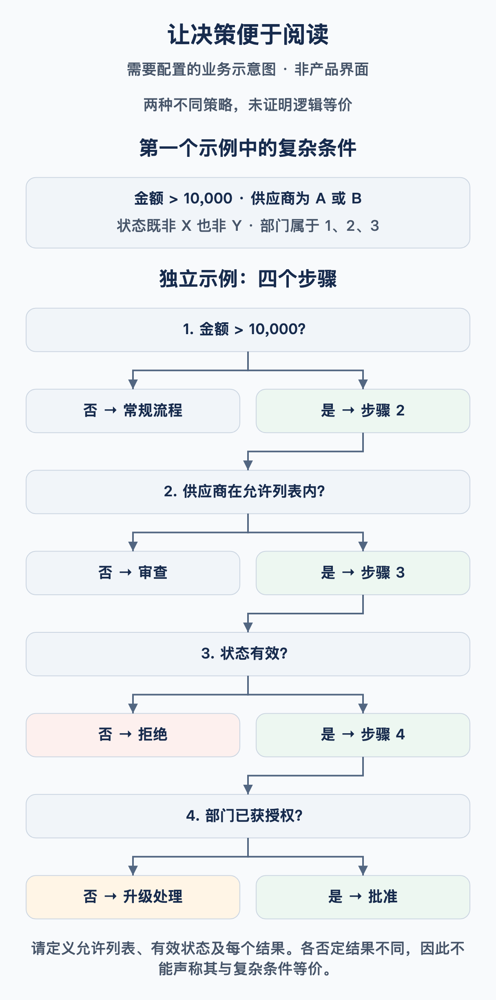<figcaption><p>四步示例展示与复杂条件不同的策略。它明确呈现每个否定结果；并未证明这是一种逻辑等价转换。请定义允许列表及输出处理方式。</p></figcaption></figure>

✅ **良好示例：**

对应概念图：[图示：一个条件，两种结果](#diagram-simple-if)。

<details>
<summary>可维护性：简单条件</summary>

```
IF Amount > 10000:
  → 高金额路径
ELSE:
  → 标准路径
```

</details>

❌ **不良示例（过于复杂）：**

对应概念图：[图示：让决策便于阅读](#diagram-staged-maintainability)。

<details>
<summary>可维护性：复杂条件</summary>

```
IF (Amount > 10000 AND (Supplier = "A" OR Supplier = "B") AND NOT (Status = "X" OR Status = "Y") AND Department IN [1,2,3]):
  → 复杂路径
```

</details>

**另一个示例：分四步表达不同策略。各否定结果不同，不能据此断言它与上面的复杂条件逻辑等价。**

对应概念图：[图示：让决策便于阅读](#diagram-staged-maintainability)。

<details>
<summary>独立策略：四个决策步骤</summary>

```
步骤 1：IF Amount > 10000：继续，ELSE：标准路径
步骤 2：IF Supplier 在允许列表中：继续，ELSE：审核
步骤 3：IF Status 有效：继续，ELSE：拒绝
步骤 4：IF Department 已授权：批准，ELSE：升级处理
```

</details>

***

### 2. 记录决策逻辑

**务必包含：**

* 每个决策点的用途
* 所实施的业务规则
* 预期结果
* 异常处理

**文档示例：**

对应概念图：[图示：记录规则与例外](#diagram-rule-documentation)。

<details>
<summary>规则记录示例</summary>

```
决策点：金额阈值检查
业务规则：BR-INV-001（发票审批矩阵）
用途：依据公司的政策，按金额阈值路由发票
阈值：
  < €1,000：自动审批（CFO 批准的阈值）
  €1,000 ≤ Amount < €10,000：经理审批（授权矩阵）
  €10,000 ≤ Amount < €50,000：总监审批与供应商检查
  Amount ≥ €50,000：高管审批
例外情况：紧急发票跳过常规级别，直接转至最高级别
更新日期：2025-10-23
负责人：财务部门
```

</details>

***

### 3. 测试所有路径

**测试矩阵：**

| 测试用例 | 金额   | 类型        | 供应商 | 预期路径         | 状态 |
| -------- | ------ | ----------- | ------ | ---------------- | ---- |
| TC1      | €500   | 发票        | 现有   | 自动审批         | 待验证    |
| TC2      | €5,000 | 发票        | 现有   | 经理             | 待验证    |
| TC3      | €15,000 | 发票       | 新供应商 | 总监+CFO         | 待验证    |
| TC4      | €60,000 | 发票       | 现有   | 高管             | 待验证    |
| TC5      | €2,000 | 贷项通知单  | 现有   | 贷项工作流       | 待验证    |
| TC6      | €100,000 | 发票     | 已阻止 | 停止并升级       | 待验证    |

这些是预期结果，仍需在您的配置中验证。

***

### 4. 监控决策指标

**跟踪：**

* 各决策路径的分布情况
* 自动审批率
* 人工审核率
* 各路径的平均处理时间
* 异常率
* 路径使用率

**虚构指标示例，非 DocBits 实测性能：** 四条流程合计 1,250 张发票，百分比四舍五入为 54/34/10/2。15 个异常占 1.2%，可与同批发票重叠，不构成第五条流程。

#### 图示：理解监控示例 {#diagram-fictional-metrics}

<figure>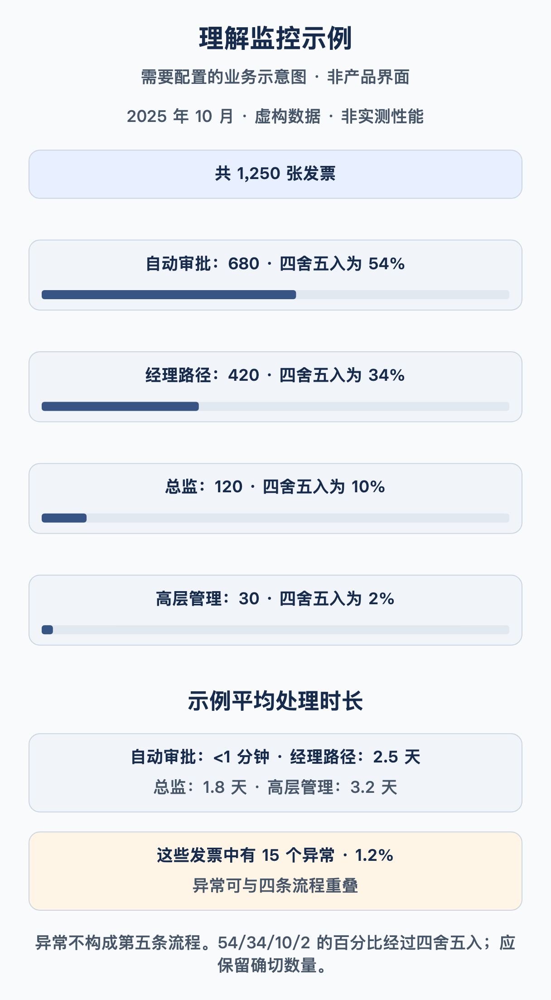<figcaption><p>虚构示例：四条流程合计 1,250 张发票。流程占比经过四舍五入。15 个异常占 1.2%，可能涉及同一批发票，不构成第五条流程。处理时长并非 DocBits 的实测性能。</p></figcaption></figure>

对应概念图：[图示：理解监控示例](#diagram-fictional-metrics)。

<details>
<summary>虚构监控指标示例</summary>

```
月份：2025 年 10 月
发票总数：1250

决策路径分布：
- 自动批准（< €1k）：680（54%）
- 经理路径（€1k ≤ Amount < €10k）：420（34%）
- 总监路径（€10k ≤ Amount < €50k）：120（10%）
- 高管路径（Amount ≥ €50k）：30（2%）

处理时间：
- 自动审批：< 1 分钟
- 经理路径：平均 2.5 天
- 总监路径：平均 1.8 天
- 高管路径：平均 3.2 天

异常：15（1.2%）
```

</details>

***

## 相关模式

### 可配合使用的模式：

* [**任务管理模式**](task-management-pattern.md) - 根据决策创建任务
* [**API 集成模式**](api-integration-pattern.md) - 获取决策所需的数据
* [**采购订单匹配模式**](po-matching-pattern.md) - 在决策中使用采购订单匹配结果
* [**数据转换模式**](data-transformation-pattern.md) - 在决策前转换数据

***

## 相关指南

### 前置条件

* [条件卡片完整指南](../condition-cards-complete-guide.md) - 所有条件卡片
* [字段操作指南](../field-manipulation-guide.md) - 字段操作
* [分配用户指南](../assignment-user-guide.md) - 路由逻辑

### 相关卡片

* **CONDITION\_DOC\_FIELD\_AMOUNT** - [条件卡片指南](../condition-cards-complete-guide.md)
* **CONDITION\_DOC\_TYPE\_IS\_ISNOT** - [条件卡片指南](../condition-cards-complete-guide.md)
* **CONDITION\_SUPPLIER\_STATUS\_IS\_ISNOT** - [条件卡片指南](../condition-cards-complete-guide.md)
* **ACTION\_ASSIGN\_TO\_USER** - [分配指南](../assignment-user-guide.md)
* **tasks\_create** - [任务分配指南](../task-assignment-guide.md)

### 后续步骤

* 创建任务：[任务管理模式](task-management-pattern.md)
* 添加复杂匹配：[采购订单匹配模式](po-matching-pattern.md)
* 集成 API：[API 集成模式](api-integration-pattern.md)

***

**模式版本：**1.0 **最后更新：**2025 年 10 月 23 日 **难度：**中等 **预计时间：**30-45 分钟
