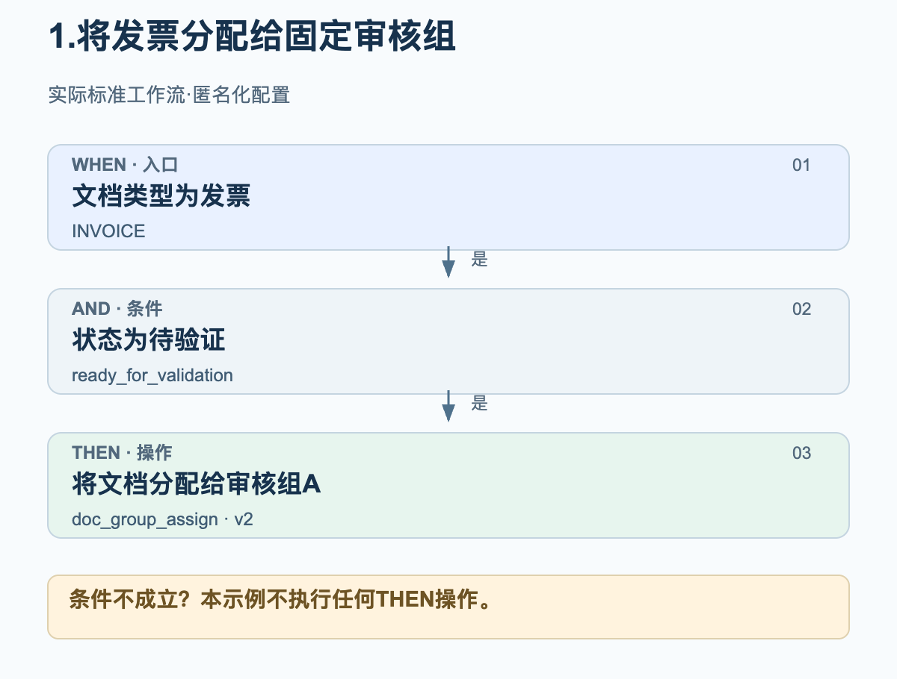
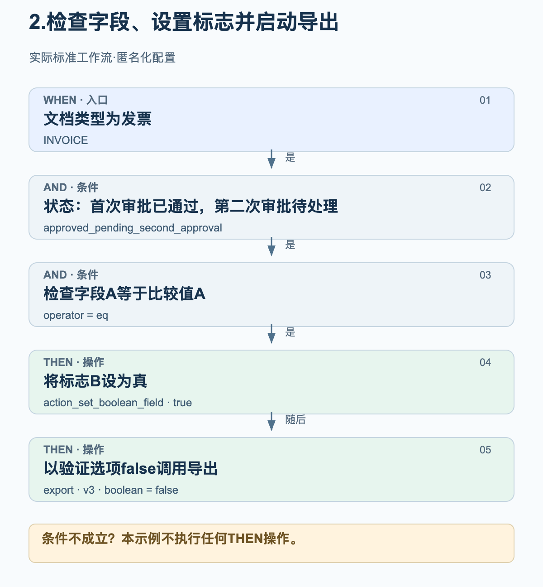
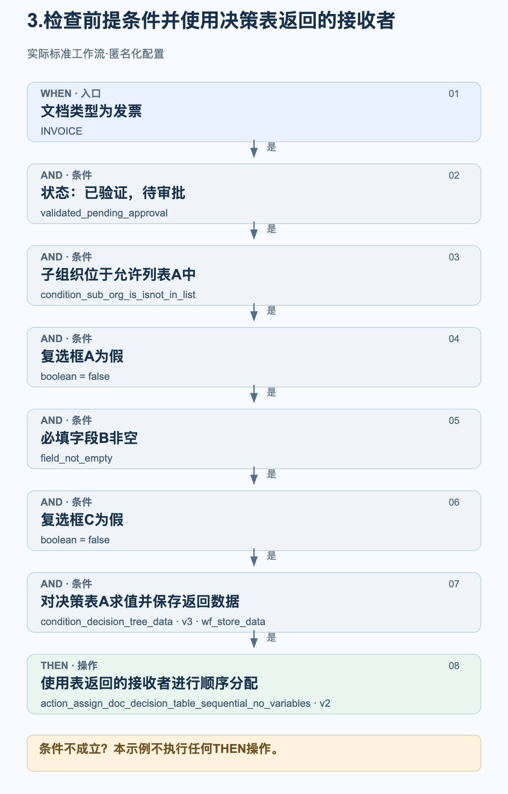

# 来自实际生产环境的工作流示例

以下三个示例来自生产环境中已启用的标准工作流，展示实际配置的 WHEN、AND 和 THEN 顺序。组、组织、字段名、比较值和决策表均已替换为中性名称。图示用于解释配置，并非界面截图。

核验日期：2026年10月27日。所用卡片、版本、参数及其顺序均已与成功生产运行所保存的配置核对。结果为 success 的工作流日志既不能证明人工审批已完成，也不能证明 ERP 已收到数据。核验期间未修改工作流，也未为测试而运行工作流。

## 如何阅读图示

这些示例使用标准模式。WHEN 限定文档类型；只有全部 AND 条件成立，才会执行后续 THEN 操作。在这些示例中，任一条件不成立都不会执行 THEN 操作。操作之间的箭头表示配置的执行顺序，并不代表额外的成功检查或审批步骤。运行也可能以错误结束。

## 1. 将发票分配给固定审核组

当发票达到“待验证”状态时，将其发送到固定配置的组进行审核。本示例不需要决策表。

<figure><figcaption>当文档为发票且状态符合要求时，文档会被分配给固定配置的审核组 A。分配不代表审批已通过。</figcaption></figure>

卡片与设置

| 阶段 / 卡片 | 示例设置 | 含义 |
| --- | --- | --- |
| WHEN · condition_doc_type_is_isnot_list · v2 | operator = is; doc_type = INVOICE | 只有发票符合此条件。 |
| AND · condition_doc_status_is_isnot · v2 | operator = is; status = ready_for_validation | 文档已准备好进行验证。 |
| THEN · doc_group_assign · v2 | groups = 审核组 A | 版本 2 使用已配置的组。决策表选项在此卡片版本中不起决定作用。 |

### 复现配置时的检查事项

- 审核组 A 是匿名化名称。请选择自己组织中的组，并核实其职责。
- 分别检查文档类型和状态：处于其他状态的发票不符合本示例条件。
- 文档分配、任务和审批是不同的操作。本配置只包含分配。

## 2. 检查字段、设置标志并启动导出

只有当检查字段 A 与比较值 A 完全一致时，才继续处理处于指定审批状态的发票。随后，工作流会尝试将标志 B 设为真，再调用导出。原始字段名和比较值均已匿名化。

<figure><figcaption>字段检查通过后才会执行这两个操作。首先调用设置标志的操作，随后调用导出。所用状态和停用验证检查的设置属于这一具体配置。</figcaption></figure>

卡片与设置

| 阶段 / 卡片 | 示例设置 | 含义 |
| --- | --- | --- |
| WHEN · condition_doc_type_is_isnot_list · v2 | operator = is; doc_type = INVOICE | 只有发票符合此条件。 |
| AND · condition_doc_status_is_isnot · v2 | operator = is; status = approved_pending_second_approval | 配置的状态表示“首次审批已通过，第二次审批待处理”。此处不会将其替换为更笼统的审批状态。 |
| AND · condition_docfield_operator_value · v2 | field_name = 检查字段 A; operator = eq; field_value = 比较值 A | 字段内容必须等于配置的值；此条件不只是检查字段是否已填写。 |
| THEN 1 · action_set_boolean_field · v2 | field_name = 标志 B; boolean = true | 尝试将配置的布尔字段设为真。 |
| THEN 2 · export · v3 | boolean = false | 启动导出，并设置 ignore_field_validation_errors = true 和 validate_po_match = false。此处的 false 停用的是验证检查，而非导出。 |

### 复现配置时的检查事项

- 导出选项 false 是特定客户的设置，并非通用建议。复现配置前，尤其需要检查字段验证、采购订单匹配和审批要求。
- 设置标志与导出之间没有配置其他条件。执行顺序本身并不保证第一个操作成功；异常和操作错误需要单独检查。
- 本工作流不包含等待第二次人工审批的步骤。工作流运行成功不能替代 ERP 已收到数据的证明。

## 3. 检查前提条件并使用决策表返回的接收者

只有当组织、状态、两个复选框和一个必填字段均符合要求时，才通过决策表分配发票。工作流会保存决策表的返回数据，供后续顺序分配使用。

<figure><figcaption>六个 AND 条件必须全部成立。决策表的返回数据会被保存，随后用于文档的顺序分配。图示未虚构接收者或审批层级。</figcaption></figure>

卡片与设置

| 阶段 / 卡片 | 示例设置 | 含义 |
| --- | --- | --- |
| WHEN · condition_doc_type_is_isnot_list · v2 | operator = is; doc_type = INVOICE | 将本示例限定为发票。 |
| AND 1 · condition_doc_status_is_isnot · v2 | operator = is; status = validated_pending_approval | 文档已验证，尚待审批。 |
| AND 2 · condition_sub_org_is_isnot_in_list · v2 | operator = is; sub_org_id = 允许列表 A | 仅配置的子组织属于适用范围。 |
| AND 3 · condition_checkbox_is · v2 | field_name = 复选框 A; boolean = false | 第一个配置的复选框必须为假。 |
| AND 4 · condition_docfield_status · v2 | field_name = 必填字段 B; field_status = field_not_empty | 配置的字段必须已填写。 |
| AND 5 · condition_checkbox_is · v2 | field_name = 复选框 C; boolean = false | 第二个复选框也必须为假。 |
| AND 6 · condition_decision_tree_data · v3 | decision_table = 决策表 A; store_data = wf_store_data | 针对该文档对决策表求值，并保存返回数据供后续卡片使用。额外保留的旧版 boolean 字段为空，不控制此版本的行为。 |
| THEN · action_assign_doc_decision_table_sequential_no_variables · v2 | 无卡片自身变量 | 使用已保存的决策表返回数据中的接收者进行顺序分配。接收者及其优先级取决于该表。 |

### 复现配置时的检查事项

- 复选框 A、必填字段 B 和复选框 C 分别表示三个不同的配置字段。这些中性名称替代了原始名称。
- 字段非空检查并不能证明字段内容在业务上正确。
- 请检查实际决策表，包括接收者和优先级。此处不公开其规则，也不虚构金额阈值或角色。
- 决策表求值成功并不保证返回了可用的接收者。后续分配需要有效的用户或组输出。
- 顺序分配不能证明人工审批已完成。本工作流不包含导出调用。

## 将示例用于自己的配置

请在自己的组织中确定适用的字段、组和决策表。不要将这些中性名称当作产品中已存在的字段。请在合适的测试环境中检查每个条件成立和不成立的情况，以及操作错误。根据实际结果核验审批和导出；仅在业务验收通过后启用工作流。

[生产环境中的高级工作流示例](advanced-production-workflow-examples.md)
