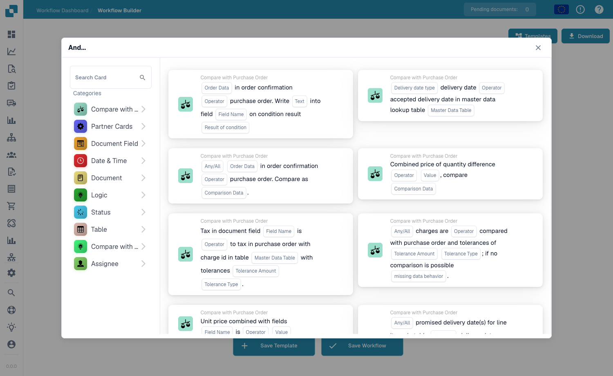

# 任务管理模式

**模式类型：**工作流管理 **复杂度：**低-中 **预计设置时间：**30-45 分钟 **常见用例：**审批工作流、审核任务、异常处理、升级

***

在 **Workflow Builder**（工作流仪表板 → 工作流列表 → 添加工作流）中构建此模式。点击 **Add Card** 打开卡片库，然后选择此模式使用的卡片 — `tasks_create`、`ACTION_ASSIGN_TO_USER`、`ACTION_SEND_EMAIL_TO_GROUPS` 和 `CONDITION_TASK_STATUS`（**Assignee** 类别中包含任务和分配卡片）：

<figure><figcaption><p><strong>Add Card</strong> 卡片库 — 任务、分配和通知卡片位于 <strong>Assignee</strong> 和 <strong>Status</strong> 类别下。</p></figcaption></figure>

***

## 模式概述

此模式演示如何在 DocBits 工作流中创建、分配、跟踪和管理任务。任务是分配给用户或群组的可执行工作项，必须完成后文档工作流才能继续。

**此模式的作用：**

1. 根据工作流条件创建任务
2. 将任务分配给合适的用户或群组
3. 设置任务属性（优先级、截止日期、描述）
4. 在创建任务时发送通知
5. 跟踪任务状态和完成情况
6. 根据任务结果路由文档

***

## 何时使用此模式

在以下情况下使用此模式：

* ✅ 创建审批工作流
* ✅ 将审核任务分配给用户
* ✅ 处理需要人工介入的异常
* ✅ 将问题升级给经理
* ✅ 创建多级审批链
* ✅ 跟踪谁需要处理什么
* ✅ 为操作设置截止日期

**以下情况不要使用此模式：**

* ❌ 不需要人工操作（改用自动处理）
* ❌ 只需要发送通知（改用电子邮件）
* ❌ 只需进行简单的文档路由（改用分配）

***

## 完整工作流示例

### 场景：按金额路由的发票审批

**业务需求：**

* 发票 < €1,000：自动审批（无需任务）
* 发票 €1,000-€10,000：向经理分配审批任务
* 发票 > €10,000：双重审批（经理 + 总监）
* 所有审批人都会收到电子邮件通知
* 任务截止期限为 3 天

**使用的工作流卡片：**

1. CONDITION\_DOC\_FIELD\_AMOUNT - 检查发票金额
2. tasks\_create - 创建审批任务
3. ACTION\_ASSIGN\_TO\_USER - 将任务分配给审批人
4. ACTION\_SEND\_EMAIL\_TO\_GROUPS - 发送通知
5. CONDITION\_TASK\_STATUS - 检查任务是否已完成
6. ACTION\_APPROVE\_DOCUMENT - 任务完成后审批

***

## 分步实施

### 步骤 1：检查金额阈值

**卡片：**CONDITION\_DOC\_FIELD\_AMOUNT 或类似的字段条件

**路径 1（< €1,000）的配置：**

```
字段: Total_Amount
运算符: IS LESS THAN
值: 1000
货币: EUR
```

**路径 2（€1,000-€10,000）的配置：**

```
字段: Total_Amount
运算符: IS BETWEEN
最小值: 1000
最大值: 10000
货币: EUR
```

**路径 3（> €10,000）的配置：**

```
字段: Total_Amount
运算符: IS GREATER THAN
值: 10000
货币: EUR
```

**指南参考：**[条件卡片完整指南](../condition-cards-complete-guide.md)

***

### 步骤 2A：自动审批小额发票（< €1,000）

**小额无需创建任务**

**卡片：**

* ACTION\_SET\_FIELD\_TO\_TEXT
  * 将 "Approval\_Type" 设为 "AUTO"
  * 将 "Approval\_Reason" 设为 "Amount below threshold"
* ACTION\_APPROVE\_DOCUMENT

**结果：**文档自动获批，不会创建任务

***

### 步骤 2B：创建经理审批任务（€1,000-€10,000）

**卡片：**tasks\_create（推荐 v4）

**配置：**

```json
{
  "task_type": "Approval",
  "task_title": "Approve Invoice {{DOCUMENT_NUMBER}} - €{{Total_Amount}}",
  "task_description": "Please approve invoice from {{Supplier_Name}}\n\nAmount: €{{Total_Amount}}\nInvoice Number: {{Invoice_Number}}\nInvoice Date: {{Invoice_Date}}\n\nReview and approve within 3 business days.",
  "priority": "Medium",
  "deadline_days": 3,
  "assign_to": "{{DOCUMENT_FIELD:Approving_Manager}}",
  "task_category": "Invoice Approval",
  "required_action": "Approve or Reject"
}
```

**字段映射：**

* `{{DOCUMENT_NUMBER}}` - 自动生成的文档 ID
* `{{Total_Amount}}` - 字段：Total\_Amount
* `{{Supplier_Name}}` - 字段：Supplier\_Name
* `{{Invoice_Number}}` - 字段：Invoice\_Number
* `{{Invoice_Date}}` - 字段：Invoice\_Date
* `{{Approving_Manager}}` - 字段或固定用户

**指南参考：**[任务分配指南](../task-assignment-guide.md)

***

### 步骤 2C：创建双重审批任务（> €10,000）

**高额发票需要依次完成两个任务**

**任务 1：经理审批**

```json
{
  "task_type": "First Approval",
  "task_title": "URGENT: Approve High-Value Invoice {{DOCUMENT_NUMBER}} - €{{Total_Amount}}",
  "task_description": "HIGH VALUE INVOICE REQUIRES APPROVAL\n\nSupplier: {{Supplier_Name}}\nAmount: €{{Total_Amount}}\n\nThis invoice exceeds €10,000 and requires dual approval.\nYour approval is required before Director review.",
  "priority": "High",
  "deadline_days": 2,
  "assign_to": "Finance_Manager",
  "task_category": "High-Value Approval",
  "next_task": "Director_Approval"
}
```

**任务 2：总监审批（任务 1 完成后创建）**

```json
{
  "task_type": "Second Approval",
  "task_title": "Final Approval: Invoice {{DOCUMENT_NUMBER}} - €{{Total_Amount}}",
  "task_description": "FINAL APPROVAL REQUIRED\n\nSupplier: {{Supplier_Name}}\nAmount: €{{Total_Amount}}\n\nFirst approval: Completed by {{Task1_Approver}} on {{Task1_Date}}\n\nYour final approval required.",
  "priority": "High",
  "deadline_days": 1,
  "assign_to": "Finance_Director",
  "task_category": "Final Approval",
  "prerequisite_task": "Manager_Approval"
}
```

***

### 步骤 3：将任务分配给用户/群组

**卡片：**ACTION\_ASSIGN\_TO\_USER 或 ACTION\_ASSIGN\_TO\_GROUP

**选项 1：分配给特定用户**

```
用户: John.Smith@company.com
OR
用户字段: {{DOCUMENT_FIELD:Approving_Manager}}
```

**选项 2：分配给群组**

```
组: Finance Managers
分配模式: First Available
OR
分配模式: Round Robin
OR
分配模式: All (组内每个人都会收到任务)
```

**选项 3：依次分配**

```
卡片: ACTION_ASSIGN_SEQUENTIALLY_TO_USER

用户 1: Finance_Manager
用户 2: Finance_Director (仅当用户 1 批准时)
用户 3: CFO (仅当用户 2 批准时)
```

**指南参考：**[用户分配指南](../assignment-user-guide.md)

***

### 步骤 4：发送电子邮件通知

**卡片：**ACTION\_SEND\_EMAIL\_TO\_GROUPS

**配置：**

```json
{
  "recipients": [
    "{{TASK_ASSIGNEE_EMAIL}}",
    "finance-notifications@company.com"
  ],
  "subject": "New Task Assigned: Approve Invoice {{DOCUMENT_NUMBER}}",
  "body": "Dear {{TASK_ASSIGNEE_NAME}},\n\nA new approval task has been assigned to you:\n\nTask: Approve Invoice {{DOCUMENT_NUMBER}}\nSupplier: {{Supplier_Name}}\nAmount: €{{Total_Amount}}\nDeadline: {{TASK_DEADLINE}}\nPriority: {{TASK_PRIORITY}}\n\nPlease log in to DocBits to review and approve:\n{{DOCUMENT_LINK}}\n\nBest regards,\nDocBits Automation"
}
```

**电子邮件变量：**

* `{{TASK_ASSIGNEE_EMAIL}}` - 任务受派人的电子邮件地址
* `{{TASK_ASSIGNEE_NAME}}` - 任务受派人的姓名
* `{{DOCUMENT_NUMBER}}` - 文档 ID
* `{{TASK_DEADLINE}}` - 任务截止日期
* `{{TASK_PRIORITY}}` - 任务优先级
* `{{DOCUMENT_LINK}}` - 文档的直接链接

**指南参考：**[发送电子邮件至群组指南](../send-email-groups-guide.md)

***

### 步骤 5：跟踪任务状态

**卡片：**CONDITION\_TASK\_STATUS 或类似的任务状态检查器

**配置：**

```
任务 ID: {{CREATED_TASK_ID}}
状态检查: IS COMPLETED
```

**状态选项：**

* CREATED - 任务刚创建
* ASSIGNED - 任务已分配给用户
* IN\_PROGRESS - 用户已开始处理任务
* COMPLETED - 任务已完成
* APPROVED - 任务已批准
* REJECTED - 任务已拒绝
* CANCELLED - 任务已取消
* OVERDUE - 任务已超过截止日期

**逻辑：**

```
IF TASK_STATUS = COMPLETED AND TASK_RESULT = APPROVED：
  → 继续执行下一步（或下一个审批级别）
  → 更新文档状态
  → 记录审批

IF TASK_STATUS = COMPLETED AND TASK_RESULT = REJECTED：
  → 停止工作流
  → 发送拒绝通知
  → 创建更正审核任务

IF TASK_STATUS = OVERDUE：
  → 升级给经理处理
  → 发送提醒邮件
  → 创建升级任务
```

***

### 步骤 6：根据任务结果完成工作流

**任务完成后：**

**场景 A：任务已批准**

```
1. 将字段 "Approval_Status" 设置为 "APPROVED"
2. 将字段 "Approved_By" 设置为 {{TASK_COMPLETED_BY}}
3. 将字段 "Approval_Date" 设置为 {{TASK_COMPLETED_DATE}}
4. ACTION_APPROVE_DOCUMENT
5. 导出文档（如果已配置）
```

**场景 B：任务已拒绝**

```
1. 将字段 "Approval_Status" 设置为 "REJECTED"
2. 将字段 "Rejected_By" 设置为 {{TASK_COMPLETED_BY}}
3. 将字段 "Rejection_Reason" 设置为 {{TASK_REJECTION_REASON}}
4. ACTION_REJECT_DOCUMENT
5. 向供应商发送拒绝通知
6. 创建 "Correction Needed"（需要更正）任务
```

**场景 C：任务已逾期**

```
1. 将字段 "Task_Status" 设置为 "OVERDUE"
2. 为经理创建升级任务
3. 向原受派人发送提醒邮件
4. 向经理发送升级邮件
5. 记录逾期事件
```

***

## 完整工作流图

```
发票到达
│
├─ 检查金额
│  │
│  ├─ 金额 < €1,000 ✅
│  │  │
│  │  ├─ 将 Approval_Type 设置为 "AUTO"
│  │  └─ 自动批准文档
│  │     → 结束（已批准）
│  │
│  ├─ 金额 €1,000-€10,000 ⚠️
│  │  │
│  │  ├─ 创建任务：经理审批
│  │  │  - 标题："Approve Invoice"
│  │  │  - 优先级：Medium
│  │  │  - 截止时间：3 天
│  │  │  │
│  │  │  ├─ 分配给：财务经理
│  │  │  │
│  │  │  ├─ 发送邮件：通知
│  │  │  │
│  │  │  ├─ 等待任务完成
│  │  │  │  │
│  │  │  │  ├─ 任务已批准 ✅
│  │  │  │  │  │
│  │  │  │  │  ├─ 将 Approval_Status 设置为 "APPROVED"
│  │  │  │  │  └─ 批准文档
│  │  │  │  │     → 结束（已批准）
│  │  │  │  │
│  │  │  │  ├─ 任务已拒绝 ❌
│  │  │  │  │  │
│  │  │  │  │  ├─ 将 Approval_Status 设置为 "REJECTED"
│  │  │  │  │  ├─ 拒绝文档
│  │  │  │  │  └─ 创建更正任务
│  │  │  │  │     → 结束（已拒绝）
│  │  │  │  │
│  │  │  │  └─ 任务已逾期 ⏰
│  │  │  │     │
│  │  │  │     ├─ 发送提醒邮件
│  │  │  │     ├─ 升级给总监处理
│  │  │  │     └─ 创建升级任务
│  │  │  │        → 等待（已升级）
│  │  │  │
│  │  │  └─ [任务跟踪已启用]
│  │  │
│  │  └─ [经理审批路径]
│  │
│  └─ 金额 > €10,000 🚨
│     │
│     ├─ 创建任务 1：经理首次审批
│     │  - 标题："URGENT: First Approval"
│     │  - 优先级：High
│     │  - 截止时间：2 天
│     │  │
│     │  ├─ 分配给：财务经理
│     │  ├─ 发送邮件：高优先级通知
│     │  │
│     │  ├─ 等待任务 1 完成
│     │  │  │
│     │  │  ├─ 任务 1 已批准 ✅
│     │  │  │  │
│     │  │  │  ├─ 创建任务 2：总监最终审批
│     │  │  │  │  - 标题："Final Approval Required"
│     │  │  │  │  - 优先级：High
│     │  │  │  │  - 截止时间：1 天
│     │  │  │  │  │
│     │  │  │  │  ├─ 分配给：财务总监
│     │  │  │  │  ├─ 发送邮件：最终审批通知
│     │  │  │  │  │
│     │  │  │  │  ├─ 等待任务 2 完成
│     │  │  │  │  │  │
│     │  │  │  │  │  ├─ 任务 2 已批准 ✅
│     │  │  │  │  │  │  │
│     │  │  │  │  │  │  ├─ 将 Dual_Approval 设置为 "COMPLETE"
│     │  │  │  │  │  │  └─ 批准文档
│     │  │  │  │  │  │     → 结束（双重审批通过）
│     │  │  │  │  │  │
│     │  │  │  │  │  └─ 任务 2 已拒绝 ❌
│     │  │  │  │  │     │
│     │  │  │  │  │     ├─ 拒绝文档
│     │  │  │  │  │     └─ 通知所有相关方
│     │  │  │  │  │        → 结束（最终审批拒绝）
│     │  │  │  │  │
│     │  │  │  │  └─ [任务 2 跟踪中]
│     │  │  │  │
│     │  │  │  └─ [任务 2 已创建]
│     │  │  │
│     │  │  └─ 任务 1 已拒绝 ❌
│     │  │     │
│     │  │     ├─ 拒绝文档（不创建任务 2）
│     │  │     └─ 通知供应商
│     │  │        → 结束（首次审批拒绝）
│     │  │
│     │  └─ [任务 1 跟踪中]
│     │
│     └─ [双重审批路径]
│
└─ [金额检查完成]
```

***

## 配置模板

### 模板 1：简单审批任务

```json
{
  "card": "tasks_create",
  "task_title": "Approve {{DOCUMENT_TYPE}} {{DOCUMENT_NUMBER}}",
  "task_description": "Please review and approve this document.",
  "priority": "Medium",
  "deadline_days": 3,
  "assign_to": "approver@company.com",
  "category": "Approval"
}
```

***

### 模板 2：包含详细信息的审核任务

```json
{
  "card": "tasks_create",
  "task_title": "Review Exception: {{EXCEPTION_TYPE}}",
  "task_description": "Document: {{DOCUMENT_NUMBER}}\nException: {{EXCEPTION_REASON}}\n\nDetails:\n- Supplier: {{Supplier_Name}}\n- Amount: €{{Total_Amount}}\n- Date: {{Document_Date}}\n\nAction Required: Review and resolve exception",
  "priority": "High",
  "deadline_days": 1,
  "assign_to_group": "Exceptions Team",
  "category": "Exception Handling"
}
```

***

### 模板 3：升级任务

```json
{
  "card": "tasks_create",
  "task_title": "ESCALATION: {{ORIGINAL_TASK_TITLE}}",
  "task_description": "ESCALATED TASK\n\nOriginal Task: {{ORIGINAL_TASK_ID}}\nOriginal Assignee: {{ORIGINAL_ASSIGNEE}}\nDeadline Passed: {{ORIGINAL_DEADLINE}}\nDays Overdue: {{DAYS_OVERDUE}}\n\nPlease review and take immediate action.",
  "priority": "Urgent",
  "deadline_days": 1,
  "assign_to": "manager@company.com",
  "category": "Escalation",
  "parent_task": "{{ORIGINAL_TASK_ID}}"
}
```

***

## 高级模式

### 模式 1：顺序多级审批

**用途：**发票必须依次经过多个审批人

```
级别 1: Accounts Clerk（验证数据）
  → IF APPROVED:
    级别 2: Accounts Manager（批准金额）
      → IF APPROVED:
        级别 3: Finance Director（最终签核）
          → IF APPROVED:
            文档已批准 ✅
```

**实施：**

```
1. 为文员创建任务 1
2. 等待任务 1 完成
3. IF 任务 1 = APPROVED：
     为经理创建任务 2
4. 等待任务 2 完成
5. IF 任务 2 = APPROVED：
     为总监创建任务 3
6. 等待任务 3 完成
7. IF 任务 3 = APPROVED：
     批准文档
```

***

### 模式 2：并行多审批人审批

**用途：**多人必须同时审批

```
同时发送给所有审批人:
- Finance Manager
- Procurement Manager
- Quality Manager

仅当所有人都批准后，文档才会获批
```

**实施：**

```
1. 同时创建 3 个任务
2. 跟踪所有 3 个任务的状态
3. WAIT，直到所有任务完成
4. IF ALL = APPROVED:
     批准文档
   ELSE:
     拒绝文档
```

***

### 模式 3：有条件地创建任务

**用途：**根据条件创建不同任务

```
IF 供应商 = "New"（新供应商）：
  → 创建 "New Supplier Review"（新供应商审核）任务
ELSE IF 金额 > €50,000：
  → 创建 "High Value Approval"（高金额审批）任务
ELSE IF 文档有错误：
  → 创建 "Error Correction"（错误更正）任务
ELSE：
  → 创建 "Standard Approval"（标准审批）任务
```

***

### 模式 4：基于截止日期的升级

**用途：**任务未能按时完成时自动升级

```
第 0 天：为用户 A 创建任务（截止时间为 3 天）
第 3 天：IF 尚未完成：
         → 向用户 A 发送提醒
第 4 天：IF 仍未完成：
         → 为经理 B 创建升级任务
         → 通知用户 A 和经理 B
第 5 天：IF 仍未完成：
         → 为总监 C 创建紧急任务
         → 发送高优先级通知
```

***

## 错误处理 <a id="error-handling"></a>

### 场景 1：未找到受派人

**问题：**用户不存在或已停用

**解决方案：**

```
1. 使用 CONDITION_USER_IS_ISNOT 检查用户状态
2. IF 用户 = INACTIVE:
     → 分配给备用用户
     → OR 分配给该用户所属的组
     → 记录警告
3. 向管理员发送通知
```

***

### 场景 2：任务创建失败

**问题：**创建任务时发生系统错误

**解决方案：**

```
1. 检查任务创建状态
2. IF Failed:
     → 重试创建任务
     → 改为发送邮件通知
     → 创建管理员警报任务
     → 记录错误详情
```

***

### 场景 3：任务无人响应

**问题：**用户未能在截止日期前完成任务

**解决方案：**

```
1. 监控任务截止日期
2. 截止日期前一天:
     → 发送提醒邮件
3. 截止日期当天:
     → 发送紧急提醒
4. 截止日期之后:
     → 创建升级任务
     → 通知经理
     → 记录逾期事件
```

***

## 测试清单

* [ ] 任务已成功创建
* [ ] 任务已分配给正确的用户/群组
* [ ] 已发送电子邮件通知
* [ ] 任务显示在用户的任务列表中
* [ ] 任务属性正确（标题、描述、优先级、截止日期）
* [ ] 用户可以完成任务
* [ ] 任务完成后工作流继续运行
* [ ] 审批工作流正常运行
* [ ] 拒绝工作流正常运行
* [ ] 在正确的时间触发升级
* [ ] 逾期处理正常运行
* [ ] 已发送所有电子邮件通知
* [ ] 字段更新正常运行

***

## 实际示例

### 示例 1：三方采购订单匹配异常

**场景：**发票与采购订单不匹配，需要审核

```
1. 采购订单匹配失败（价格差异 > 5%）
2. 创建任务："Review PO Mismatch"
   - 分配给：采购专员
   - 优先级：High
   - 描述：包含差异详情
3. 发送包含比较表格的邮件
4. 等待任务完成
5. IF 已批准：继续处理
   IF 已拒绝：退回给供应商
```

***

### 示例 2：供应商发票审批

**场景：**新供应商的发票需要特别审批

```
1. 检查供应商是否为新供应商（成立时间 < 6 个月）
2. IF 是新供应商：
     创建任务："New Supplier Invoice Review"
     - 分配给：采购经理
     - 包含供应商详情
     - 要求验证供应商
3. 批准后：
     将供应商添加到已批准供应商列表
     继续正常工作流
```

***

### 示例 3：月末处理

**场景：**月末发票需要紧急处理

```
1. 检查文档日期是否处于月末最后 3 天
2. IF 是：
     创建任务："URGENT: Month-End Invoice"
     - 优先级：Urgent
     - 截止时间：1 天
     - 分配给：财务团队（所有成员）
     - 标记为加急处理
3. 发送紧急邮件通知
4. 跟踪完成情况
```

***

## 性能提示

✅ **最佳实践：**

* 设置切合实际的截止日期
* 使用清晰的任务标题和描述
* 在任务中包含所有必要信息
* 及时发送通知
* 监控任务完成率
* 自动升级逾期任务
* 记录所有任务活动
* 每月检查任务模式

❌ **避免：**

* 为所有事项都创建任务
* 使用含糊的任务描述
* 设置不切实际的截止日期
* 发送过多通知邮件
* 不设置升级路径
* 忽略逾期任务
* 不跟踪任务指标

***

## 相关模式

### 可配合使用的模式：

* [**API 集成模式**](api-integration-pattern.md) - 为 API 错误创建任务
* [**采购订单匹配模式**](po-matching-pattern.md) - 为采购订单不匹配创建任务
* [**决策逻辑模式**](decision-logic-pattern.md) - 路由到合适的任务类型
* [**数据转换模式**](data-transformation-pattern.md) - 在创建任务前转换数据

***

## 相关指南

### 前置条件

* [任务分配指南](../task-assignment-guide.md) - 任务卡片文档
* [用户分配指南](../assignment-user-guide.md) - 用户分配
* [发送电子邮件至群组指南](../send-email-groups-guide.md) - 电子邮件通知

### 相关卡片

* **tasks\_create** - [任务分配指南](../task-assignment-guide.md)
* **ACTION\_ASSIGN\_TO\_USER** - [分配指南](../assignment-user-guide.md)
* **ACTION\_SEND\_EMAIL\_TO\_GROUPS** - [电子邮件指南](../send-email-groups-guide.md)
* **CONDITION\_TASK\_STATUS** - [条件卡片完整指南](../condition-cards-complete-guide.md)

### 后续步骤

* 添加电子邮件通知：[发送电子邮件指南](../send-email-groups-guide.md)
* 实施复杂路由：[决策逻辑模式](decision-logic-pattern.md)
* 解决任务错误：上方的[错误处理](task-management-pattern.md#error-handling)

***

**模式版本：**1.0 **最后更新：**2025 年 10 月 23 日 **难度：**低-中 **预计时间：**30-45 分钟 **成功率：**很高
