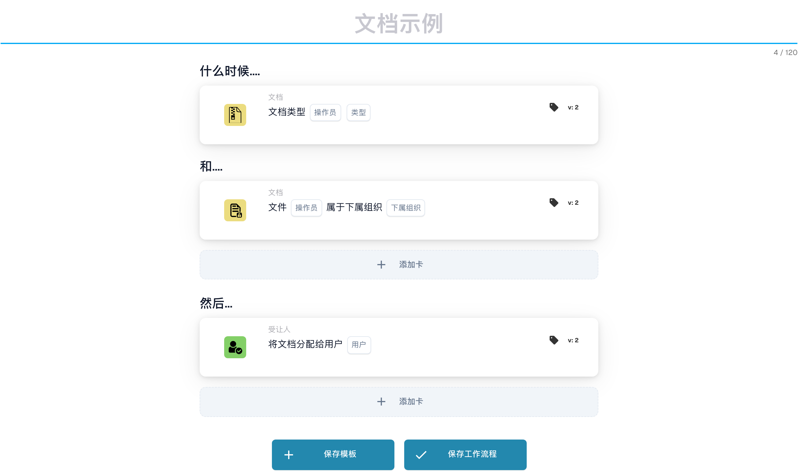

# PO 匹配卡 - 完整指南

## 采购订单 (PO) 匹配卡 - 完整指南

**状态：**涵盖15张PO比较卡，并有详细的计算

***

此页面上的 PO 比较卡位于工作流程生成器的 **且** 组中 — 它们在运行“Then”操作之前将发票数据与匹配的采购订单进行比较：

<figure><figcaption><p>包含“当”“且”和“则”卡片的未保存示例。执行前请配置所有占位字段。 此版本界面的部分标签尚未翻译或翻译不准确。本页说明使用正确术语；图片保留了实际界面。</p></figcaption></figure>

***

### 📌 版本信息

**进化最多的卡牌：**CONDITION\_DOC\_TO\_PO\_UNIT\_PRICE（5个版本，最新v5）**其他复杂卡牌：**CONDITION\_OC\_TO\_PO\_ITEMS（v4），CONDITION\_LESS\_THAN\_TOLERANCE\_AS\_VALUE\_OF\_ORDERED\_QUANTITY（v4）

**关键模式：**

* **v2 → v3+:** 增加公差参数，灵活匹配
* **v3 → v4:** 增加比较模式参数
* **v4 → v5:** 增强了多个单位的容差（%、欧元、美元等）

📖【完整版本历史](../release.md) | [卡牌版本和行为](card-versions-guide.md)

***

### 了解采购订单匹配

当您收到发票时，它应该与之前下达的采购订单 (PO) 相符。 PO 匹配卡会自动检查发票数据是否与 PO 数据匹配。

**大图：**

```
PO Placed     Invoice Arrives     PO Matching     Decision
(€100)    →   (€103)          →   (Check if       → Approve/Reject
Qty: 100      Qty: 100            within tolerance)
```

***

## 1. 采购订单全匹配

### 目的

检查整个发票是否与 PO 完全匹配或在容差范围内

### 何时使用

* 批准发票之前
* 作为初步质量检查
* 及早发现问题

### 它是如何运作的

系统比较：

* 发票数量与采购订单数量
* 发票价格与 PO 价格
* 发票项目与 PO 项目
* 发票总额与采购订单总额

### 结果

* **TRUE**（完全匹配）：一切匹配，继续
* **FALSE**（不匹配）：有些内容不匹配，需要审核

### 示例

```
PO:
- Item ABC: Qty 100, Unit Price €50 = €5000
- Item XYZ: Qty 50, Unit Price €20 = €1000
- Total: €6000

Invoice:
- Item ABC: Qty 100, Unit Price €50 = €5000
- Item XYZ: Qty 50, Unit Price €20 = €1000
- Total: €6000

Result: ✅ FULL MATCH
```

***

## 2. 单价比较（文件与 PO）

### 目的

将发票上的单价与采购订单上的单价进行比较

### 参数

* **单价容差**：允许差异达到此金额
* **公差类型**：百分比 (%) 或绝对值 (€/$)
* **运算符**：等于、大于、小于等。

### 工作原理（百分比公差）

**公式：**

```
Variance % = |(Invoice Price - PO Price)| / PO Price × 100

Check: Is Variance % ≤ Tolerance %?
```

**逐步示例：**

```
Step 1: Get prices
  PO Unit Price: €100.00
  Invoice Unit Price: €103.00

Step 2: Calculate difference
  Difference = |€103.00 - €100.00| = €3.00

Step 3: Calculate percentage
  Percentage = (€3.00 / €100.00) × 100 = 3%

Step 4: Check tolerance (5% allowed)
  Is 3% ≤ 5%? YES ✅

Result: PASS - Within tolerance
```

### 现实世界的例子

#### 示例 1：小幅增加（已接受）

```
PO Price: €50.00
Invoice Price: €51.50
Tolerance: ±3%

Calculation:
  Variance = |(€51.50 - €50.00)| / €50.00 × 100
  Variance = €1.50 / €50.00 × 100 = 3%

Is 3% ≤ 3%? YES ✅ ACCEPT
```

#### 示例2：大幅度增加（拒绝）

```
PO Price: €50.00
Invoice Price: €55.00
Tolerance: ±3%

Calculation:
  Variance = |(€55.00 - €50.00)| / €50.00 × 100
  Variance = €5.00 / €50.00 × 100 = 10%

Is 10% ≤ 3%? NO ❌ REJECT - NEEDS REVIEW
```

#### 示例 3：折扣（也选中）

```
PO Price: €100.00
Invoice Price: €97.00
Tolerance: ±5%

Calculation:
  Variance = |(€97.00 - €100.00)| / €100.00 × 100
  Variance = €3.00 / €100.00 × 100 = 3%

Is 3% ≤ 5%? YES ✅ ACCEPT (Discount is within tolerance)
```

#### 示例 4：绝对值容差

```
PO Price: €10.00
Invoice Price: €10.50
Tolerance: ±€1.00 (absolute, not %)

Calculation:
  Variance = |€10.50 - €10.00| = €0.50

Is €0.50 ≤ €1.00? YES ✅ ACCEPT
```

### 如何处理结果

**如果通过 ✅:**

* 继续下一步检查
* 或批准发票
* 或者继续导出

**如果失败❌:**

* 手动审核标记
* 要求供应商解释
* 联系采购团队
* 如果可以接受，请批准并注明

***

## 3. 数量比较

### 目的

检查订购数量是否与发票数量相符

### 参数

* **公差**：允许不同的量或百分比
* **运算符**：等于、大于、小于
* **数量类型**：已订购、已收到、未结

### 计算示例

**百分比公差：**

```
Formula:
  Quantity Variance % = |(Invoice Qty - PO Qty)| / PO Qty × 100

Example:
  PO Quantity: 100 units
  Invoice Quantity: 103 units
  Tolerance: ±5%

  Variance = |(103 - 100)| / 100 × 100
  Variance = 3 / 100 × 100 = 3%

  Is 3% ≤ 5%? YES ✅ ACCEPT
```

**绝对公差：**

```
Formula:
  Quantity Variance = |Invoice Qty - PO Qty|

Example:
  PO Quantity: 100 units
  Invoice Quantity: 102 units
  Tolerance: ±5 units

  Variance = |102 - 100| = 2 units

  Is 2 units ≤ 5 units? YES ✅ ACCEPT
```

### 真实场景

#### 超额交付（超过订单数量）

```
Ordered: 100 units
Invoiced: 110 units
Tolerance: ±5%

Variance = |(110-100)|/100 × 100 = 10%

Is 10% ≤ 5%? NO ❌

Decision: Contact supplier - more delivered than ordered
Possible reason: Error by supplier, partial shipment already received
```

#### 交货不足（少于订单）

```
Ordered: 100 units
Invoiced: 95 units
Tolerance: ±5%

Variance = |(95-100)|/100 × 100 = 5%

Is 5% ≤ 5%? YES ✅

Decision: Accept - within tolerance
Possible reason: Partial shipment, rest to follow
```

***

## 4. 数量差价合并价

### 目的

当数量不同时，计算总价差是否可以接受

### 为什么这很重要

```
Scenario: You ordered 100 units but received 110
- Quantity is 10% over (bad)
- BUT: You're only charged for 10% extra
- Combined effect might be acceptable
```

### 计算

**公式：**

```
Combined Variance = Quantity Variance × Price Variance

If both are within tolerance, combined is usually acceptable
```

**示例：**

```
PO:
- Unit Price: €100
- Quantity: 100
- Total: €10,000

Invoice:
- Unit Price: €102 (2% higher)
- Quantity: 105 (5% higher)
- Total: €10,710

Analysis:
- Price variance: 2% ✅
- Quantity variance: 5% ✅
- Combined effect: 1.02 × 1.05 = 1.071 = 7.1% total increase

Is combined variance acceptable? Usually YES ✅
```

***

## 5. 商品 ID/供应商商品编号比较

### 目的

检查发票中的项目是否与 PO 中的项目匹配

### 它是如何运作的

**精确匹配（最简单）：**

```
PO Item ID: ABC-123
Invoice Item ID: ABC-123
Result: ✅ MATCH
```

**供应商货品编号（较常见）：**

```
PO Item: ABC-123 (Our internal code)
Supplier Item: SUPP-456 (Their code for same item)
System matches these as same item
Result: ✅ MATCH
```

### 场景：如果不匹配怎么办？

```
PO Item: ABC-123 (Copper Wire, 2mm)
Invoice Item: ABC-124 (Steel Wire, 2mm)

Result: ❌ NO MATCH

Actions:
1. Is this a substitution? Check with procurement
2. Is this an error? Contact supplier
3. Is the description similar? Verify manually
```

***

## 6. 订单类型验证

### 目的

验证采购订单类型是否正确

### 订单类型

* **标准订单**：常规购买
* **Rush Order**：紧急，可能有溢价
* **框架协议**：长期合同
* **一揽子订单**：开放式合同
* **寄售**：使用后才付款

### 检查示例

```
PO Order Type: Standard Order
Invoice Order Type: Standard Order
Result: ✅ MATCH

If mismatch: Could affect terms, payment, pricing
```

***

## 7. 交货日期验证

### 目的

检查交货日期是否与采购订单上承诺的日期相符

### 计算

**延迟交货：**

```
Formula:
  Days Late = Invoice Delivery Date - PO Promised Date

Example:
  PO Promised: 2025-10-15
  Actual Delivery: 2025-10-22
  Days Late = 7 days

If tolerance is ±3 days:
  Is 7 ≤ 3? NO ❌ LATE
```

**提早交付：**

```
Formula:
  Days Early = PO Promised Date - Invoice Delivery Date

Example:
  PO Promised: 2025-10-15
  Actual Delivery: 2025-10-10
  Days Early = 5 days

Early delivery is usually OK ✅
Unless you need it at specific time
```

### 公差设置

```
±3 days: Allow 3 days late or early
±5 days: Allow up to 5 days variance
0 days: Must match exactly
```

***

## 8. 费用验证（税费、运费等）

### 目的

检查附加费用（税费、运费、手续费）是否与 PO 相符

### 常见收费

```
- Shipping: €50
- Handling: €10
- Packaging: €5
- Insurance: €15
- Taxes: €300
```

### 计算

**示例：运费检查**

```
PO Shipping: €50.00
Invoice Shipping: €51.00
Tolerance: ±3%

Variance = |€51.00 - €50.00| / €50.00 × 100 = 2%

Is 2% ≤ 3%? YES ✅ ACCEPT
```

**示例：多次收费**

```
PO Total Charges:
  - Shipping: €50
  - Taxes: €300
  - Handling: €10
  Total: €360

Invoice Total Charges:
  - Shipping: €50
  - Taxes: €312 (11% tax)
  - Handling: €10
  Total: €372

Difference: €12
Check if within tolerance ✅ or ❌
```

***

## 9. 税务核实

### 目的

验证税额计算是否正确

### 计算

**公式：**

```
Tax Amount = Subtotal × Tax Rate

Example:
  Subtotal: €1000
  Tax Rate: 19%
  Expected Tax: €1000 × 0.19 = €190

Invoice Tax: €190
Match? YES ✅
```

**常见问题：**

```
1. Tax rate changed (region-based)
2. Tax applied to wrong amount (before/after discounts)
3. Multiple tax rates (some items 7%, others 19%)
4. Tax exempt items (0% tax)
```

**示例：多重税率**

```
Item A: €100 @ 19% tax = €119
Item B: €100 @ 7% tax = €107
Item C: €100 @ 0% tax = €100
Total: €326

Invoice shows €325 (€1 error)

Check: Within tolerance or needs attention?
```

***

## 10. 设施/成本中心匹配

### 目的

确保发票适用于正确的设施/成本中心

### 示例

```
PO is for:
- Facility: Berlin Plant
- Cost Center: CC-2025

Invoice should have:
- Facility: Berlin Plant ✅
- Cost Center: CC-2025 ✅

If different facility: May need different approval
```

***

## 11. 供应商状态验证

### 目的

检查供应商是否仍然获得批准/活跃

### 状态类型

```
✅ ACTIVE: Approved, can do business
⚠️ ON HOLD: Temporarily blocked
❌ INACTIVE: No longer doing business
⚠️ CONDITIONAL: Only for specific items
```

### 检查示例

```
Supplier: ABC Corp
Status in Database: ACTIVE
Status when creating PO: ACTIVE
Status when invoice arrives: INACTIVE

Alert: Supplier status changed! Investigate why.
```

***

## 我应该使用哪种公差？

### 严格的公差（更低的风险，更多的手工工作）

```
Use for:
- High-value items
- Items where exactness matters
- Regulated industries

Settings:
- Unit Price: ±1%
- Quantity: ±1%
- Delivery Date: ±1 day
- Charges: ±1%
```

### 中等公差（平衡）

```
Use for:
- Most business transactions
- Standard items
- Normal purchasing

Settings:
- Unit Price: ±3-5%
- Quantity: ±3-5%
- Delivery Date: ±3 days
- Charges: ±5%
```

### 宽松的公差（风险更高，体力工作更少）

```
Use for:
- Low-value items
- Bulk purchases
- Supplier agreements with flexibility

Settings:
- Unit Price: ±10%
- Quantity: ±10%
- Delivery Date: ±7 days
- Charges: ±10%
```

***

## PO 匹配工作流程示例

```
Invoice Arrives
    ↓
Condition: "Is amount > €5000?" → YES
    ↓
Check: Full Match? → NO (10% price difference)
    ↓
Check: Unit Price within 5%? → NO (12% difference)
    ↓
Check: Quantity within 5%? → YES (2% difference)
    ↓
Decision: FAIL - Price variance too high
    ↓
Flag for: Manual review / Buyer approval
    ↓
Wait for: Buyer comment
    ↓
If Approved: Continue to Export
If Rejected: Return to Supplier
```

***

## PO 匹配故障排除

### “未找到订单”

```
Cause: Invoice PO number doesn't exist in system
Fix:
1. Verify PO number spelling
2. Check if PO was created
3. Verify PO is in correct organization
4. Ask supplier for PO reference
```

### “物品不匹配”

```
Cause: Invoice items are different from PO items
Possible Reasons:
1. Substitution approved by procurement
2. Different item numbers for same item
3. Error by supplier
Fix: Contact procurement or supplier
```

### “价格高于 PO”

```
Cause: Invoice price > PO price
Possible Reasons:
1. Price increase approved
2. Supplier error
3. Currency difference
4. Additional services included
Fix: Verify with procurement
```

### “交货日期错误”

```
Cause: Invoice dated after promised delivery
Possible Reasons:
1. Shipment was delayed
2. Receiving date different from invoice date
3. Partial shipment
Fix: Check shipping documents or contact supplier
```

***

## 汇总表

| 卡           | 它检查什么        | 主要计算     | 通用公差 |
| -------------- | --------------------- | -------------------- | ---------------- |
| 完整比赛     | 一切            | 所有检查           | 各不相同           |
| 单价     | 每单位价格        | % 或 € 差异    | ±3-5%            |
| 数量       | 订购数量        | %或单位差异 | ±3-5%            |
| 综合价格 | 数量变化总计 | 数量×价格          | ±5-10%           |
| 商品编号        | 正确的项目           | 字符串匹配         | 准确            |
| 订单类型     | 购买类型      | 字符串匹配         | 准确            |
| 交货日期  | 到达时          | 日差       | ±3天          |
| 收费        | 额外费用            | % 或 € 差异    | ±5%              |
| 税            | 税额            | 税%计算    | ±1%              |
| 设施       | 成本中心           | 字符串匹配         | 准确            |
| 供应商       | 批准了吗？             | 状态检查         | 仅活动      |

***

## 相关文档

* 请参阅“发票验证”指南了解完整的工作流程
* 有关行业推荐值，请参阅“公差设置”
* 请参阅“异常处理”了解如何处理失败
* 请联系您的采购团队了解具体的容忍政策

<!-- workflow-card-example-condition_promised_delivery_date_to_current-20261021 -->

### 承诺交货日期与参考日期

<figure><figcaption><p>所示版本的卡片字段。占位字段尚未配置。 此版本界面的部分标签尚未翻译或翻译不准确。本页说明使用正确术语；图片保留了实际界面。</p></figcaption></figure>

`CONDITION_PROMISED_DELIVERY_DATE_TO_CURRENT`·版本2

假设参考日期为`2026-10-21`，承诺的线路交付日期为`2026-10-23`。选择稍后比较和零日容差。未来的日期满足该比较； `2026-10-20` 没有。有意配置“任何/全部”和“可接受的容忍天”选项，并单独测试缺失的日期。

<!-- workflow-card-example-condition_po_extracted_table_column-20261021 -->

### 采购订单列与提取列的对比

<figure><figcaption><p>所示版本的卡片字段。占位字段尚未配置。 此版本界面的部分标签尚未翻译或翻译不准确。本页说明使用正确术语；图片保留了实际界面。</p></figcaption></figure>

`CONDITION_PO_EXTRACTED_TABLE_COLUMN`·版本2

使用相等和全部将匹配的 PO 文章列与提取的列 `article_number` 进行比较。匹配值`DEMO-A`通过；提取的值`DEMO-B`失败。仅当需要记录的 ID 到值替换时才选择查找表；在比较之前验证该映射。

<!-- workflow-card-example-condition_check_facility_in_po-20261021 -->

### 允许的采购订单设施

<figure><figcaption><p>所示版本的卡片字段。占位字段尚未配置。 此版本界面的部分标签尚未翻译或翻译不准确。本页说明使用正确术语；图片保留了实际界面。</p></figcaption></figure>

`CONDITION_CHECK_FACILITY_IN_PO`·版本2

选择全部、正在比较和配置的设施代码`DEMO-NORTH`。该设施通行证中匹配的采购订单行； `DEMO-SOUTH` 中的一行失败。使用 PO 数据中的设施代码，而不是假设显示标签就是其代码。

<!-- workflow-card-example-condition_purchase_order_full_match-20261021 -->

### 完成采购订单匹配

<figure><figcaption><p>所示版本的卡片字段。占位字段尚未配置。 此版本界面的部分标签尚未翻译或翻译不准确。本页说明使用正确术语；图片保留了实际界面。</p></figcaption></figure>

`CONDITION_PURCHASE_ORDER_FULL_MATCH`·版本2

使用完全匹配的演示发票和采购订单，双方数量为`2`，单价为`100`，并配置数量/价格容差。选择完全匹配条件：通过。然后测试超出配置容差的价格。缺少比较数据或缺少 PO 并不是成功的完全匹配。交货单仅进行数量比较；不要假设发票价格规则适用于它。

<!-- workflow-card-example-condition_po_update_empty_column_check-20261021 -->

### 采购订单数据库列为空

<figure><figcaption><p>所示版本的卡片字段。占位字段尚未配置。 此版本界面的部分标签尚未翻译或翻译不准确。本页说明使用正确术语；图片保留了实际界面。</p></figcaption></figure>

`CONDITION_PO_UPDATE_EMPTY_COLUMN_CHECK`·版本2

选择卡和 is-empty 运营商提供的有效 PO 表和列。对于具有空白值的现有匹配 PO 记录，条件通过；填充值失败。首先验证 PO 引用和表/列映射。布尔`false`仍然是当前布尔值；缺少 PO 记录是一个单独的数据错误。

<!-- workflow-card-example-condition_compare_unit_price_percent_per-20261021 -->

### 每个价格基础的百分比容差

<figure><figcaption><p>所示版本的卡片字段。占位字段尚未配置。 此版本界面的部分标签尚未翻译或翻译不准确。本页说明使用正确术语；图片保留了实际界面。</p></figcaption></figure>

`CONDITION_COMPARE_UNIT_PRICE_PERCENT_PER`·版本2

示例：PO 单价 `200`、基本价格 `100` 和配置的容差 `1` 产生有效费率 `(200 / 100) * (1 / 100) = 0.02` 或 `2%`。比较波段是`196–204`。公差范围内的平等接受`203`的单据价格并拒绝`210`。不要假设此卡与固定的 1% 容差相同。

<!-- workflow-card-example-condition_compare_po_line_value-20261021 -->

### 相对于参考的采购订单行值

<figure><figcaption><p>所示版本的卡片字段。占位字段尚未配置。 此版本界面的部分标签尚未翻译或翻译不准确。本页说明使用正确术语；图片保留了实际界面。</p></figcaption></figure>

`CONDITION_COMPARE_PO_LINE_VALUE`·版本2

选择匹配的 PO 列 `item_number`、等式和值 `DEMO-A`。 `DEMO-A` 的线通过； `DEMO-B` 失败。仅使用所选数据类型支持的运算符，并单独测试缺失的匹配行数据。
