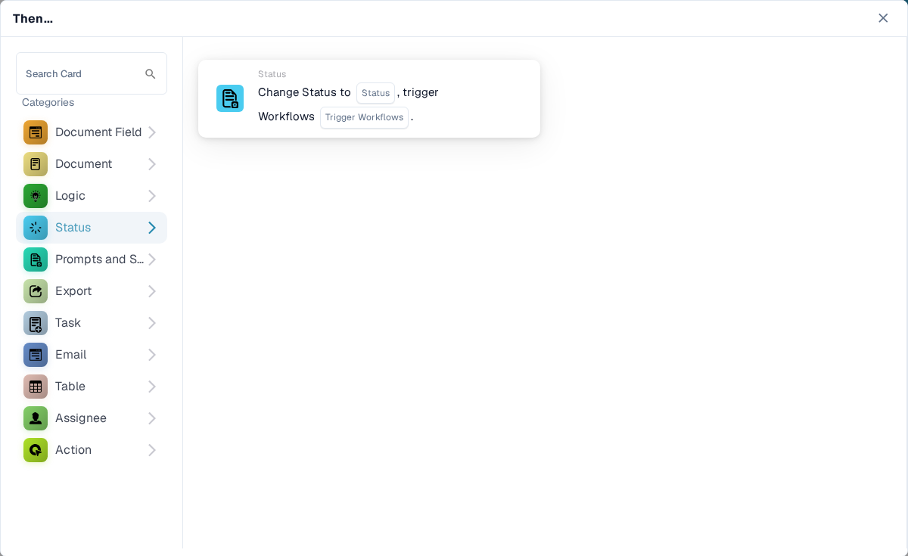
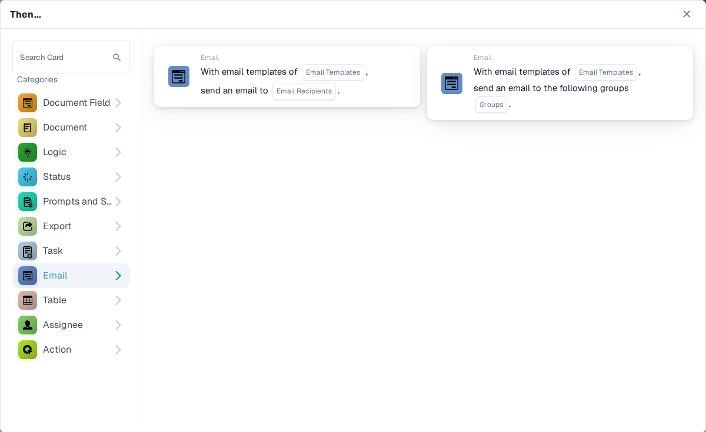
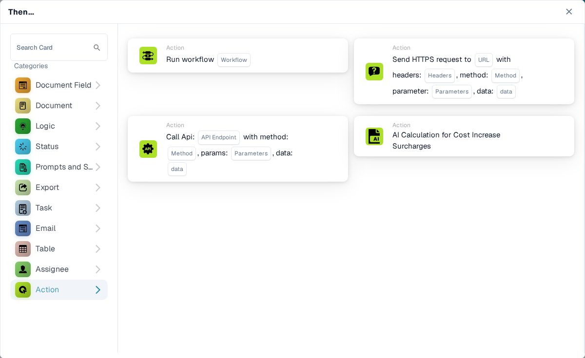

# Then

**Then** 卡片会告诉工作流在 **When** 触发条件和所有 **And** 条件满足后要执行什么操作。在 **Workflow Builder** 中，选择 **Then...** 下方的 **Add Card**。在左侧选择一个类别，或在 **Search Card** 中输入名称。选择卡片预览以添加卡片，填写卡片上显示的字段，然后保存工作流。在选择器中滚动可查看更多卡片。选择 **×** 可关闭选择器而不添加卡片。有关完整顺序，请参阅 [Workflow](../../)。

下方的预览展示了可用操作，而不是已完成的设置。请选择与预期结果相符的操作。

## 文档字段

设置或反转复选框、在字段中填入文本，或将一个字段的内容复制到另一个字段。选择卡片要求的字段名称和值。请参阅 [Document Field](document-field/)。

<figure><figcaption>
更改字段或复制字段内容。
</figcaption></figure>

## 文档

当工作流需要作出相应决定时，选择 **Approve the Document** 或 **Reject the Document**。如果审批应取决于某项检查，请先使用 **And** 条件。请参阅 [Document](document/)。

<figure><figcaption>
审批或拒绝当前文档。
</figcaption></figure>

## 逻辑

使用这些卡片在数字、文本和布尔格式之间转换值，或从 JSON 读取值。在所选卡片上选择输入字段和输出字段。

<figure><figcaption>
转换值，以便在后续工作流步骤中使用。
</figcaption></figure>

## 状态

选择 **Change Status** 将文档更改为指定状态。此卡片也可以触发另一个工作流。请参阅 [Status](status/)。

<figure><figcaption>
将文档转为另一种状态。
</figcaption></figure>

## 提示词和脚本

选择此类别以运行 DocOperator 提示词脚本。选择脚本以及卡片要求的变量。卡片还提供重试等执行设置。

<figure><figcaption>
运行已配置的 DocOperator 提示词脚本。
</figcaption></figure>

## 导出

启动导出、使用所选配置导出，或将最终导出加入队列。选择卡片上显示的导出配置和待处理任务选项。请参阅 [Export](export/)。

<figure><figcaption>
选择文档导出的时机和方式。
</figcaption></figure>

## 任务

创建任务或通知，并将其分配给用户或群组。填写卡片要求的标题、描述、优先级和通知设置。有些卡片会按顺序分配。请参阅 [Task](task/)。

<figure><figcaption>
为个人或群组创建后续工作。
</figcaption></figure>

## 电子邮件

使用所选模板向收件人或群组发送电子邮件。在卡片上选择模板和发送对象。

<figure><figcaption>
发送模板邮件。
</figcaption></figure>

## 表格

更改文档表格中的条目或计算数值。选择卡片要求的表格、列、运算符和结果列。请参阅 [Table](table/)。

<figure><figcaption>
更新或计算表格数据。
</figcaption></figure>

## 受分配人

将文档分配给用户、群组、收件人或子组织。有些卡片会使用字段或决策表，并提供回退选项。在所选卡片上选择合适的目标对象和回退选项。请参阅 [Assignee](assignee/)。

<figure><figcaption>
将文档路由给下一位负责人员或群组。
</figcaption></figure>

## 操作

运行另一个工作流、发送 HTTPS 请求、调用 API，或使用成本增加计算卡片。这些操作可能会影响其他系统；请咨询管理员，了解应使用的端点和设置。请参阅 [Action](action/)。

<figure><figcaption>
启动另一个工作流或集成操作。
</figcaption></figure>
