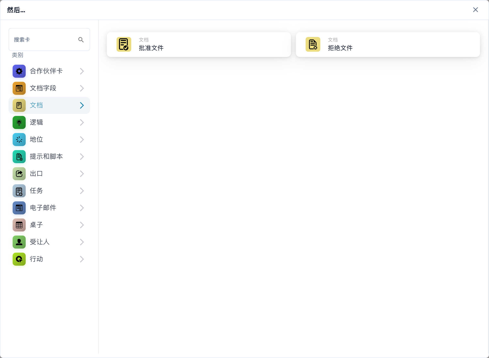
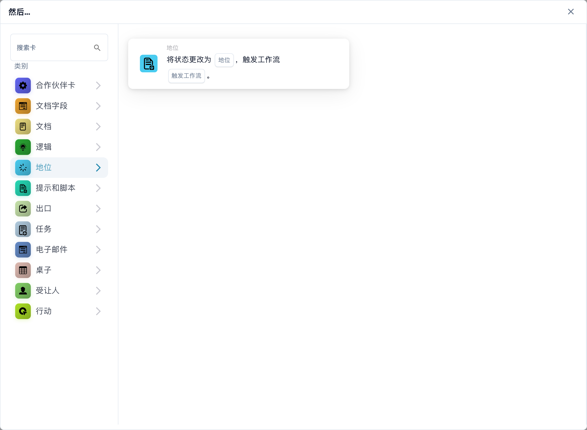
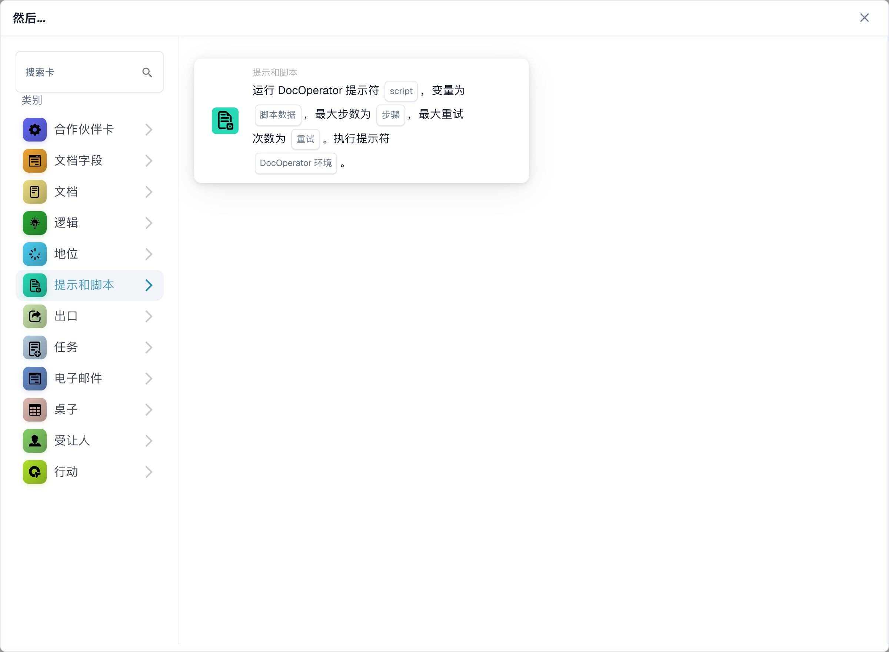
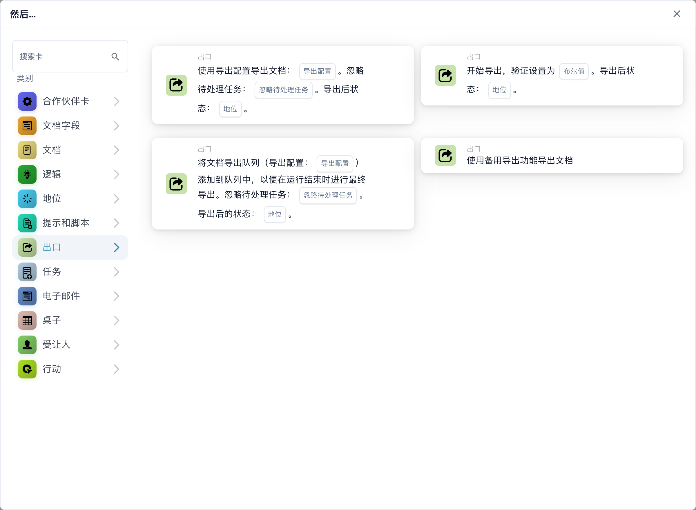
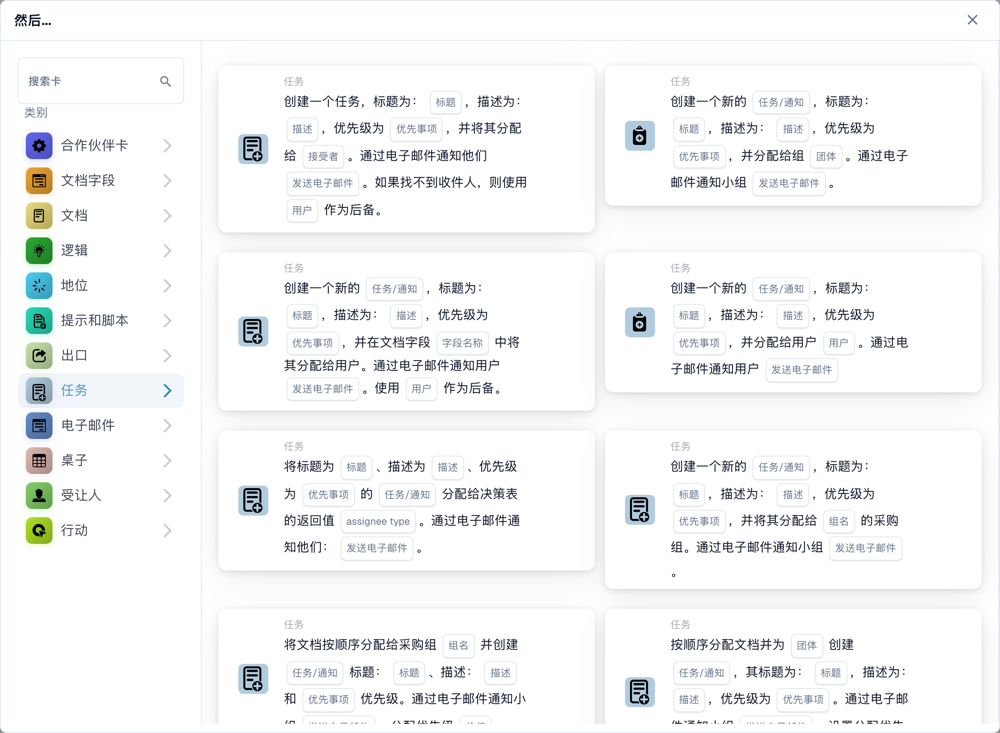
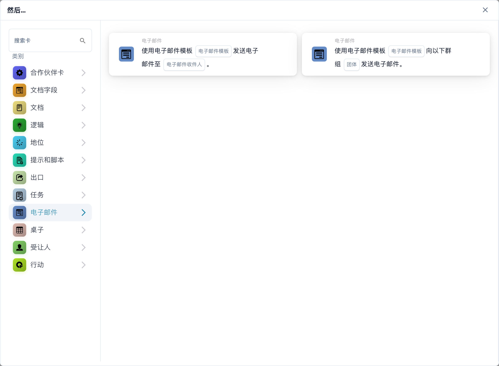
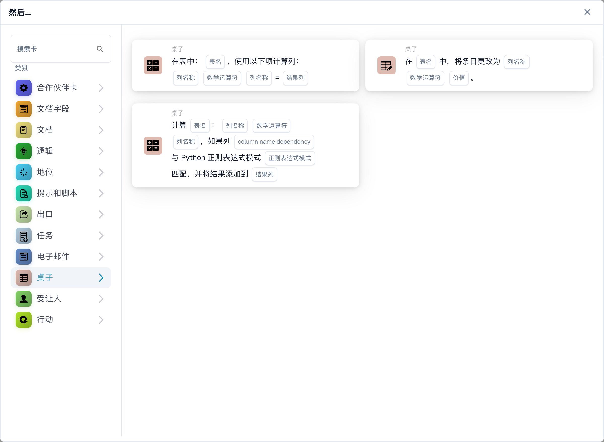
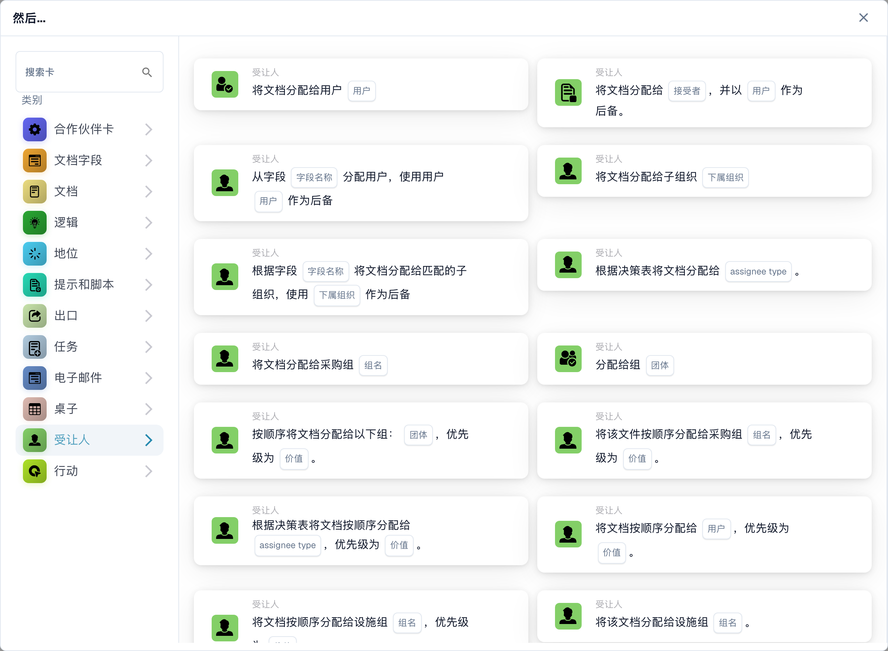
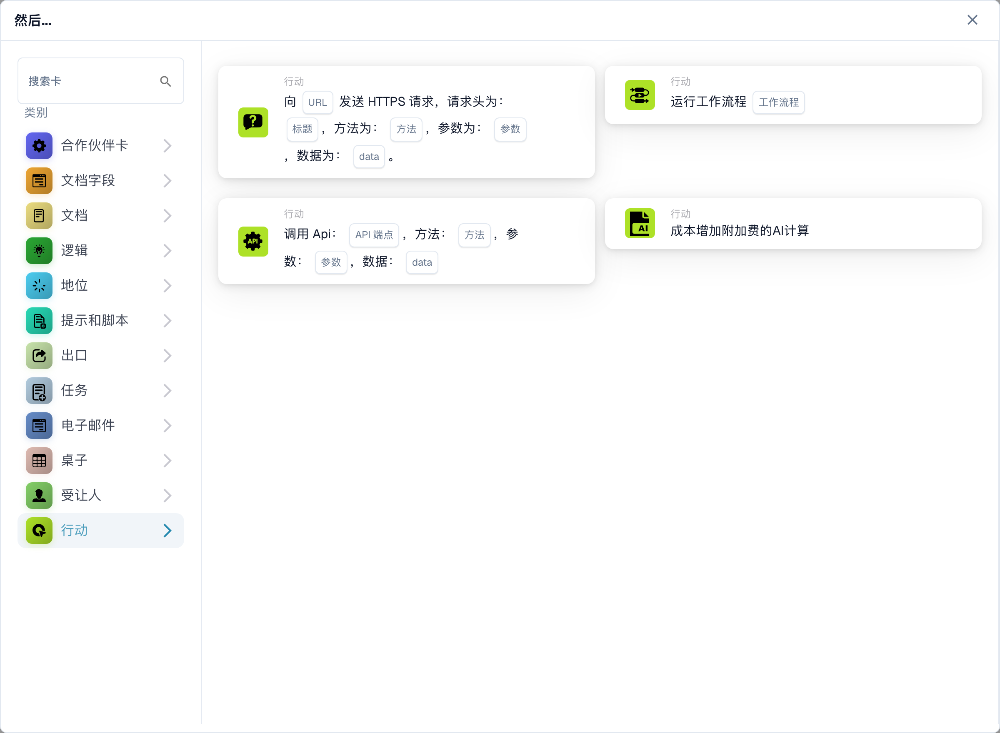

# 则

**则** 卡告诉工作流程在其 **当** 触发器和任何 **且** 条件之后要做什么。在**工作流程生成器**中，选择**然后...**下的**添加卡**。在左侧选择类别或在**搜索卡**中输入名称。选择卡片预览进行添加，填写卡片上显示的字段，然后保存工作流程。在选择器内滚动以查看更多卡片。选择**×**将其关闭而不添加卡片。完整序列请参见[工作流程](../..)]。

下面的预览显示了可用的操作，而不是已完成的设置。选择与您想要的结果相匹配的操作。

## 文档字段

设置或反转复选框、将文本放入字段或将一个字段复制到另一个字段。选择卡请求的字段名称和值。请参阅[文档字段](document-field)。

<figure><figcaption>
所选类别中的可用卡片。使用前请填写所需字段。 此版本界面的部分标签尚未翻译或翻译不准确。本页说明使用正确术语；图片保留了实际界面。
</figcaption></figure>

## 文件

当工作流程应做出决定时，选择**批准文档**或**拒绝文档**。如果批准应取决于检查，请首先使用 **且** 条件。请参阅[文档](document)。

<figure><figcaption>
所选类别中的可用卡片。使用前请填写所需字段。 此版本界面的部分标签尚未翻译或翻译不准确。本页说明使用正确术语；图片保留了实际界面。
</figcaption></figure>

## 逻辑

使用这些卡在数字、文本和布尔格式之间转换值，或从 JSON 读取值。选择所选卡上的输入和输出字段。

<figure><figcaption>
所选类别中的可用卡片。使用前请填写所需字段。 此版本界面的部分标签尚未翻译或翻译不准确。本页说明使用正确术语；图片保留了实际界面。
</figcaption></figure>

## 状态

选择**更改状态**将文档移动到选定状态。该卡还可以触发另一个工作流程。请参阅[状态](status)。

<figure><figcaption>
所选类别中的可用卡片。使用前请填写所需字段。 此版本界面的部分标签尚未翻译或翻译不准确。本页说明使用正确术语；图片保留了实际界面。
</figcaption></figure>

## 提示和脚本

选择此类别可运行 DocOperator 提示脚本。选择卡请求的脚本和变量。该卡还提供重试等执行设置。

<figure><figcaption>
所选类别中的可用卡片。使用前请填写所需字段。 此版本界面的部分标签尚未翻译或翻译不准确。本页说明使用正确术语；图片保留了实际界面。
</figcaption></figure>

## 导出

开始导出、使用所选配置导出或对最终导出进行排队。选择卡上显示的导出配置和待处理任务选项。请参阅[导出](export)。

<figure><figcaption>
所选类别中的可用卡片。使用前请填写所需字段。 此版本界面的部分标签尚未翻译或翻译不准确。本页说明使用正确术语；图片保留了实际界面。
</figcaption></figure>

## 任务

创建任务或通知并将其分配给用户或组。输入卡片请求的标题、描述、优先级和通知设置。有些卡按顺序分配。请参阅[任务](task)。

<figure><figcaption>
所选类别中的可用卡片。使用前请填写所需字段。 此版本界面的部分标签尚未翻译或翻译不准确。本页说明使用正确术语；图片保留了实际界面。
</figcaption></figure>

## 电子邮件

使用选定的模板向收件人或群组发送电子邮件。选择卡上的模板和目的地。

<figure><figcaption>
所选类别中的可用卡片。使用前请填写所需字段。 此版本界面的部分标签尚未翻译或翻译不准确。本页说明使用正确术语；图片保留了实际界面。
</figcaption></figure>

## 表

更改文档表中的条目或计算值。选择卡请求的表、列、运算符和结果列。参见[表](table)。

<figure><figcaption>
所选类别中的可用卡片。使用前请填写所需字段。 此版本界面的部分标签尚未翻译或翻译不准确。本页说明使用正确术语；图片保留了实际界面。
</figcaption></figure>

## 分配对象

将文档分配给用户、组、收件人或子组织。有些卡使用字段或决策表并提供后备。选择正确的目的地并在所选卡上进行后备。请参阅[分配对象](assignee)。

<figure><figcaption>
所选类别中的可用卡片。使用前请填写所需字段。 此版本界面的部分标签尚未翻译或翻译不准确。本页说明使用正确术语；图片保留了实际界面。
</figcaption></figure>

## 行动

运行另一个工作流、发送 HTTPS 请求、调用 API 或使用成本增加计算卡。这些操作可能会影响其他系统；询问您的管理员要使用哪个端点和设置。请参阅[操作](action)。

<figure><figcaption>
所选类别中的可用卡片。使用前请填写所需字段。 此版本界面的部分标签尚未翻译或翻译不准确。本页说明使用正确术语；图片保留了实际界面。
</figcaption></figure>

[详细的逻辑卡字段、JSON 路径、触发器和测试](../logic-cards-guide.md)。
