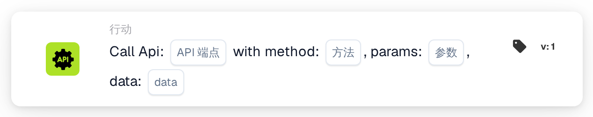
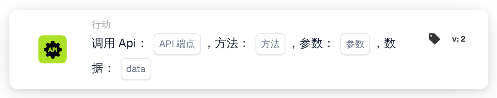

# 调用 API

<figure><figcaption>
版本 1
</figcaption></figure>

<figure><figcaption>
版本 2
</figcaption></figure>

<!-- workflow-card-call-api-contract-20261022 -->

## 用途

使用 `call_api` 调用已配置的 DocBits API 内部端点。端点是附加到 DocBits API 基础地址后的相对路径。输入任意外部 URL 并不能配置第三方 API 集成。

## 配置

填写端点路径、HTTP 方法、查询参数和端点支持的请求数据。请求使用当前 DocBits 用户上下文。缺少的 `org_id` 和 `triggered_by_docflow` 会自动补充。参数对象和数据对象，或其受支持的文本表示，必须符合此卡片版本的格式。本版本不提供通用的 JSON 响应字段映射。

## 结果与限制

响应文本会转换为布尔值：完整内容仅为 `true`、`1`、`yes` 或 `on` 时为真；无法识别的响应（包括任意 JSON 对象）默认为假。HTTP 状态本身并不决定该布尔值。超时或请求异常返回假。卡片测试模式只模拟调用，不发送请求并返回真，因此不能证明身份验证、连通性或端点的实际行为。

<!-- workflow-card-practical-example-20261021 -->

## 实际示例

需要从已配置的 DocBits API 端点获取布尔值时，在必要条件之后使用此卡片。隔离测试应选择实际存在、已有文档且只读的 DocBits 端点，并确认其布尔响应约定，再选择合适的方法，例如 `GET`。仅使用该端点支持的演示参数。

预期结果与反例：假设 HTTP `200` 响应的完整文本为 `true`，卡片结果为真；文本为 `false` 时为假。`{"approved": true}` 这样的对象不会自动映射为真。应分别检查实际响应和日志。本示例已对照执行代码核实；未执行任何请求或工作流。
