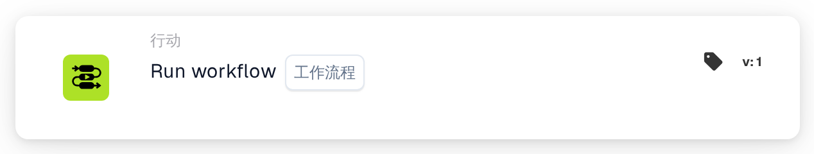
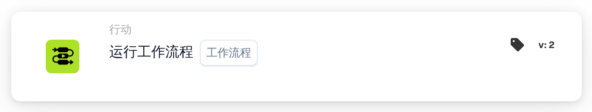

# 运行工作流

<figure><figcaption>
版本 1
</figcaption></figure>

<figure><figcaption>
版本 2
</figcaption></figure>

## 用途：

**“Run Workflow”（运行工作流）**卡片允许用户从可用工作流列表中动态执行选定的工作流。此卡片适用于多个工作流相互关联的自动化流程，可帮助简化操作。

## 卡片组件：

1. **Workflow（工作流）**
   * **描述：**指定条件评估为 true 时要执行的工作流。
   * **详情：**提供包含所有可用工作流的下拉列表供用户选择。

## 功能：

* **条件评估：**只有当 **“当”** 和 **“且”** 均评估为 true 时，卡片才会执行选定的工作流。
  * 如果任一条件为 false，则不会执行任何操作，也不会触发工作流。
* **工作流执行：**
  * 满足条件时，会自动触发指定的工作流。
  * 不满足条件时，不会执行任何工作流。

## 设置和配置：

1. **选择工作流：**从可用工作流的**下拉列表**中选择要触发的工作流。
2. **定义条件：**配置 **“当”** 和 **“且”**，指定工作流执行必须满足的条件。

## 总结：

**“Run Workflow”（运行工作流）**卡片提供了一种便捷高效的工作流关联方式，可轻松实现多步骤流程自动化。确保 **“当”** 和 **“且”** 中的条件均已满足后，用户即可动态执行工作流并减少人工干预。

<!-- workflow-card-practical-example-20261021 -->

## 实际例子

**何时使用：** 重用现有的验证工作流程。

**配置：** 选择已配置的演示子工作流程，将`routing_result`设置为`checked`。

**预期结果和反例：**所选工作流在其支持的执行上下文中调用。验证自己的日志和字段结果；不要将其链接回循环中的父级。

这是说明性配置和预期结果。使用测试组织中配置的字段、用户和组；这并不是说这个例子已经被执行了。
