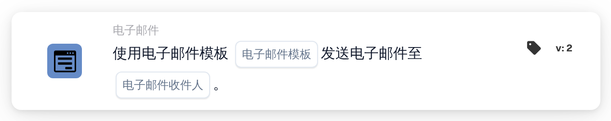

# 发送电子邮件

<figure><figcaption>
版本 2
</figcaption></figure>

## 用途：

此工作流卡片会基于一个或多个电子邮件模板发送电子邮件。收件人不是以固定地址输入的，而是按其在工作流中的角色选择，例如文档所分配到的用户或组，或者决策表返回的用户和组。这样，即使这些角色背后的人员发生变化，工作流仍然有效。

如需改为向选定的用户组发送电子邮件，可以使用卡片 **向群组发送电子邮件**，参见 [向群组发送电子邮件](../../send-email-groups-guide.md)。

## 卡片组件：

1. **电子邮件模板**
   * **描述：** 用于电子邮件的模板。
   * **详细信息：** 可以选择组织中的一个或多个电子邮件模板。每个所选模板都会发送给每位收件人。当工作流针对某份文档运行时，为特定文档类型设置的模板只有在文档属于该文档类型时才会发送。
2. **电子邮件收件人**
   * **描述：** 谁会收到电子邮件。
   * **选项：** 可以选择以下一项或多项：
     * **文档的指定用户/组：** 文档当前分配到的用户或组。
     * **返回决策表的用户/组：** 同一工作流中较早评估的决策表所返回的用户和组，例如通过卡片 **决策表有返回值** 评估。
     * **分配给供应商的用户：** 在由供应商状态变化启动的工作流中，供应商的分配用户。
     * **供应商推荐人：** 在由供应商状态变化启动的工作流中，供应商的推荐人。

## 功能：

* **收集收件人：** 卡片收集所有所选选项对应的收件人。由多个选项得出的同一收件人只会收到一次电子邮件。
* **执行操作：** 电子邮件会使用所选模板发送。当工作流针对某份文档运行时，模板可以使用该文档的字段值。结果会连同收件人姓名一起记录在工作流日志中。
* **无文档时：** 此卡片也可以在并非针对文档启动的工作流中运行，例如由供应商状态变化启动的工作流。在此类工作流中，选项 **文档的指定用户/组** 不会添加收件人。
* **缺少数据：**
  * 如果卡片上未选择任何电子邮件模板或收件人选项，卡片不会运行，并会在工作流日志中报告缺少的数据。
  * 如果所选选项没有对应到任何人，例如文档没有分配人或决策表未返回任何人，则该选项不会添加收件人。
* **错误：** 如果电子邮件服务拒绝请求或未及时响应，卡片会以错误结束。

## 设置和配置：

* 电子邮件模板应先在组织中设置好，才能在卡片上选择。
* 可以从 **电子邮件** 类别中添加此卡片，然后在 **电子邮件模板** 中选择一个或多个模板，并在 **电子邮件收件人** 中选择一个或多个选项。
* 对于选项 **返回决策表的用户/组**，应在同一工作流中较早的位置评估一个决策表。

## 结论：

“发送电子邮件”工作流卡片使用预先准备的模板，自动通知参与文档或供应商流程的人员。由于收件人按角色选择，即使分配发生变化，同一工作流仍能通知到正确的人员。
