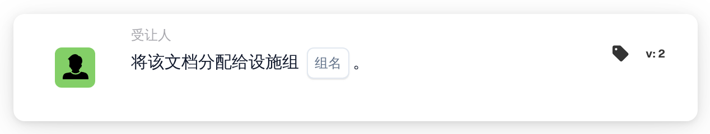

# 将文档分配给设施组

<figure><figcaption>
版本 2
</figcaption></figure>

## 用途：

此工作流卡片会将文档分配给负责其采购订单所属设施的组。设施并不在卡片上选择，而是取自与文档匹配的采购订单。随后，卡片会查找名称中同时包含卡片上输入的组名和设施代码的用户组，并将文档分配给该组。

当每个设施都设有同一类团队时，例如每个工厂或仓库各有一个审批组，并且每份文档都应交给其订购所属设施的团队处理，此卡片就非常有用。

如果希望将分配加入审批人序列，而不是直接分配，可以使用卡片 **按顺序分配给设施组**。

## 卡片组件：

1. **组名**
   * **描述：** 各设施组共有的名称部分。
   * **详细信息：** 一段文本，用于与组织中用户组的名称进行比较。如果某个组的名称同时包含此文本和采购订单的设施代码，则该组匹配。比较时不区分大小写。例如，组名为 **Approver**、采购订单的设施为 **1000** 时，名为 **Approver 1000** 的组即可匹配。

## 功能：

* **查找设施：** 卡片读取与文档匹配的采购订单，并收集每个采购订单的设施代码（即采购订单的地点）。
* **查找组：** 对于每个设施代码，卡片会查找名称中同时包含卡片上的 **组名** 和该设施代码的用户组。未找到对应组的设施代码会列在工作流日志中。
* **执行操作：** 文档会分配给匹配的组。如果有多个组匹配，例如因为文档与不同设施的采购订单相匹配，文档只会分配给其中一个组；具体是哪一个，并不由卡片决定。
* **缺少数据：**
  * 如果卡片上未输入组名，卡片不会运行，并会在工作流日志中报告缺少的数据。
  * 如果文档未与任何采购订单匹配，卡片会报告缺少的数据，而不会分配文档。
  * 如果没有任何组与任一设施代码匹配，文档不会被分配，工作流日志会注明未找到匹配的组。

## 设置和配置：

* 用户组的命名应使每个名称都包含共同的名称部分和设施代码，例如 **Approver 1000**、**Approver 2000**。
* 可以从 **受让人** 类别中添加此卡片，然后在 **组名** 字段中输入各组共同的名称部分。
* 由于设施取自匹配的采购订单，此卡片最适合用于处理已与采购订单匹配的文档的工作流。

## 结论：

“将文档分配给设施组”工作流卡片会将文档路由到其订购所属设施的团队。只要用户组遵循统一的命名规则并在名称中包含设施代码，一张卡片即可覆盖所有设施。
