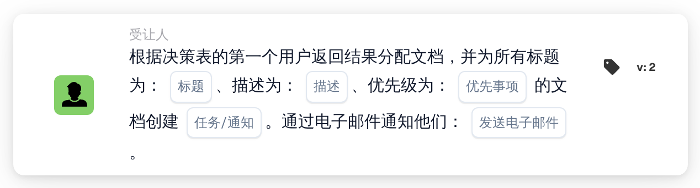

# 将文档分配给决策表的第一个用户并创建任务

<figure><figcaption>
版本 2
</figcaption></figure>

## 用途：

此工作流卡片以两种方式使用决策表返回的用户：文档会分配给返回的第一个用户，并且每个返回的用户（包括第一个用户）都会收到一项关于该文档的任务或通知。这样，一个人负责该文档，其他人则会收到通知或被要求一同处理。

这些用户来自同一工作流中较早评估的决策表，例如通过卡片 **决策表有返回值** 评估，并设置为在后续卡片中使用返回的数据。

## 卡片组件：

1. **任务/通知**
   * **描述：** 定义为返回的用户创建任务还是通知。
   * **选项：**
     * **任务：** 为每个用户创建一项任务。
     * **通知：** 为每个用户创建一条通知。
2. **标题**
   * **描述：** 任务或通知的标题。
   * **详细信息：** 用于标识任务或通知的简短文本。
3. **描述**
   * **描述：** 有关任务或通知的更多详细信息。
   * **详细信息：** 一段文本，说明需要做什么或为什么通知这些用户。
4. **优先事项**
   * **描述：** 任务或通知的紧急程度。
   * **选项：**
     * **高重量：** 以高优先级创建任务或通知。
     * **中等重量：** 以中优先级创建任务或通知。
     * **低重量：** 以低优先级创建任务或通知。
5. **发送电子邮件**
   * **描述：** 定义是否同时通过电子邮件将任务或通知告知用户。
   * **选项：**
     * **True：** 发送电子邮件通知。
     * **False：** 不发送电子邮件通知。

## 功能：

* **读取决策表：** 卡片读取工作流中较早评估的决策表所返回的用户。只考虑返回的用户，不考虑组。
* **文档分配：** 文档会分配给返回的第一个用户。
* **创建任务：** 系统会为每个返回的用户创建一项任务或通知，使用卡片上的标题、描述和优先级。每个用户都会收到自己的任务。即使文档分配未成功，任务也会被创建；工作流日志会显示分配结果以及每项任务的结果。
* **默认值：** 如果未设置优先级，则使用 **中等重量**。如果未设置 **发送电子邮件**，则不发送电子邮件。如果未设置 **任务/通知**，则创建任务，并且工作流日志会注明缺少该设置。
* **缺少数据：**
  * 如果决策表未返回任何用户，则不会分配任何内容，卡片会在工作流日志中报告缺少的数据。
  * 如果标题或描述为空，文档不会被分配，也不会创建任务，卡片会报告缺少的数据。

## 设置和配置：

* 应在工作流中较早的位置评估一个返回用户的决策表，例如使用卡片 **决策表有返回值**。返回用户的顺序很重要，因为第一个用户会收到该文档。
* 可以从 **受让人** 类别中添加此卡片，然后配置类型（**任务** 或 **通知**）、标题、描述、优先级和电子邮件设置。

## 结论：

“将文档分配给决策表的第一个用户并创建任务”工作流卡片既明确了文档的负责人，又能将信息传达给决策表指定的每个人。当一个人应负责该文档，而其他人也需要参与或随时了解进展时，此卡片非常有用。
