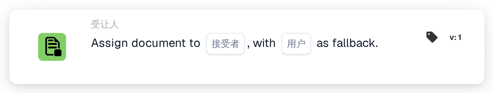
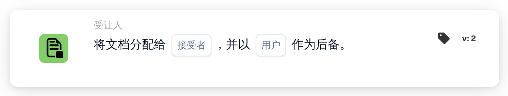

# 将文档分配给接收人

<figure><figcaption>
版本 1
</figcaption></figure>

<figure><figcaption>
版本 2
</figcaption></figure>

## **用途：**

**“将文档分配给 Disponent / Purchaser”**工作流卡片会将文档分配给 **Disponent** 或 **采购员**。如果未找到有效用户，系统会选择备用用户，以确保文档始终有人负责。

## **卡片组件：**

1. **卖方/买方**
   * **说明：**指定将文档分配给 Disponent 还是 Purchaser。
   * **选项：**
     * **Disponent：**将文档分配给 Disponent。
     * **采购人：**将文档分配给 Purchaser。
2. **备用用户**
   * **说明：**指定备用用户，以便在无法将文档分配给所选 Disponent 或 Purchaser 时使用。
   * **详情：**可用用户的下拉列表允许您选择一名备用用户，确保即使无法确定主要用户，文档仍会有人负责。

## **功能：**

* **条件评估：**\
  只有当 **“当”** 和 **“且”** 均评估为真时，此卡片才会执行操作。
* **文档分配：**\
  此卡片会按照所选对象，将文档分配给 **Disponent** 或 **采购员**。如果所选人员不可用或无效，文档将分配给备用用户。

## **设置与配置：**

* **选择卖方/买方：**\
  选择将文档分配给 **Disponent** 还是 **采购员**。
* **选择备用用户：**\
  从下拉列表中选择一名备用用户；如果无法进行主要分配，文档将分配给该用户。

## **结论：**

**“将文档分配给 Disponent / Purchaser”**工作流卡片可确保文档始终有人负责：优先分配给所选的 Disponent / Purchaser，必要时分配给备用用户。这有助于减少工作流中断，并确保文档处理顺利继续。

<!-- workflow-card-practical-example-20261021 -->

## 实际例子

**何时使用：** 将文档分配给已解析的收件人，并提供安全后备。

**配置：** 选择收件人来源和后备用户`Demo Reviewer A`。

**预期结果和反例：**可解析的接收者收到分配。如果无法解析收件人，则使用配置的后备。验证两条路径。

这是说明性配置和预期结果。使用测试组织中配置的字段、用户和组；这并不是说这个例子已经被执行了。
