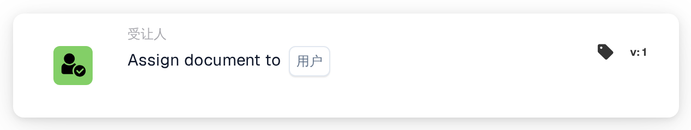
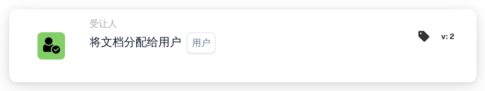
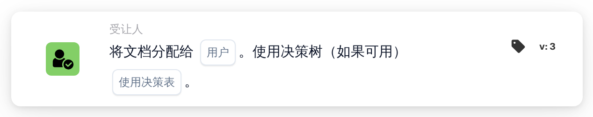

# 将文档分配给用户

<figure><figcaption>
版本 1
</figcaption></figure>

<figure><figcaption>
版本 2
</figcaption></figure>

<figure><figcaption>
版本 3
</figcaption></figure>

## **用途：**

**“Assign Document to User”（将文档分配给用户）**工作流卡片允许用户将文档分配给特定用户，确保文档能够流转到合适的人员，从而顺畅地管理工作流。版本 3 新增了使用决策树的功能，可根据现有条件动态确定分配对象。

## **卡片组件：**

1. **用户**
   * **说明：**指定接收文档的用户。
   * **详情：**提供包含所有可用用户的下拉列表供选择。选中的用户将接收该文档并进行后续处理。

## **版本 3 中的其他组件：**

1. **使用决策树**
   * **说明：**启用后，卡片会使用决策树动态确定分配对象。
   * **选项：**
     * **真实情况：**使用决策树动态分配用户。
     * **False：**将文档分配给所选用户，不使用决策树。

## **功能：**

* **条件评估：**\
  仅当 **“当”** 和 **“且”** 均评估为真时，卡片才会执行操作。
* **文档分配：**\
  卡片会将文档分配给所选用户，确保任务流转到合适的人员进行处理。这有助于明确责任并有效管理文档。
* **决策树（版本 3）：**\
  启用决策树后，卡片会评估树中定义的条件，以动态选择文档的分配对象。

## **设置与配置：**

* **选择用户：**\
  从下拉列表中选择要接收文档的**用户**。
* **使用决策树（版本3）：**\
  启用或停用决策树，以便动态选择用户。

## **结论：**

**“Assign Document to User”（将文档分配给用户）**工作流卡片通过将文档分配给所选用户来实现高效的文档流转。版本 3 还提供了使用决策树动态确定分配对象的灵活性，从而使工作流流程更加灵活、高效。

<!-- workflow-card-practical-example-20261021 -->

## 实际例子

**何时使用：** 将需要人工审核的发票发送给一名负责人。

**配置：** 选择已配置的用户`Demo Reviewer A`。

**预期结果和反例：**文档已分配给该用户。确认最终的文件分配；这张卡本身并不创建单独的复习任务。

这是说明性配置和预期结果。使用测试组织中配置的字段、用户和组；这并不是说这个例子已经被执行了。
