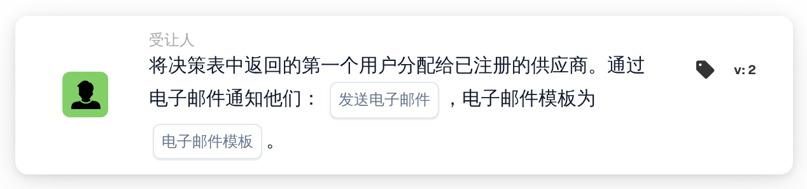

# 将决策表的第一个用户分配给供应商

<figure><figcaption>
版本 2
</figcaption></figure>

## 用途：

此工作流卡片根据决策表设置已注册供应商的分配用户。决策表返回的第一个用户会成为该供应商的分配用户，即负责该供应商的内部联系人。还可以通过电子邮件通知返回的用户。

与 **将用户分配给供应商** 一样，此卡片不处理文档：它适用于由供应商状态变化启动的工作流，例如使用 When 卡片 **供应商状态已更改** 启动的工作流。用户不是在卡片上选择的，而是由同一工作流中较早评估的决策表确定，例如通过卡片 **决策表有返回值** 评估。

## 卡片组件：

1. **发送电子邮件**
   * **描述：** 卡片的电子邮件设置。
   * **选项：** **True** 或 **False**。
   * **详细信息：** 选择 **True** 时，会使用所选的电子邮件模板发送电子邮件。选择 **False** 时，不发送电子邮件。如果未设置 **发送电子邮件**，同样不发送电子邮件。
2. **电子邮件模板**
   * **描述：** 用于电子邮件的模板。
   * **详细信息：** 可以选择组织中的一个或多个电子邮件模板。当 **发送电子邮件** 为 **True** 时会使用这些模板。

## 功能：

* **读取决策表：** 卡片读取工作流中较早评估的决策表所返回的用户。只考虑返回的用户，不考虑组。
* **电子邮件通知：** 发送电子邮件时，邮件会发给决策表返回的所有用户，而不仅仅是第一个用户。电子邮件会在用户被分配给供应商之前发送。
* **执行操作：** 返回的第一个用户会被保存为状态发生变化的供应商的分配用户。如果该供应商已有分配用户，则该用户会被替换。结果会记录在工作流日志中。
* **缺少数据：**
  * 如果决策表未返回任何用户，则不会分配任何内容，卡片会在工作流日志中报告缺少的数据。
  * 如果 **发送电子邮件** 为 **True** 但未选择任何电子邮件模板，卡片会停止且不分配用户，并报告缺少的数据。
  * 如果未设置 **发送电子邮件**，工作流日志会注明缺少该设置，用户会在不发送电子邮件的情况下被分配。
* **错误：** 如果电子邮件服务或供应商服务拒绝请求或未及时响应，卡片会以错误结束。如果电子邮件发送失败，用户不会被分配给供应商。

## 设置和配置：

* 可以在由供应商状态变化启动的工作流中使用此卡片。应在同一工作流中较早的位置评估一个返回用户的决策表。
* 可以从 **受让人** 类别中添加此卡片，然后设置 **发送电子邮件**，并选择一个或多个电子邮件模板。

## 结论：

“将决策表的第一个用户分配给供应商”工作流卡片会根据决策表中维护的规则，为供应商分配负责联系人。可选的电子邮件能让返回的用户立即了解该供应商。
