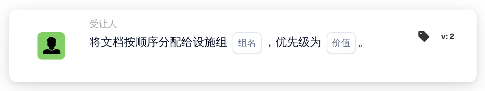

# 按顺序分配给设施组

<figure><figcaption>
版本 2
</figcaption></figure>

## 用途：

此工作流卡片会将负责文档采购订单所属设施的组加入文档的顺序分配中。与 **将文档分配给设施组** 一样，它通过匹配的采购订单的设施代码来查找组。不同的是，它不会立即分配文档，而是按优先级将该组加入审批人顺序，这样工作流中的多张顺序卡片就可以组成一条分配链。

## 卡片组件：

1. **组名**
   * **描述：** 各设施组共有的名称部分。
   * **详细信息：** 一段文本，用于与组织中用户组的名称进行比较。如果某个组的名称同时包含此文本和采购订单的设施代码，则该组匹配。比较时不区分大小写。例如，组名为 **Approver**、采购订单的设施为 **1000** 时，名为 **Approver 1000** 的组即可匹配。
2. **价值**
   * **描述：** 该组在顺序分配中的优先级。
   * **详细信息：** 一个整数。数字越小越靠前，0 为最高优先级。如果未输入值或输入了负值，则使用优先级 1。

## 功能：

* **查找设施：** 卡片读取与文档匹配的采购订单，并收集每个采购订单的设施代码（即采购订单的地点）。
* **查找组：** 对于每个设施代码，卡片会查找名称中同时包含卡片上的 **组名** 和该设施代码的用户组。未找到对应组的设施代码会列在工作流日志中。
* **执行操作：** 每个匹配的组都会以 **价值** 字段中的优先级加入顺序分配。实际分配在工作流运行结束时进行：优先级数字最小的条目最先分配，所有条目（包括第一个）都会作为审批请求保存在文档上。序列的后续步骤按优先级升序从这些条目中依次选取。如果在同一次运行中已有其他卡片直接分配了该文档，则会跳过这第一次顺序分配。
* **缺少数据：**
  * 如果卡片上未输入组名，卡片不会运行，并会在工作流日志中报告缺少的数据。
  * 如果文档未与任何采购订单匹配，卡片会报告缺少的数据，而不会添加组。
  * 如果没有任何组与任一设施代码匹配，则不会添加任何组，工作流日志会注明未找到匹配的组。

## 设置和配置：

* 用户组的命名应使每个名称都包含共同的名称部分和设施代码，例如 **Approver 1000**、**Approver 2000**。
* 可以从 **受让人** 类别中添加此卡片，然后在 **组名** 字段中输入各组共同的名称部分，并在 **价值** 字段中输入优先级。
* 如需组成审批人链，可以在工作流中组合多张顺序卡片，每张卡片设置各自的优先级，例如设施组的优先级为 1，中央组的优先级为 2。

## 结论：

“按顺序分配给设施组”工作流卡片会将负责的设施团队放在顺序审批中的指定位置。与其他顺序卡片配合使用，可以构建审批链，使设施团队成为多个步骤中的一步。
