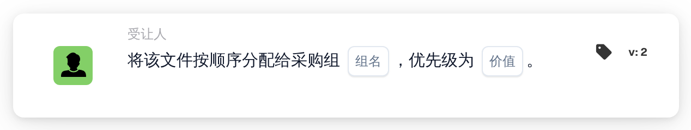

# 按顺序分配给采购组

<figure><figcaption>
版本 2
</figcaption></figure>

## **用途**

“**按顺序将文档分配给采购组**”工作流卡片可按顺序将文档分配给指定的采购组。优先级值决定分配顺序，数值越小，优先级越高。

## **卡片组件**

1. **组**
   * **描述**：用于输入采购组名称的文本字段。
   * **详情**：指定文档将被分配到的采购组。
2. **优先级（值）**
   * **描述**：用于设置该组优先级的数字输入字段。
   * **详情**：数值越小，优先级越高，从而确保文档按优先级升序分配给各组。

## **功能**

* **文档分配**：\
  此卡片会按顺序将文档分配给指定的采购组。\
  优先级值决定分配顺序，数值较小的优先处理。

## **设置与配置**

1. 将**按顺序分配文档**卡片添加到工作流中。
2. 配置**组**字段：
   * 在文本字段中输入采购组名称。
3. 配置**优先级（值）**字段：
   * 输入数字以设置分配优先级。
4. 保存并启用工作流以应用配置。

## **结论**

“按顺序将文档分配给采购组”工作流卡片可根据优先级有效地将文档分配给采购组，从而提高组织效率和任务管理水平。

<!-- workflow-card-practical-example-20261021 -->

## 实际例子

**何时使用：** 在文件审查中优先考虑采购组。

**配置：**选择`Demo Procurement`和优先级`10`。

**预期结果和反例：** 文件优先接收采购组分配`10`。检查后续分配是否使用预期的更高数字优先级。

这是说明性配置和预期结果。使用测试组织中配置的字段、用户和组；这并不是说这个例子已经被执行了。
