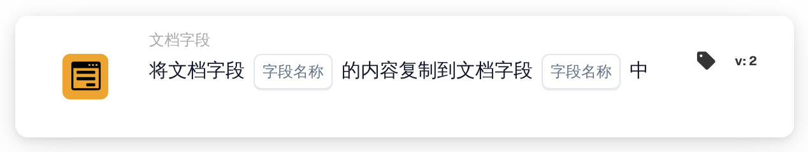

# 将文档字段复制到文档字段

<figure><figcaption>
版本 2
</figcaption></figure>

## 用途：

此工作流卡片会将一个文档字段的内容复制到同一文档的另一个文档字段中。例如，可以用它将已提取到其他字段中的值填入导出或后续卡片所需的字段。

## 卡片组件：

1. **字段名称**（第一个）
   * **描述：** 要复制其内容的文档字段。
   * **详细信息：** 文档字段的名称。名称按完全一致进行比较，区分大小写。该字段本身不会被更改。
2. **字段名称**（第二个）
   * **描述：** 内容要复制到的文档字段。
   * **详细信息：** 文档字段的名称。其当前内容会被复制的内容替换。

## 功能：

* **读取值：** 卡片在文档的字段中查找第一个字段并读取其值。找到的值会记录在工作流日志中。
* **执行操作：** 该值会写入第二个字段，并保存文档。复制的值按原样接收，不做任何转换。如果文档上尚不存在第二个字段，则会添加该字段。复制成功后，工作流中的后续卡片会使用新值。
* **缺少数据：**
  * 如果卡片上未设置两个字段名称中的任何一个，卡片不会运行，并会在工作流日志中报告缺少的数据。
  * 如果文档中没有与第一个名称对应的字段，则不会复制任何内容，卡片会报告在文档中未找到该字段。
* **错误：** 如果文档无法保存，例如因为其当前状态不允许更改，卡片会以错误结束，第二个字段会保留其原有内容。

## 设置和配置：

* 可以从 **文档字段** 类别中添加此卡片，然后在第一个 **字段名称** 位置设置复制来源字段，在第二个位置设置复制目标字段。
* 由于值在复制时不做转换，两个字段应存放同类数据，例如文本复制到文本，日期复制到日期。

## 结论：

“将文档字段复制到文档字段”工作流卡片无需人工操作即可在字段之间传递值。它能使相关字段保持一致，并让工作流的后续步骤以其所需的字段名称使用该值。
