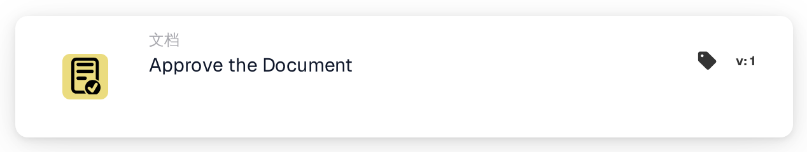
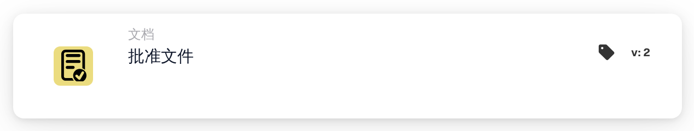

# 批准文档

<figure><figcaption>
版本 1
</figcaption></figure>

<figure><figcaption>
版本 2
</figcaption></figure>

## **用途：**

**“批准文件”** 工作流卡片用于将文档标记为已批准。它允许文档进入工作流的下一阶段，从而执行自动化处理或审批工作流。此卡片有助于简化文档管理流程，确保只有已批准的文档才能继续进行后续操作。

## **卡片组件：**

1. **审批状态**
   * **描述**：此组件用于将文档标记为已批准。
   * **详情**：触发此卡片时，文档的审批状态会更新为已批准。此操作可根据 **“当”** 和 **“且”** 中定义的条件执行。

## **功能：**

* **条件评估**：系统会评估 **“当”** 和 **“且”** 中设置的条件。
  * 如果**两个条件都为真**，文档将标记为已批准。
  * 如果**任一条件为假**，则不会执行此卡片，文档的审批状态保持不变。
* **执行操作**：满足条件后，文档将获批。此更改会反映在文档状态中，使其能够继续沿工作流流转。

## **结论：**

**“批准文件”** 工作流卡片是业务工作流中实现文档审批自动化的重要组成部分。通过确保只有符合特定条件的文档才能获批，它有助于保持一致性、减少人工监督，并让文档处理更加顺畅。

<!-- workflow-card-practical-example-20261021 -->

## 实际例子

**何时使用：** 在所有必需的审核条件通过后批准文档。

**配置：**将此操作放置在成功分支中的审核条件之后。使用等待批准的演示文档。

**预期结果和反例：**该操作批准该文档。未满足较早条件的文档永远不会达到此操作；仅获得批准并不能证明 ERP 导出已完成。

这是说明性配置和预期结果。使用测试组织中配置的字段、用户和组；这并不是说这个例子已经被执行了。
