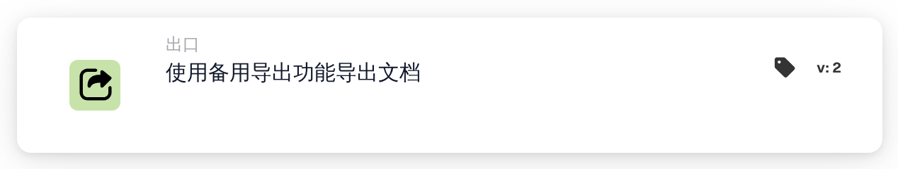

# 使用备用导出进行导出

<figure><figcaption>
版本 2
</figcaption></figure>

## 何时使用此卡

使用此“然后”操作进行当前文档类型上配置的备用导出。在添加操作之前配置并验证该路由。

## 配置来自文档类型

该卡没有导出配置选择器。它从文档类型设置中读取是否启用备用导出、备用导出配置以及导出后的状态。在内部，这些是 `DOC_ALTERNATE_EXPORT_SETTING`、`DOC_ALTERNATE_EXPORT_EXPORT_CONFIG` 和 `DOC_ALTERNATE_EXPORT_STATUS`。

显式禁用的备用导出会产生失败情况。报告缺少的激活数据、配置或结果状态，而不是默默地替换默认路由。导出请求检查待处理的任务。

## 验证结果

检查卡日志、导出历史记录、文档状态和授权测试目的地。仅请求、超时或状态更改并不能确定数据已到达目的地。在重试可能创建重复项的操作之前，请检查导出历史记录。

<!-- workflow-card-complete-example-20261021 action_alternate_export -->

### 备用导出示例

**配置：** 准备合成文档类型`DEMO_INVOICE`，启用备用导出、授权测试导出配置以及文档类型设置中所需的结果状态。在所需检查之后添加此“Then”操作。该卡读取这些设置；它不提供导出配置选择器。

**预期结果和反例：**操作请求通过备用配置导出并检查待处理任务。分别验证导出结果和测试目的地。禁用备用导出会导致失败情况；缺少激活设置或配置不是成功的导出。不要针对记帐目标运行此示例。

这是一个说明性的测试配置和预期结果；它没有被执行。使用测试组织中配置的数据和收件人。
