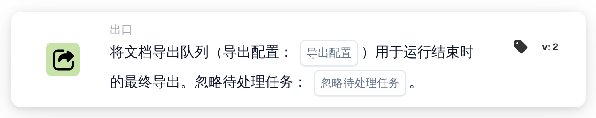
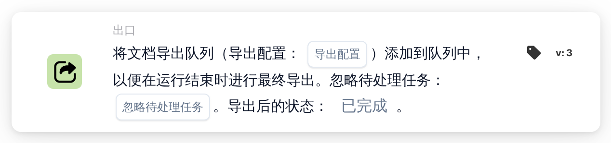

# 使用导出配置导出

<figure><figcaption>
版本 1
</figcaption></figure>

<figure><figcaption>
版本 3
</figcaption></figure>

<figure><figcaption>
将文档导出队列（导出配置：…）用于运行结束时的最终导出。忽略待处理任务：…。 — 版本 2
</figcaption></figure>

<figure><figcaption>
将文档导出队列（导出配置：…）添加到队列中，以便在运行结束时进行最终导出。忽略待处理任务：…。导出后的状态：…。 — 版本 3
</figcaption></figure>

## **目的：**

**“使用导出配置导出文档”** 工作流程卡旨在使用指定的导出配置导出文档。它可以灵活地忽略与文档关联的任何待处理任务，从而确保导出过程顺利进行，无论其当前状态如何。

## **卡的组成部分：**

1. **导出配置**
   * **描述**：指定用于处理文档的导出配置。
   * **详情**：此配置决定导出文档的格式、结构和目的地。
2. **忽略待处理任务**
   * **描述**：确定在导出过程中是否应忽略链接到文档的待处理任务。
   * **选项**：
     * **True**：导出文档，无论待处理任务如何。
     * **False**：确保挂起的任务在导出之前完成。

## **功能：**

* **条件评估**：系统评估工作流程**“当”**和**“且”**中设置的条件。如果两个条件都成立，则启动导出过程。
* **文档导出**：使用指定的**导出配置**，以定义的格式和目的地处理和导出文档。
* **待处理任务处理**：如果**忽略待处理任务** 设置为**True**，则导出过程将绕过链接到文档的任何未完成任务。如果设置为 **False**，挂起的任务会阻止导出。解决它们并安排预期的工作流触发器或重试。

## **设置和配置：**

要配置此卡，用户需要：

1. 选择所需的**导出配置**以定义文档的导出方式。
2. 通过将值设置为 **True** 或**False，选择是否**忽略待处理任务**。**
3. 确保正确设置**“当”**和**“且”**中的条件，因为卡仅在这些条件为真时执行其操作。

## **结论：**

**“使用导出配置导出文档”** 工作流程卡可确保文档根据预定义的配置高效导出。由于能够忽略待处理的任务，该卡可以灵活地处理各个阶段的文档，减少延迟并简化导出流程。

## 当前版本和待处理任务

在 v3 上，还选择**导出后状态**：`finished`导出成功后关闭文档； `exported` 将其保留以供进一步处理。早期版本保留`finished`。缺失选择默认为`finished`；无效的选择被拒绝。

如果未完成的任务阻止导出，该卡会报告拒绝情况。解决任务并安排预期的触发或重试；此卡不保证自动等待和恢复。单独的排队导出卡收集配置以在运行结束时进行最终导出。参见【导出卡片及结果状态](../../export-cards-guide.md)】。

<!-- workflow-card-practical-example-20261021 -->

## 实际例子

**何时使用：** 为已验证的文档选择特定的导出配置。

**配置：** 选择已配置的演示导出器并将忽略待处理任务设置为`false`。使用包含未完成任务的文档，然后进行没有未完成任务的单独测试。

**预期结果和反例：** 开放任务情况不能假定为自动恢复。解决任务后，再次触发预期导出并验证导出器结果和支持状态。

这是说明性配置和预期结果。使用测试组织中配置的字段、用户和组；这并不是说这个例子已经被执行了。
