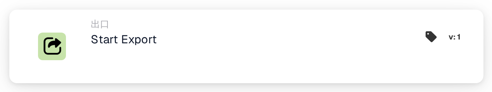
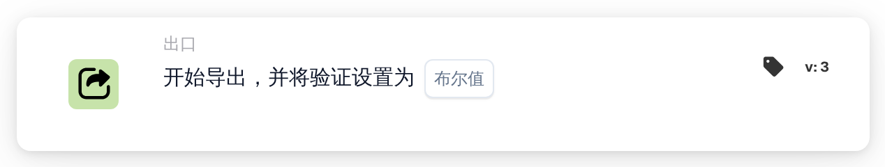
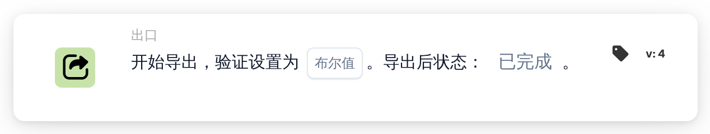

# 开始导出

<figure><figcaption>
版本 1
</figcaption></figure>

<figure><figcaption>
版本 2
</figcaption></figure>

<figure><figcaption>
版本 3
</figcaption></figure>

<figure><figcaption>
版本 4
</figcaption></figure>

## **目的：**

**“开始导出”**工作流程卡旨在启动文档的导出过程。该卡充当工作流程中的触发器，一旦满足前面部分中的条件，即可无缝启动导出操作。

## **卡的组成部分：**

1. **动作**
   1. **描述**：启动文档的导出过程。
   2. **详细信息**：卡使用系统中配置的导出设置来处理和导出文档。

## **功能：**

* **条件评估**：系统评估工作流程**“当”**和**“且”**中设置的条件。如果所有条件均成立，则导出过程开始。
* **文档导出**：使用默认或之前定义的导出配置处理和导出文档。

## **设置和配置：**

早期版本使用系统中已定义的导出设置。在版本 4 上，配置验证并选择导出后的状态。另请检查：

1. **“当”** 和 **“且”** 条件已正确配置，因为卡仅在这些条件评估为 true 时执行。
2. 有效的导出配置与系统中的文档相关联。

## **结论：**

**“开始导出”**工作流程卡提供了一种简化且自动化的方式来触发导出过程。通过依赖预先配置的设置和条件评估，它确保高效、准确的文档处理。

## 卡版本和结果状态

上面关于没有特定于卡的配置的声明适用于早期的“开始导出”卡。开始导出并验证 v4 包括验证和导出后的**状态**。选择`finished`关闭成功导出的文档，或选择`exported`将其保持打开状态以进行进一步处理。早期版本保留`finished`。有关默认值、错误和测试，请参阅[导出卡和结果状态](../../export-cards-guide.md)。

<!-- workflow-card-practical-example-20261021 -->

## 实际例子

**何时使用：** 通过所需检查后导出文档。

**配置：** 选择支持的导出后状态，例如当文档必须保持可用于进一步处理时为`exported`。确保已配置的导出器和所需数据已准备就绪。

**预期结果及反例：**导出成功后，应用所选结果状态。导出器错误不是已完成的导出；检查其日志并测试失败分支。

这是说明性配置和预期结果。使用测试组织中配置的字段、用户和组；这并不是说这个例子已经被执行了。
