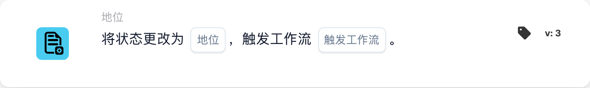

# 将状态更改为

<figure><figcaption>
所示版本的卡片字段。占位字段尚未配置。 此版本界面的部分标签尚未翻译或翻译不准确。本页说明使用正确术语；图片保留了实际界面。
</figcaption></figure>

## **用途：**

**“更改状态”**工作流卡用于将文档状态更改为预定义状态之一——**错误、已拒绝、待验证、待审批、待二次审批**，并可根据状态更改触发相关工作流。此卡可自动完成状态更新和工作流触发，帮助高效管理文档并处理错误。

## **卡片组件：**

1. **状态**
   * **说明**：指定要应用于文档的新状态。
   * **选项**：
     * **错误**：标记文档发生错误。
     * **已拒绝**：表示文档已被拒绝，不会继续处理。
     * **待验证**：将文档设为待处理状态，由下一位用户或系统流程审核并验证。
     * **待审批**：将文档置于待审批状态。
     * **待二次审批**：如果适用，将文档暂缓处理，等待第二级审批。
2. **触发工作流**
   * **说明**：确定状态更改后是否应触发后续工作流。
   * **选项**：
     * **True**：根据状态更改启动相关工作流。
     * **False**：状态更改后不执行工作流。

## **功能：**

* **条件评估**：系统评估 **“当”** 和 **“且”** 中设置的条件。如果这些条件为真，卡片会将文档状态更改为所选值。
* **状态更新**：满足条件后，系统会根据用户的选择，将文档状态更新为预定义选项之一（错误、已拒绝、待验证、待审批、待二次审批）。
* **触发工作流操作**：如果 **触发工作流** 设置为 **True**，系统会在状态更新后自动启动相关工作流。如果设置为 **False**，则不会触发其他工作流，流程在状态更改后结束。

## **设置与配置：**

配置此卡片时，用户需要：

1. 指定条件评估后要为文档设置的 **状态**（错误、已拒绝、待验证、待审批或待二次审批）。
2. 选择状态更改后是否 **触发工作流**，并设置为 **True** 或 **False**。
3. 仅当 **“当”** 和 **“且”** 中的两个条件评估结果均为真时，卡片才会执行操作。

## **总结：**

**“更改状态”**工作流卡提供了一种简化的方式来管理文档状态并触发相关工作流。它可确保文档自动流转到正确的状态，并根据状态更改执行必要操作。通过设置明确的执行条件，它能减少手动操作并提高工作流效率。

<!-- workflow-card-practical-example-20261021 -->

## 实际示例

**何时使用:** 将已检查的单据交给审批环节。

**位置:** 标准工作流设计器 → 然后 → 状态 → 将状态更改为。

**配置:** 选择 `staus_change` 的第 3 版，将状态设为待批准（`validated_pending_approval`），并将触发其他工作流设为 `false`（`trigger_docflow=false`）。使用一张隔离的合成发票，并确保前面的检查条件已满足。

**预期结果与反例:** 只有获准且成功的更新，才会把单据改为选定状态。如果前面的条件不成立，就不会执行这张动作卡片，也不会由此改变状态。API 拒绝更新或更新失败不算成功，应检查实际状态和日志。这张卡片本身不执行导出。

### 卡片版本

显式控制是否触发其他工作流的开关位于第 3 版。第 1、2 版没有这个开关，其旧版更新路径使用默认的工作流触发行为。切换到旧版后，不应假定第 3 版的 `false` 设置仍然有效。

此配置和预期结果已对照执行代码核实；未执行工作流或状态更新。
