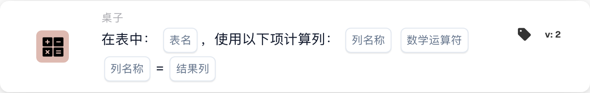

# 使用以下方式计算列

<figure><figcaption>
所示版本的卡片字段。占位字段尚未配置。 此版本界面的部分标签尚未翻译或翻译不准确。本页说明使用正确术语；图片保留了实际界面。
</figcaption></figure>

## **用途：**

**“在表格中计算列”**工作流卡片用于对所选表格中的列进行计算。用户可以选择列、应用数学运算，并将结果存储在指定的结果列中。

## **卡片组件：**

1. **表格名称**
   * **说明：**指定要进行列计算的**表格**。
   * **详情：**提供包含所有可用**表格**的下拉列表供用户选择。
2. **列名称（第 1 列）**
   * **说明：**指定要参与计算的**第一列**。
   * **详情：**提供包含所有可用**列**的列表供用户选择。
3. **运算**
   * **说明：**定义所选列之间要执行的数学运算。
   * **选项：**
     * **加法 (+)：**将第二列的值加到第一列的值上。
     * **减法 (-)：**从第一列的值中减去第二列的值。
     * **乘法 (\*):** 将第一列的值乘以第二列的值。
     * **除法 (/)：**将第一列的值除以第二列的值。
4. **列名称（第 2 列）**
   * **说明：**指定要参与计算的**第二列**。
   * **详情：**提供可用**列**的列表供用户选择。
5. **结果列**
   * **说明：**指定用于存储计算结果的**列**。
   * **详情：**提供可用**列**的列表，计算结果将保存到所选列中。

## **功能：**

* **条件评估：**\
  只有当 **“当”** 和 **“且”** 的条件都评估为真时，此卡片才会执行操作。
* **列计算：**\
  此卡片会对所选的两列执行指定的数学运算。
* **结果存储：**\
  计算结果会存储在所选的**结果列**中。

## **设置和配置：**

* **选择表格：**\
  选择要进行列计算的**表格**。
* **选择列：**\
  选择用于计算的**第一列**和**第二列**。
* **选择运算：**\
  选择要在两列之间执行的数学运算（**加法 (+)**、**减法 (-)**、**乘法 (\*)**、**除法 (/)**）。
* **选择结果列：**\
  选择用于存储计算结果的**结果列**。

## **结论：**

**“在表格中计算列”**工作流卡片支持用户对表格中的列进行动态计算，并将结果存储在指定列中。此卡片提供多种数学运算选项，并确保结果保存在指定的列中。

<!-- workflow-card-practical-example-20261021 -->

## 实际例子

**何时使用：** 根据数量和单价计算行总计。

**配置：** 选择表`lines`、列`quantity` 和`unit_price`、乘法和结果列`line_total`。

**预期结果和反例：** 包含`2`和`10`的行产生`20`。独立测试另一行并诊断缺失或非数字输入，而不是将其视为有效总计。

这是说明性配置和预期结果。使用测试组织中配置的字段、用户和组；这并不是说这个例子已经被执行了。
