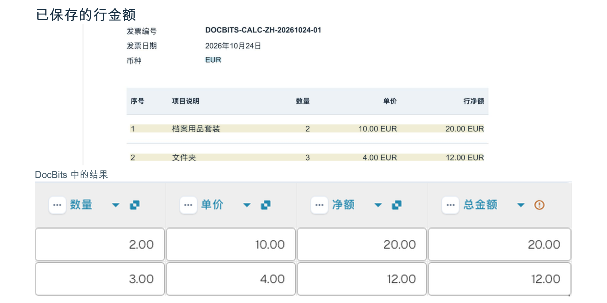

# 使用以下方式计算列

此卡片对同一表格中的两列执行数学运算，并把每一行的结果保存到目标列。

## 何时何处使用

当工作流的下一步需要计算每一行的值时使用此卡片，例如 **数量 × 单价**。在 **然后** 区域的 **表格** 类别中添加卡片。计算前，先确认两列输入都是数字，并且所需数据完整。

<figure><figcaption>
卡片版本 2：INVOICE_TABLE，数量 × 单价 → TOTAL_AMOUNT。界面会重复显示表格名称。
</figcaption></figure>

## 管理员视频

**37 秒 · 简体中文。** 陈伟说明何时使用这张卡片，演示乘法配置，并展示同一张示例发票中保存的结果。



[观看带中文字幕的视频](https://docbits-videos.fra1.cdn.digitaloceanspaces.com/settings-assistant/workflow-card-calc-columns-admin/v1/zh.html) · [阅读文字稿](https://docbits-videos.fra1.cdn.digitaloceanspaces.com/settings-assistant/workflow-card-calc-columns-admin/v1/zh.txt)

## 配置卡片

| 设置 | 示例中的选择 |
| --- | --- |
| 表格 | `INVOICE_TABLE` |
| 第一列 | `QUANTITY` — 数量 |
| 运算 | `*` — 乘法 |
| 第二列 | `UNIT_PRICE` — 单价 |
| 结果列 | `TOTAL_AMOUNT` — 总金额 |

还可以使用 `+`（加法）、`-`（减法）和 `/`（除法）。使用减法或除法时，两列的先后顺序会影响结果。请选择您的组织中配置的表格和列标识。

<!-- workflow-card-practical-example-20261021 -->

## 已验证的实际示例

示例发票包含两行。计算前，结果列尚不存在：

| 行 | 数量 | 单价 | `TOTAL_AMOUNT` 中保存的值 |
| --- | --- | --- | --- |
| 1 | 2 | 10 | 20 |
| 2 | 3 | 4 | 12 |

在所示测试中，卡片创建了结果列。重新打开同一张发票后，**总金额** 列中显示 `20.00` 和 `12.00`。本例中的输入列和 `NET_AMOUNT` 原有值保持不变。如果所选结果列已经有值，计算结果会覆盖这些值。

<figure><picture><source srcset="../../../../../.gitbook/assets/workflow-card-calc-columns-saved-result-zh-dark-20261025.png" media="(prefers-color-scheme: dark)"></picture><figcaption>
重新打开同一张发票后，两行的 TOTAL_AMOUNT 仍为 20.00 和 12.00，原始 NET_AMOUNT 金额保持不变。
</figcaption></figure>

## 检查和反例

计算前检查两列输入，计算后核对保存的结果。

- 本例中缺少单价时，结果可能为零。零并不表示数据完整：请在计算前检查输入。
- 输入 `ABC` 等文字而非数字时，会出现计算错误。请修正输入并再次检查。

这两个反例描述的是预期结果，并不是对所示发票的额外执行。
