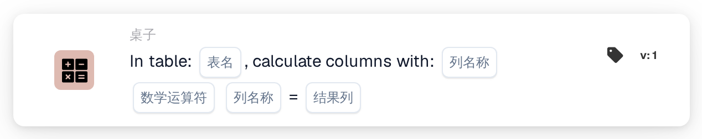
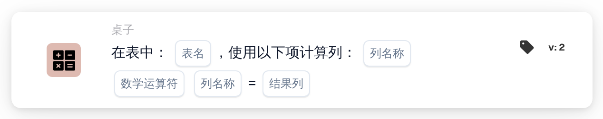

# 使用以下方式计算列

<figure><figcaption>
版本 1
</figcaption></figure>

<figure><figcaption>
版本 2
</figcaption></figure>

## 用途：

此工作流卡片逐行根据文档上某个表格的两列计算一个值，并将结果保存到结果列中。例如，可以用它根据数量和单价计算行合计。

## 管理员视频：



[观看带中文字幕的视频](https://docbits-videos.fra1.cdn.digitaloceanspaces.com/settings-assistant/workflow-card-calc-columns-admin/v1/zh.html) · [阅读文字稿](https://docbits-videos.fra1.cdn.digitaloceanspaces.com/settings-assistant/workflow-card-calc-columns-admin/v1/zh.txt)

## 卡片组件：

1. **表格**
   * **描述：** 文档上执行计算的表格。
2. **第一列**
   * **描述：** 包含每行第一个值的列。
3. **运算**
   * **选项：**
     * **+** 将第二个值加到第一个值上。
     * **-** 从第一个值中减去第二个值。
     * **\*** 将两个值相乘。
     * **/** 用第一个值除以第二个值。
4. **第二列**
   * **描述：** 包含每行第二个值的列。
5. **结果列**
   * **描述：** 保存每行结果的列。
   * **详细信息：** 列名以大写字母保存，空格替换为下划线（`total amount` 变为 `TOTAL_AMOUNT`）。如果该列尚不存在，卡片会添加该列；如果已存在，则替换其值。

该卡片的版本 1 和版本 2 设置相同，工作方式也相同。

## 功能：

* **计算：** 卡片针对表格的每一行读取两列的值（列名不区分大小写），执行运算，并将结果写入结果列。结果四舍五入到四位小数。随后，文档会以新值保存。
  * 空值或缺失值按 `0` 计算。如果一行的两个值都为空，该行的结果保持为空。
  * 除以零时，该行的结果保持为空。
  * 使用 **+** 时，两个非数字值会用空格连接，而不是相加。使用其他运算时，非数字值会导致错误，并且不会保存任何结果。
* **执行操作：** 如果计算和保存成功，工作流将继续执行后续卡片。如果文档上不存在该表格、某个值无法计算或文档无法保存，卡片会在工作流日志中报告错误。
* **测试卡片：** 使用 **测试卡片** 运行此卡片时，计算仅为模拟，文档不会被更改。

## 设置和配置：

* 可以从 **表格** 类别中添加此卡片作为 Then 操作，然后选择表格、两列、运算和结果列。
* **示例：** 表格 `INVOICE_TABLE`，`QUANTITY` **\*** `UNIT_PRICE`，结果列 `TOTAL_AMOUNT`。数量为 2、单价为 10 的行得到 20，值为 3 和 4 的行得到 12。
* 由于空值按 `0` 计算，缺少价格时结果为 `0`。检查输入列是否已填写（例如在此卡片之前使用一个条件）有助于避免错误的合计。
* 对于减法和除法，两列的顺序很重要。

## 结论：

“使用以下方式计算列”工作流卡片会自动为表格行添加计算值。行合计及类似的值无需手动计算，即可供后续卡片和导出使用。
