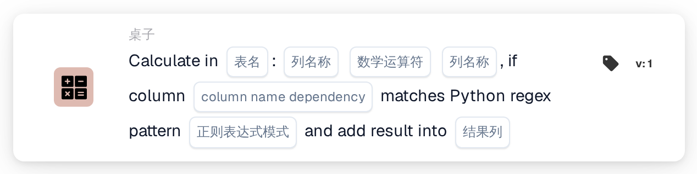
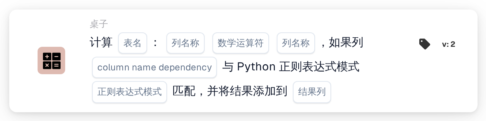

# 在表格中计算

<figure><figcaption>
版本 1
</figcaption></figure>

<figure><figcaption>
版本 2
</figcaption></figure>

## **用途：**

**“使用正则表达式依赖项进行计算”（Calculate with Regex Dependency）**工作流卡片允许用户对所选表格中的列进行计算，并根据应用于依赖列的正则表达式（regex）模式添加条件。如果模式匹配，则执行计算，并将结果存储在指定的结果列中。

## **卡片组件：**

1. **表格名称**
   * **说明：**指定要对其中的列进行计算的**表格**。
   * **详情：**提供所有可用**表格**的下拉列表供用户选择。
2. **列名称（第 1 列）**
   * **说明：**指定参与计算的**第一列**。
   * **详情：**提供所有可用**列**的列表供用户选择。
3. **运算**
   * **说明：**定义所选列之间要执行的数学运算。
   * **选项：**
     * **加法 (+)：**将第二列的值加到第一列的值上。
     * **减法 (-)：**用第一列的值减去第二列的值。
     * **乘法 (\*)：**将第一列的值乘以第二列的值。
     * **除法 (/)：**用第一列的值除以第二列的值。
4. **列名称（第 2 列）**
   * **说明：**指定参与计算的**第二列**。
   * **详情：**提供所有可用**列**的列表供用户选择。
5. **列名称（依赖项）**
   * **说明：**指定要应用正则表达式模式的**依赖列**。
   * **详情：**提供所有可用**列**的列表供用户进行模式匹配。
6. **正则表达式模式**
   * **说明：**定义用于匹配依赖列的**正则表达式模式**。
   * **详情：**如果依赖列中的值与正则表达式模式匹配，则执行计算。
7. **结果列**
   * **说明：**指定用于存储计算结果的**结果列**。
   * **详情：**可以选择新列或现有列来存储计算值。

## **功能：**

* **条件评估：**
  * 只有当**“当”**和**“且”**的评估结果均为 true 时，该卡片才会执行其操作。
  * 只有当依赖列中的值与提供的**正则表达式模式**匹配时，该卡片才会执行其操作。
* **列计算：**\
  如果正则表达式模式匹配，该卡片会对所选的两列执行所选数学运算。
* **存储结果：**\
  计算结果会存储在所选的**结果列**中。

## **设置与配置：**

* **选择表格：**\
  选择要对其中的列进行计算的**表格**。
* **选择列：**\
  选择用于计算的**第一列**和**第二列**。
* **选择运算：**\
  选择要在两列之间执行的数学运算（**加法 (+)**、**减法 (-)**、**乘法 (\*)**、**除法 (/)**）。
* **选择依赖列：**\
  选择要应用正则表达式模式的**依赖列**。
* **定义正则表达式模式：**\
  输入依赖列应匹配的**正则表达式模式**。
* **选择结果列：**\
  选择用于存储计算值的**结果列**。

## **总结：**

**“使用正则表达式依赖项进行计算”（Calculate with Regex Dependency）**工作流卡片提供了一种基于正则表达式模式条件进行计算的强大方式。这样，只有依赖列与指定模式匹配的行才会执行相应计算，并将结果存储在所选结果列中。

<!-- workflow-card-practical-example-20261021 -->

## 实际例子

**何时使用：** 仅计算选定的表行。

**配置：** 使用演示表`lines`以及数字列`quantity`和`unit_price`。通过依赖列和正则表达式选择匹配的行，将数字列相乘并写入`line_total`。

**预期结果和反例：**具有`2`和`10`的选定行接收`20`。必须单独检查不匹配的行，以确认它未被选择进行计算。

这是说明性配置和预期结果。使用测试组织中配置的字段、用户和组；这并不是说这个例子已经被执行了。
