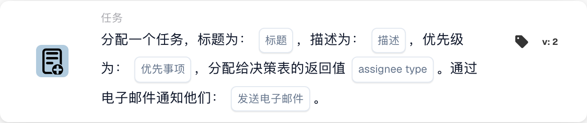

# 分配带标题的任务

<figure><figcaption>
所示版本的卡片字段。占位字段尚未配置。 此版本界面的部分标签尚未翻译或翻译不准确。本页说明使用正确术语；图片保留了实际界面。
</figcaption></figure>

## **用途：**

“Assign Task / Notification from Decision Table”工作流卡片旨在根据决策表的结果动态分配任务或通知。此卡片可确保根据决策表中定义的逻辑，将任务或通知分配给正确的用户或群组，并可选择向接收者发送电子邮件通知。

## **卡片组件：**

1. **标题**
   * **说明**：指定要创建的任务或通知的标题。
   * **详情**：标题应提供背景信息，并说明任务或通知的用途。
2. **描述**
   * **说明**：定义任务或通知的内容或用途。
   * **详情**：提供有关任务或通知的更多信息，解释其背景或需要执行的操作。
3. **优先级**
   * **说明**：定义任务或通知的紧急程度。
   * **选项**：
     * **High**：需要立即处理的任务或通知。
     * **中等**：应尽快处理的重要任务。
     * **Low**：可以稍后处理的任务。
4. **受派人类型**
   * **说明**：根据决策表的输出，指定被分配任务或通知的用户或群组。
   * **详情**：决策表会动态评估条件，并返回适当的用户或群组以进行分配。
5. **电子邮件通知**
   * **说明**：设置是否向被分配的用户或群组发送电子邮件通知。
   * **选项**：
     * **True**：向接收者发送电子邮件通知。
     * **False**：不发送电子邮件通知。

#### **版本 3 中的其他组件**

1. **通知类型**
   * **说明**：指定此卡片创建的是任务还是通知。
   * **选项**：
     * **任务**：创建任务，并将其分配给决策表返回的用户或群组。
     * **Notification**：向决策表返回的用户或群组发送通知。

## **功能：**

* **条件评估：**\
  只有当**“当”**和**“且”**都评估为 true 时，此卡片才会执行其操作。
* **任务 / 通知分配**\
  此卡片会将任务或通知分配给决策表指定的用户或群组。决策表会动态评估预定义条件，并返回相应的接收者。
* **电子邮件通知**\
  如果已启用，则会向被分配的用户或群组发送电子邮件通知。
* **版本 3 功能**\
  在版本 3 中，此卡片允许创建任务或通知，为任务管理和沟通提供更大的灵活性。

## **设置与配置：**

1. **定义任务或通知详情**：\
   输入任务或通知的标题、描述和优先级。
2. **配置决策表**：\
   设置决策表，以动态确定应将任务或通知分配给哪个用户或群组。
3. **启用电子邮件通知**：\
   指定是否应向被分配的用户或群组发送电子邮件通知。
4. **指定通知类型（版本 3）**：\
   选择此卡片是创建任务还是发送通知。

## **结论：**

**“从决策表分配任务/通知”**工作流卡片可根据决策表中定义的动态条件，自动分配任务或通知。版本 3 增强了此卡片的功能，允许用户选择创建任务或通知，并确保始终将其分配给正确的接收者。电子邮件通知功能可让用户及时了解情况，从而简化沟通和任务管理。

<!-- workflow-card-practical-example-20261021 -->

## 实际例子

**何时使用：** 为决策表返回的分配对象创建任务。

**配置：** 使用匹配的演示规则返回`Demo Reviewer A`、标题`Review invoice` 和所需的优先级。

**预期结果及反例：** 根据返回的分配对象来分配结果任务。单独测试不匹配的规则并检查卡片日志。

这是说明性配置和预期结果。使用测试组织中配置的字段、用户和组；这并不是说这个例子已经被执行了。
