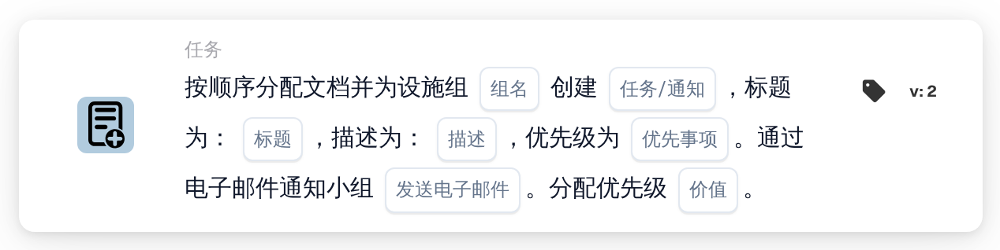

# 分配给设施组并创建任务/通知

<figure><figcaption>
版本 2
</figcaption></figure>

## 用途：

此工作流卡片会将负责文档采购订单所属设施的组加入文档的顺序分配中，并为这一步附加一项任务或通知。设施取自与文档匹配的采购订单，组则按名称查找，其名称同时包含卡片上输入的组名和设施代码。该任务或通知属于该组在序列中的那一步。

## 卡片组件：

1. **任务/通知**
   * **描述：** 定义为该组创建任务还是通知。
   * **选项：**
     * **任务：** 创建一项任务。
     * **通知：** 创建一条通知。
2. **组名**
   * **描述：** 各设施组共有的名称部分。
   * **详细信息：** 一段文本，用于与组织中用户组的名称进行比较。如果某个组的名称同时包含此文本和采购订单的设施代码，则该组匹配。比较时不区分大小写。例如，组名为 **Approver**、采购订单的设施为 **1000** 时，名为 **Approver 1000** 的组即可匹配。
3. **标题**
   * **描述：** 任务或通知的标题。
   * **详细信息：** 用于标识任务或通知的简短文本。
4. **描述**
   * **描述：** 有关任务或通知的更多详细信息。
   * **详细信息：** 一段文本，说明需要做什么或为什么通知该组。
5. **优先事项**
   * **描述：** 任务或通知的紧急程度。
   * **选项：**
     * **高重量：** 以高优先级创建任务或通知。
     * **中等重量：** 以中优先级创建任务或通知。
     * **低重量：** 以低优先级创建任务或通知。
6. **发送电子邮件**
   * **描述：** 定义是否同时通过电子邮件将任务告知该组。
   * **选项：**
     * **True：** 向该组发送电子邮件通知。
     * **False：** 不发送电子邮件通知。
7. **价值**
   * **描述：** 该组在顺序分配中的优先级。
   * **详细信息：** 一个整数。数字越小越靠前，0 为最高优先级。如果未输入值或输入了负值，则使用优先级 1。

## 功能：

* **查找设施：** 卡片读取与文档匹配的采购订单，并收集每个采购订单的设施代码（即采购订单的地点）。
* **查找组：** 对于每个设施代码，卡片会查找名称中同时包含卡片上的 **组名** 和该设施代码的用户组。未找到对应组的设施代码会列在工作流日志中。
* **执行操作：** 每个匹配的组都会以 **价值** 字段中的优先级连同任务或通知一起加入顺序分配。实际分配在工作流运行结束时进行：优先级数字最小的条目最先分配，并创建其任务或通知。所有条目（包括第一个）都会作为审批请求保存在文档上，序列的后续步骤按优先级升序从这些条目中依次选取。如果在同一次运行中已有其他卡片直接分配了该文档，则会跳过这第一次顺序分配，其任务或通知也不会在本次运行中创建。
* **默认值：** 如果未设置任务优先级，则使用 **中等重量**。如果未设置 **发送电子邮件**，则不发送电子邮件。如果未设置 **任务/通知**，则创建任务，并且工作流日志会注明缺少该设置。
* **缺少数据：**
  * 如果组名、标题或描述为空，卡片不会运行，并会在工作流日志中报告缺少的数据。
  * 如果文档未与任何采购订单匹配，卡片会报告缺少的数据，而不会添加组。
  * 如果没有任何组与任一设施代码匹配，则不会添加任何组，工作流日志会注明未找到匹配的组。

## 设置和配置：

* 用户组的命名应使每个名称都包含共同的名称部分和设施代码，例如 **Approver 1000**、**Approver 2000**。
* 可以从 **任务** 类别中添加此卡片，然后配置类型（**任务** 或 **通知**）、各组共同的名称部分、标题、描述、任务优先级、电子邮件设置以及在序列中的位置（**价值**）。
* 如需组成审批人链，可以在工作流中组合多张顺序卡片，每张卡片设置各自的 **价值**。

## 结论：

“分配给设施组并创建任务/通知”工作流卡片会将负责的设施团队放在顺序审批中的指定位置，并为其这一步分配明确的任务。只要用户组遵循统一的命名规则并在名称中包含设施代码，一张卡片即可覆盖所有设施。
