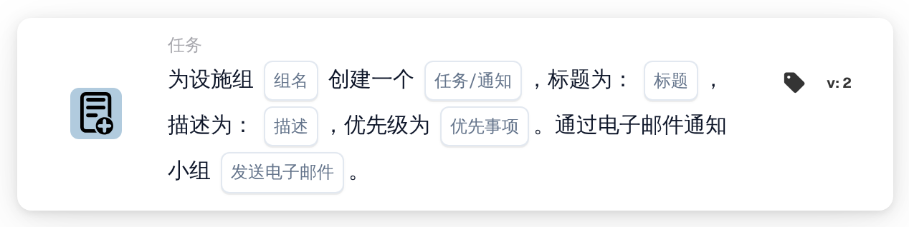

# 创建新任务并分配给设施组

<figure><figcaption>
版本 2
</figcaption></figure>

## 用途：

此工作流卡片会为负责文档采购订单所属设施的组创建一项任务或通知。设施并不在卡片上选择，而是取自与文档匹配的采购订单。随后，卡片会查找名称中同时包含卡片上输入的组名和设施代码的用户组，并为该组创建任务。文档本身不会被重新分配。

如果需要一张同时将文档作为顺序分配的一部分分配给设施组的卡片，可以使用 **分配给设施组并创建任务/通知**。

## 卡片组件：

1. **任务/通知**
   * **描述：** 定义为该组创建任务还是通知。
   * **选项：**
     * **任务：** 创建一项任务。
     * **通知：** 创建一条通知。
2. **组名**
   * **描述：** 各设施组共有的名称部分。
   * **详细信息：** 一段文本，用于与组织中用户组的名称进行比较。如果某个组的名称同时包含此文本和采购订单的设施代码，则该组匹配。比较时不区分大小写。例如，组名为 **Warehouse**、采购订单的设施为 **1000** 时，名为 **Warehouse 1000** 的组即可匹配。
3. **标题**
   * **描述：** 任务或通知的标题。
   * **详细信息：** 用于标识任务或通知的简短文本。
4. **描述**
   * **描述：** 有关任务或通知的更多详细信息。
   * **详细信息：** 一段文本，说明需要做什么或为什么通知该组。
5. **优先事项**
   * **描述：** 任务或通知的紧急程度。
   * **选项：**
     * **高重量：** 以高优先级创建任务或通知。
     * **中等重量：** 以中优先级创建任务或通知。
     * **低重量：** 以低优先级创建任务或通知。
6. **发送电子邮件**
   * **描述：** 定义是否同时通过电子邮件将任务告知该组。
   * **选项：**
     * **True：** 向该组发送电子邮件通知。
     * **False：** 不发送电子邮件通知。

## 功能：

* **查找设施：** 卡片读取与文档匹配的采购订单，并收集每个采购订单的设施代码（即采购订单的地点）。
* **查找组：** 对于每个设施代码，卡片会查找名称中同时包含卡片上的 **组名** 和该设施代码的用户组。未找到对应组的设施代码会列在工作流日志中。
* **创建任务：** 系统会为匹配的组创建一项使用卡片上标题、描述和优先级的任务或通知，并将其关联到该文档。如果有多个组匹配，任务只会为其中一个组创建；具体是哪一个，并不由卡片决定。
* **默认值：** 如果未设置优先级，则使用 **中等重量**。如果未设置 **发送电子邮件**，则不发送电子邮件。如果未设置 **任务/通知**，则创建任务，并且工作流日志会注明缺少该设置。
* **缺少数据：**
  * 如果组名、标题或描述为空，卡片不会运行，并会在工作流日志中报告缺少的数据。
  * 如果文档未与任何采购订单匹配，卡片会报告缺少的数据，而不会创建任务。
  * 如果没有任何组与任一设施代码匹配，则不会创建任务，工作流日志会注明未找到匹配的组。

## 设置和配置：

* 用户组的命名应使每个名称都包含共同的名称部分和设施代码，例如 **Warehouse 1000**、**Warehouse 2000**。
* 可以从 **任务** 类别中添加此卡片，然后配置类型（**任务** 或 **通知**）、各组共同的名称部分、标题、描述、优先级和电子邮件设置。

## 结论：

“创建新任务并分配给设施组”工作流卡片可以让相应设施的团队参与流程，而不改变文档的分配对象。只要用户组遵循统一的命名规则并在名称中包含设施代码，一张卡片即可覆盖所有设施。
