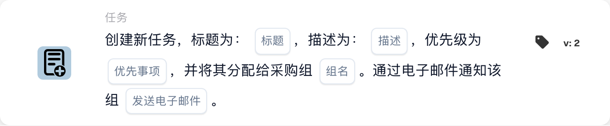

# 创建新任务并将其分配给采购组

<figure><figcaption>
所示版本的卡片字段。占位字段尚未配置。 此版本界面的部分标签尚未翻译或翻译不准确。本页说明使用正确术语；图片保留了实际界面。
</figcaption></figure>

## **用途：**

**“为采购组创建任务”**工作流卡片会创建一个新任务，并根据配置动态分配给指定的采购组。任务可以设置不同的优先级，还可以选择发送电子邮件通知，告知该组有新任务。此卡片可根据工作流条件提醒正确的团队。

## **卡片组件：**

1. **标题**
   * **说明：**指定任务的标题。
   * **详情：**此字段用于标识所创建的任务，并提供简洁的标题，便于快速识别。
2. **描述**
   * **说明：**提供任务的详细信息。
   * **详情：**此字段用于说明任务目标，以及必要的背景信息或操作说明。
3. **优先级**
   * **说明：**定义任务的紧急程度。
   * **选项：**
     * **高：**任务需要立即处理。
     * **中：**任务很重要，但不紧急。
     * **低：**任务可以稍后处理。
4. **组名称**
   * **说明：**指定要将任务分配给哪个采购组。
   * **详情：**此字段用于指定负责该任务的采购组，确保任务分配给正确的团队。
5. **电子邮件通知**
   * **说明：**设置是否向已分配任务的采购组发送电子邮件通知。
   * **选项：**
     * **真实情况：**向采购组发送电子邮件通知。
     * **False：**不发送电子邮件通知。

## **功能：**

* **条件评估：**\
  只有当 **“当”** 和 **“且”** 均评估为 true 时，此卡片才会执行操作。
* **创建任务：**\
  此卡片会创建一个新任务，并将其分配给“组名称”字段中指定的采购组。任务将包含指定的标题、描述和优先级。
* **电子邮件通知：**\
  如果电子邮件通知选项设为 true，系统会向采购组发送电子邮件，告知他们有新任务。

## **设置和配置：**

* **定义任务详情：**\
  输入任务的标题、描述和优先级。
* **选择采购组：**\
  选择负责该任务的采购组。
* **启用电子邮件通知：**\
  指定创建任务后是否向该组发送电子邮件通知。

## **结论：**

“为采购组创建任务”工作流卡片可确保任务自动分配给合适的采购组，并设置相应的优先级。此卡片还可以通过电子邮件通知该组及时处理任务，从而提高工作流效率和任务管理水平。

<!-- workflow-card-practical-example-20261021 -->

## 实际例子

**何时使用：** 要求采购团队审核发票异常。

**配置：**选择`Demo Procurement`、标题`Review order variance`、描述和优先级。

**预期结果及反例：** 为选定的采购组创建任务。检查任务负责人及描述；仅创建并不能确认差异已得到解决。

这是说明性配置和预期结果。使用测试组织中配置的字段、用户和组；这并不是说这个例子已经被执行了。
