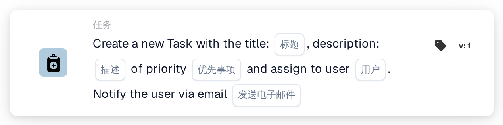
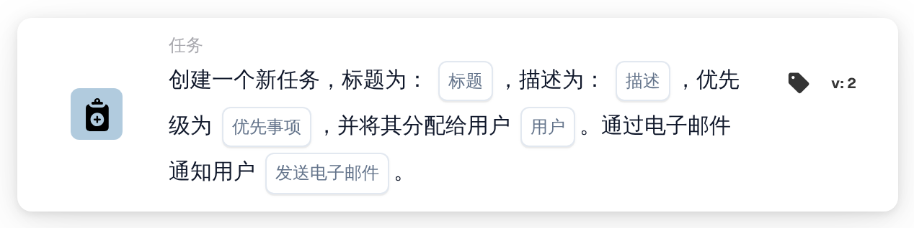
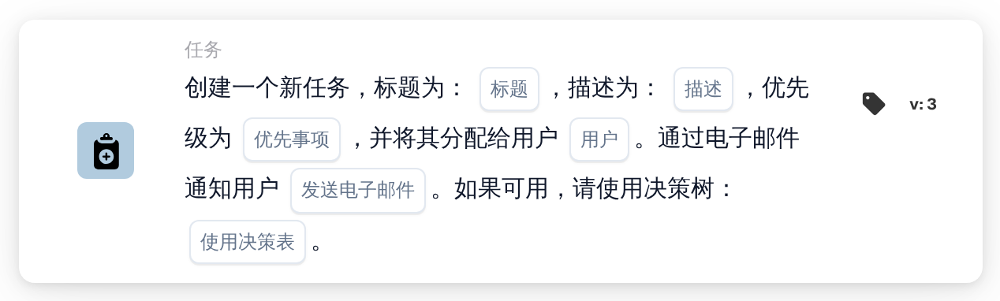
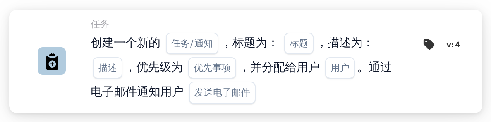

# 创建新任务并将其分配给用户

<figure><figcaption>
版本 1
</figcaption></figure>

<figure><figcaption>
版本 2
</figcaption></figure>

<figure><figcaption>
版本 3
</figcaption></figure>

<figure><figcaption>
版本 4
</figcaption></figure>

## **用途**

**“创建任务或通知”**工作流卡片可简化工作流中的任务管理和通知。根据版本不同，该卡片可以创建任务、发送通知，并利用决策树等附加功能进行动态处理。

## **卡片组件**

1. **标题**
   * **说明**：定义要创建的任务或通知的标题。
   * **详情**：标题为任务或通知提供清晰简洁的标识。
2. **描述**
   * **说明**：提供有关任务或通知的详细信息。
   * **详情**：帮助明确分配给用户的任务或通知的用途或背景。
3. **优先级**
   * **说明**：设置任务的紧急程度。
   * **选项**：
     * **高**：需要立即处理。
     * **中**：很重要，但不紧急。
     * **低**：可以稍后处理。
4. **分配用户**
   1. **说明**：指定任务的接收用户。
   2. **详情**：从可用人员的下拉列表中选择用户。
5. **电子邮件通知**
   * **说明**：确定是否向任务接收用户发送电子邮件通知。
   * **选项**：
     * **True**：向用户发送电子邮件通知。
     * **False**：不发送电子邮件通知。

## **版本 3 和版本 4 中的附加组件**

1. **决策树（仅限版本 3）**
   * **说明**：启用决策树，以动态创建任务。
   * **选项**：
     * **True**：启用决策树处理。
     * **False**：禁用决策树处理。
2. **任务或通知（仅限版本 4）**
   * **说明**：允许选择创建任务还是通知。
   * **选项**：
     * **任务**：创建任务。
     * **通知**：创建通知，而不是任务。

## **功能：**

* **条件评估**：\
  仅当满足 **“当”** 和 **“且”** 中的条件时，才会触发此卡片。
* **创建任务或通知**：
  * 版本 2 和 3：使用指定的标题、描述、优先级和接收用户创建任务。
  * 版本 4：允许创建任务或通知。
* **动态分配**：
  * 在版本 3 中，决策树根据工作流参数动态确定任务的接收用户。
* **电子邮件通知**：\
  如果启用了通知选项，则向任务接收用户发送电子邮件。

## **设置和配置：**

1. **选择版本**：根据所需功能选择卡片版本：
   * 版本 2：基本任务创建功能，支持手动分配用户和发送电子邮件通知。
   * 版本 3：包含决策树功能，可动态分配用户。
   * 版本 4：增加了创建通知而非任务的功能。
2. **输入任务详情**：指定任务或通知的标题、描述和优先级。
3. **分配用户**：
   * 对于版本 2 和 4，从下拉列表中手动选择用户。
   * 对于版本 3，启用决策树以动态确定任务接收用户。
4. **启用电子邮件通知**：指定是否向任务接收用户发送电子邮件通知。
5. （适用于版本 4）**选择任务或通知**：指定要创建任务还是通知。

## **结论：**

**“创建任务或通知”**工作流卡片是管理任务和通知的多功能工具。它支持通过决策树动态分配用户，并提供创建任务或通知的选项，从而增强工作流的适应性和协作效率。

<!-- workflow-card-practical-example-20261021 -->

## 实际例子

**何时使用：** 给一位审阅者一个明确的行动项目。

**配置：**选择`Demo Reviewer A`、标题`Review invoice`、描述和优先级。

**预期结果及反例：** 所选用户收到新任务。确认任务名称和分配对象；该任务仍有待审稿人完成。

这是说明性配置和预期结果。使用测试组织中配置的字段、用户和组；这并不是说这个例子已经被执行了。
