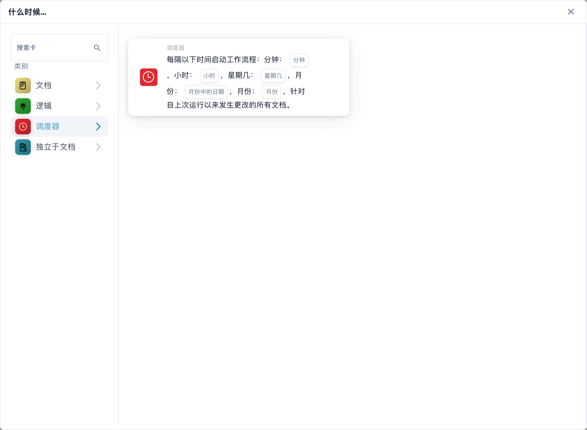
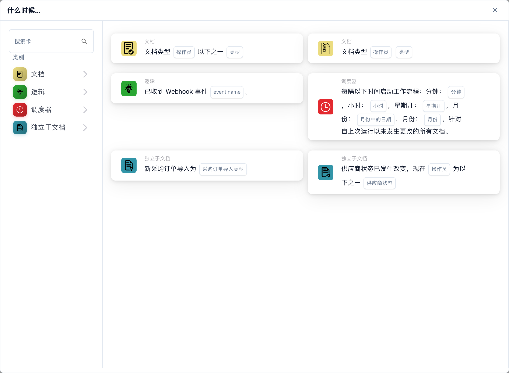

# 当

此类别中的卡片，显示在 Workflow Builder 的**添加卡** 库中：

<figure><figcaption>
所选类别中的可用卡片。使用前请填写所需字段。
</figcaption></figure>

<figure><figcaption>
所选类别中的可用卡片。使用前请填写所需字段。 此版本界面的部分标签尚未翻译或翻译不准确。本页说明使用正确术语；图片保留了实际界面。
</figcaption></figure>

#### 了解工作流配置中的“何时”

**“当”的目的**

* 工作流配置中的“何时”部分定义启动特定工作流操作的触发条件。这些条件基于与 ERP 系统内的文档属性或用户活动相关的指定标准。

**工作原理**

* 在您的界面中，“何时”似乎是用户可以选择不同触发卡的起点。每张卡指定执行后续操作（在“与”部分中定义）的条件。

**文档类型条件卡**

* 屏幕截图中显示的带有文档图标的卡片是“文档类型”条件的变体，用于根据正在处理的文档类型触发工作流程。以下是所显示的每种类型的条件卡的详细信息：
  * **文档类型（运算符）（类型）之一**：当文档类型与列表中指定类型之一匹配时，此卡将触发操作。运算符可能包括“是”或“不是”等选项，允许包含或排除条件。
  * **文档类型（运算符）（类型）**：这个更简单的变体基于单个文档类型条件触发。它通常会检查文档类型“是”还是“不是”特定类型，而没有从多种类型中进行选择的选项。
  *

**芹菜节拍**

* 屏幕截图中带有时钟图标的卡片是“Celery Beat”条件，用于根据日期和时间触发工作流程。

#### 设置“何时”触发卡

1. **选择条件类型**：用户首先选择与他们想要自动化的工作流程相关的条件类型。在这种情况下，文档类型是焦点。
2. **定义运算符**：用户必须决定逻辑运算符（例如“是”或“不是”），这为将实际文档类型与定义的条件进行比较奠定了基础。
3. **指定文档类型**：根据卡片的不同，用户可以选择一种或多种文档类型，在处理这些类型的文档时将触发工作流程。
4. **最终确定触发器**：条件一旦成立，就成为触发工作流程中定义的特定操作的基础。如果文档满足设定条件，将自动启动定义的操作。

#### 实际应用

在实践中，这些触发卡对于自动化流程（如批准、通知或任何依赖于所处理文档类型的程序）至关重要。例如，如果文档类型“是”“发票”，并且它与“时间”卡中设置的条件匹配，则工作流可能会自动路由该文档以进行付款处理。

这种设置确保工作流程不仅高效，而且可以根据组织的特定运营需求进行定制，减少人工监督并加快文档处理流程。

总之，工作流配置的“何时”部分是关于根据特定的预定义条件设置自动化操作的阶段。它是一个强大的工具，可确保您的 ERP 系统对业务需求做出动态反应，从而提高文档管理的生产力和准确性。

[Variable-change 和 webhook-event 触发参考](../logic-cards-guide.md)。

<!-- workflow-card-example-celery_beat-20261021 -->

### 预定处理

<figure><figcaption>
所示版本的卡片字段。占位字段尚未配置。
</figcaption></figure>

`CELERY_BEAT`·版本2

对自上次运行以来更改的文档使用计划触发器。对于每日演示时间表，选择分钟 `0`、小时 `9` 以及提供的每天/每月值。验证配置的调度程序时区和下一次计划运行。此触发器并不能证明未更改的文档已被重新处理。
